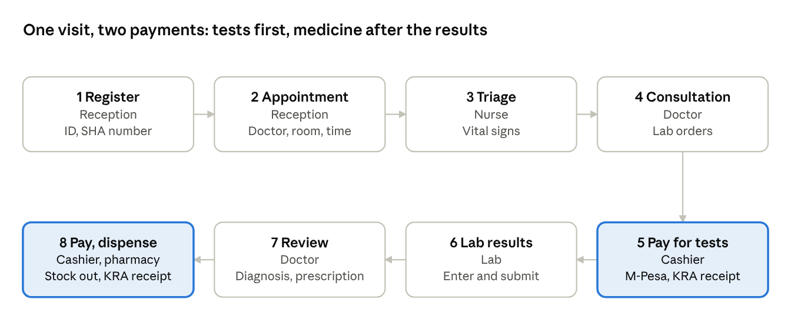
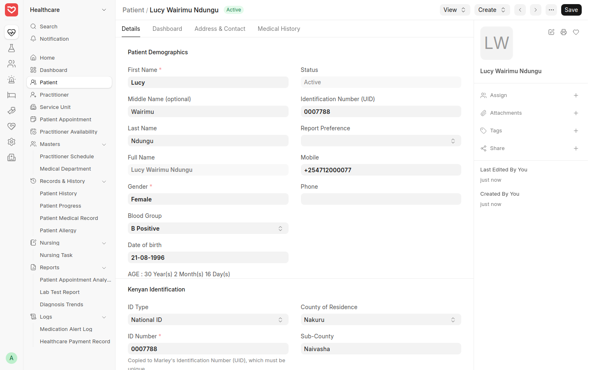
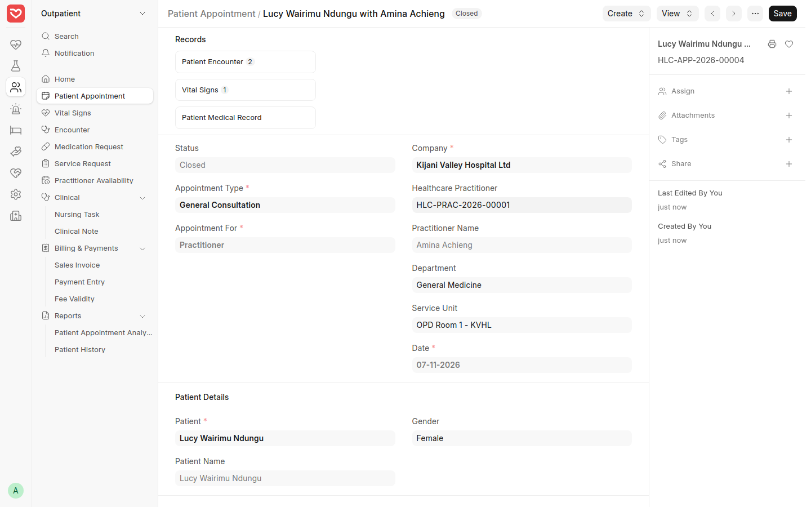
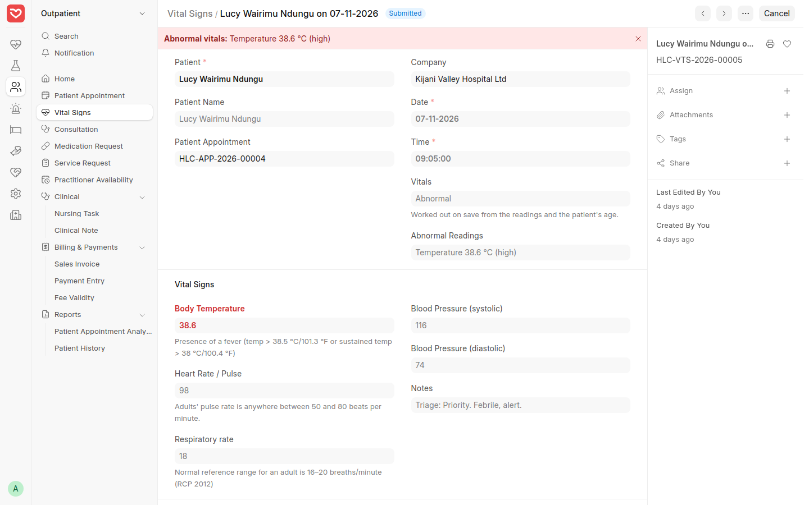
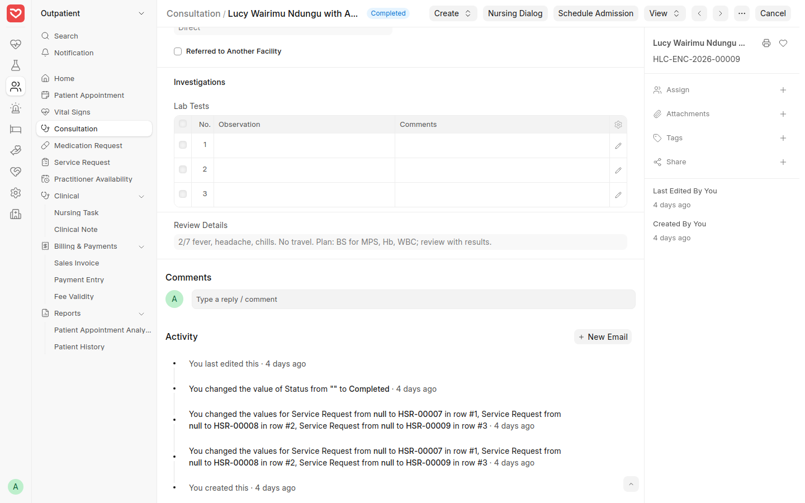
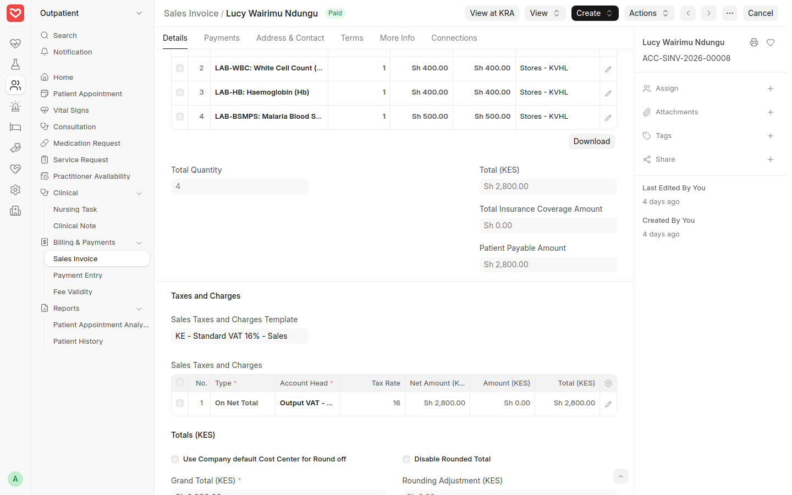
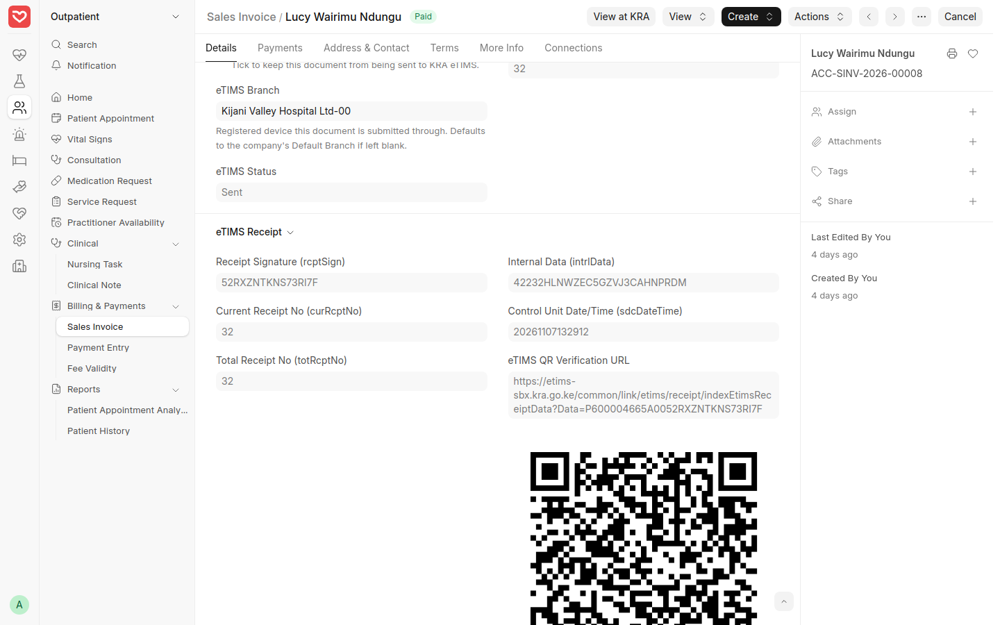
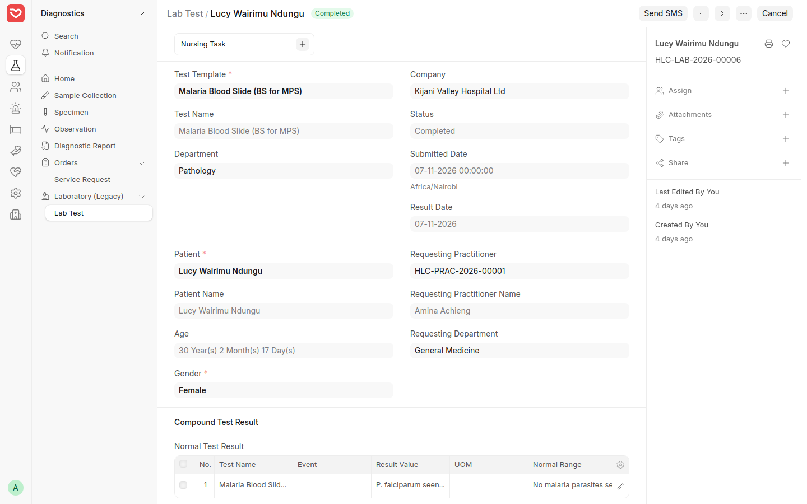
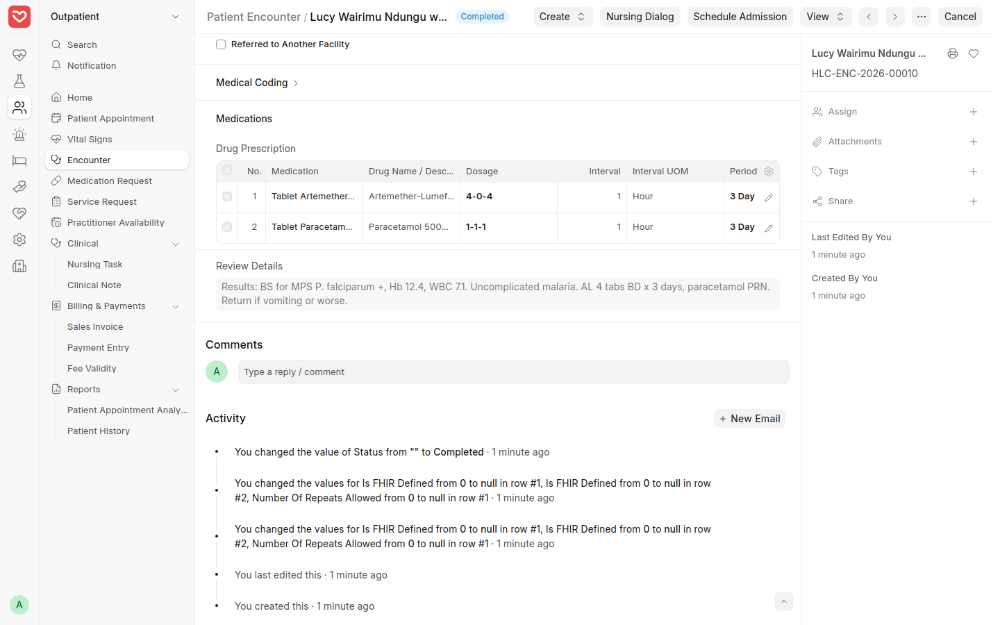
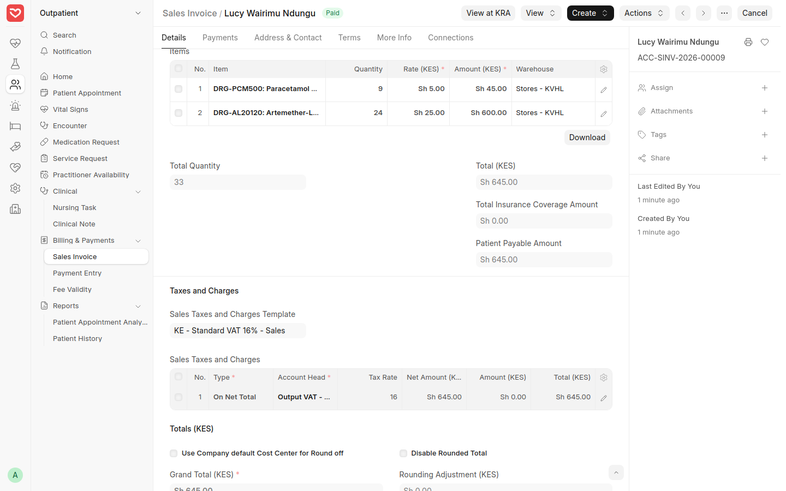

# Outpatient Workflow — Step-by-Step Guide

How a walk-in patient moves through RoyceERP Health from registration to consultation, lab, payment and medicine, shown on the demo hospital at hospital.royceltd.com.

Since v0.21 each arrival is also a **Patient Visit**: reception checks the patient in, stations pass them on through waiting lists, the visit shows its running bill, and cash patients pay before the lab, radiology and pharmacy serve them. That part is in the [Reception, queue and billing guide](12-reception-queue-billing.md); this guide covers the clinical records and invoices.

## At a glance

The highlighted steps are the two payments. Each step below says who does it, where to click, and the demo record to open.

## Step 1 — Register the patient

**Who:** reception. **Where:** Healthcare › Patient › *+ Add Patient*.

1. Enter first, middle and last name, sex, date of birth and mobile number (saved as +254).
2. Fill the Kenyan identifiers: ID type and number, SHA member number, county and sub-county.
3. Add next of kin, blood group and allergies (write *No known drug allergies* if none).
4. Save. A second patient with the same ID number is refused and the existing record is named, so returning patients are found rather than duplicated.

ID, mobile number (the next of kin's for a child), nationality, county and residence are required for a new patient. Nurses, doctors, lab and pharmacy staff see the phone and ID numbers masked.

Demo record: *Lucy Wairimu Ndung'u*, ID 0007788.

*The registered patient with Kenyan identifiers.*

## Step 2 — Book the appointment

**Who:** reception. **Where:** Outpatient › Patient Appointment › *+ Add*.

1. Choose the patient, appointment type (for example General Consultation) and the doctor.
2. Pick the department, consultation room, date and time, and add a short note on why the patient came.
3. Save. The appointment carries the consultation fee, and the doctor's encounter will link back to it.
4. When the patient arrives, press **Start Visit** to check them in: the appointment turns *Checked In* and the patient joins the triage waiting list.

The **Records** panel at the top of the appointment collects everything from the visit: encounters, vital signs and the medical record.

Demo record: HLC-APP-2026-00004, Dr Amina Achieng, OPD Room 1, 09:00.

*The appointment, with the visit's encounters and vital signs collected under Records.*

## Step 3 — Triage and vital signs

**Who:** triage nurse. **Where:** Outpatient › Vital Signs › *+ Add*, or **Create › Vital Signs** on the appointment.

1. Choose the patient and link the appointment.
2. Record temperature, pulse, respiratory rate, blood pressure, height and weight; BMI is worked out on the form.
3. Add a triage note (for example *Priority. Febrile, alert.*) and submit. Readings out of range for the patient's age are flagged **Abnormal** and shown in red.

The doctor sees these vitals when opening the consultation.

Demo record: HLC-VTS-2026-00005, temperature 38.6 °C, pulse 98.

*Triage vital signs linked to the appointment.*

## Step 4 — Consultation and lab orders

**Who:** doctor. **Where:** Outpatient › Consultation › *+ Add*, or **Create › Consultation** on the appointment. (The system calls it *Consultation*; Marley's documentation says *Patient Encounter*, the same record.)

1. Link the appointment; patient, doctor and department fill in from it.
2. Under **Presenting Complaint**, write the **Chief Complaint** (in the patient's words, with how long), the **History of Presenting Illness**, **Review of Systems** and **Physical Examination**. Pick coded **Symptoms** as well if you use them for reports.
3. **Medical History** shows the patient's allergies, current medication, past medical and surgical history, family and social history from the patient's record. Correct or add to them here: when you save, the patient's record is updated, and the patient shows a note naming this consultation. The next clinician starts from the updated history. To clear a line, write *None* rather than leaving it blank (a blank field is refilled from the record).
4. In **Lab Prescription**, add the tests (for example malaria slide, Hb, WBC).
5. Submit. Each test becomes an order that the cashier can bill and the lab can work on.

If the diagnosis is already clear, add it and the drug prescription now and skip to Step 8.

Demo record: consultation HLC-ENC-2026-00009 orders BS for MPS, Hb and WBC.

*The consultation's Lab Prescription: three tests ordered.*

## Step 5 — Pay for consultation and tests

**Who:** cashier. **Where:** Outpatient › Sales Invoice › *+ Add*.

1. On the patient's visit, **Bill › Create Bill**: the consultation and the ordered tests come in, linked to the visit. (Or, on a new invoice, choose the patient, then **Get Items From › Healthcare Services**.)
2. Check the lines and submit.
3. **Create › Payment**: M-Pesa with its transaction code, or cash.
4. The invoice is sent to KRA eTIMS and comes back *Sent*, with a KRA receipt number and QR code on the receipt.

| Bill ACC-SINV-2026-00008 | KES |
| --- | --- |
| General consultation | 1,500 |
| Malaria blood slide | 500 |
| Haemoglobin | 400 |
| White cell count | 400 |
| **Total, paid by M-Pesa** | **2,800** |

KRA receipt 32. Medical services are VAT exempt, so no VAT is added.

*Lines brought in by Get Items From › Healthcare Services.*

*The eTIMS section after submit: status Sent, KRA receipt number and QR code.*

## Step 6 — Laboratory results

**Who:** lab technologist. **Where:** Diagnostics › Lab Test, or the open **Service Request** for the test.

1. Open the lab test created from the doctor's order; the template brings in the result lines and normal ranges. For a cash patient, the test starts only once the bill is paid (the visit's **Bill** reads *Paid*).
2. Enter each result value (for example *P. falciparum seen (+)*, Hb 12.4).
3. Submit. The status becomes *Completed* and the result appears in the patient's history for the doctor.

**Send SMS** on the lab test can notify the patient that results are ready.

**Turnaround time.** Kenya Health › Reports › **Turnaround Time** shows how long tests take from the doctor's order to the result: per test type the number done, the median and average minutes, the time 90% are done within, and the share within target. Tick **Each Request** to see every test with its steps: ordered, sample collected, received in the lab, result. Set a target per test in its Lab Test Template (*Target Turnaround (minutes)*); imaging exams have the same field on their Observation Template, and the report covers radiology too (order, performed, reported). The exact result time is recorded from v0.22; older tests are marked approximate.

Demo records: HLC-LAB-2026-00006 (malaria slide, positive), HLC-LAB-2026-00005 (Hb 12.4), HLC-LAB-2026-00004 (WBC 7.1).

*The malaria slide result, completed, with the normal range beside it.*

## Step 7 — Review results and prescribe

**Who:** doctor. **Where:** a new encounter on the same appointment (Outpatient › Consultation).

1. Link the same appointment, so the review is not charged as a second consultation.
2. Read the results (Patient History, or the lab tests linked to the patient) and record the diagnosis.
3. In **Drug Prescription**, add each drug with dosage, period and interval. The quantity to dispense is worked out from them: *4-0-4* for 3 days is 24 tablets, *1-1-1* for 3 days is 9.
4. Submit. Each drug becomes a medication request for the cashier and pharmacy.

Demo record: review HLC-ENC-2026-00010: uncomplicated malaria; artemether-lumefantrine 4 tablets twice daily for 3 days, paracetamol 500 mg three times daily for 3 days.

A dosage's quantity comes from the tablets per dose set in Setup › Prescription Dosage. Add dosages such as *4-0-4* for medicines taken several tablets at a time.

*The review's Drug Prescription with dosage, period and instructions.*

## Step 8 — Pay for and dispense medicine

**Who:** cashier, then pharmacy. **Where:** Outpatient › Sales Invoice › *+ Add*.

1. Choose the patient. Use **Get Items From › Prescriptions** (the review encounter) to bring in the drugs with their quantities.
2. Tick **Update Stock** and set the pharmacy store as the warehouse, so the drugs leave stock when the bill is submitted.
3. Tick **Include Payment** and enter the M-Pesa or cash payment, then submit; the invoice is signed by KRA eTIMS. An unpaid bill that issues stock is refused for a cash patient. Alternatively bill without Update Stock and let the pharmacy issue the drugs with a **Delivery Note** once the bill is paid.
4. The pharmacist hands over the medicines against the paid bill, with the dosing instructions from the prescription.

| Pharmacy bill ACC-SINV-2026-00009 | Qty | KES |
| --- | --- | --- |
| Artemether-lumefantrine 20/120 | 24 | 600 |
| Paracetamol 500 mg | 9 | 45 |
| **Total, paid by M-Pesa** | | **645** |

KRA receipt 33. Stock in the pharmacy store went down by 24 and 9 tablets. (This demo bill was made before payment-first dispensing and paid just after submitting; today it would need Include Payment.)

Today the paid bill is the dispensing record. A pharmacy queue with a separate dispense step, partial dispensing and labels is on the roadmap.

*The pharmacy bill: drugs issued from Stores, 24 and 9 tablets, paid.*
