# Outpatient Workflow — Step-by-Step Guide

How a walk-in patient moves through RoyceERP Health from registration to consultation, lab, payment and medicine, shown on the demo hospital at hospital.royceltd.com.

Since v0.21 each arrival is also a **Patient Visit**: reception checks the patient in, stations pass them on through waiting lists, the visit shows its running bill, and cash patients pay before the lab, radiology and pharmacy serve them. Since v0.35 a cash outpatient also pays the consultation fee at the Cashier before triage, and since v0.36 the consultation is one record in tabs that stays open while the tests are done. That part is in the [Reception, queue and billing guide](12-reception-queue-billing.md); this guide covers the clinical records and invoices.

## At a glance

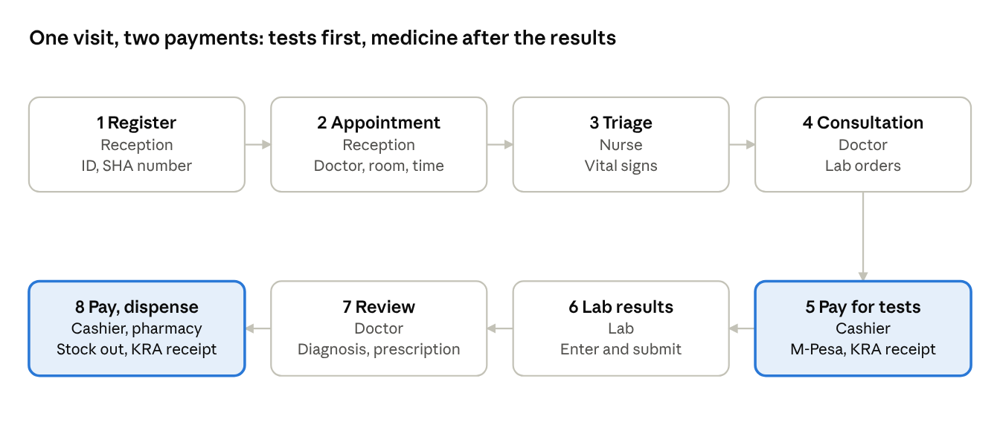

The highlighted steps are the two payments. Each step below says who does it, where to click, and the demo record to open.

## Step 1 — Register the patient

**Who:** reception. **Where:** Healthcare › Patient › *+ Add Patient*.

1. Enter first, middle and last name, sex, date of birth and **Mobile** number (saved as +254). The form has one contact number.
2. Fill the Kenyan identifiers: ID type and number, SHA member number, county, then the sub-county (start typing and pick from the county's list).
3. Add next of kin, blood group and allergies (write *No known drug allergies* if none).
4. Save. A second patient with the same ID number is refused and the existing record is named, so returning patients are found rather than duplicated.

ID, mobile number (the next of kin's for a child), nationality, county and residence are required for a new patient. Nurses, doctors, lab and pharmacy staff see the phone and ID numbers masked.

Demo record: *Lucy Wairimu Ndung'u*, ID 0007788.

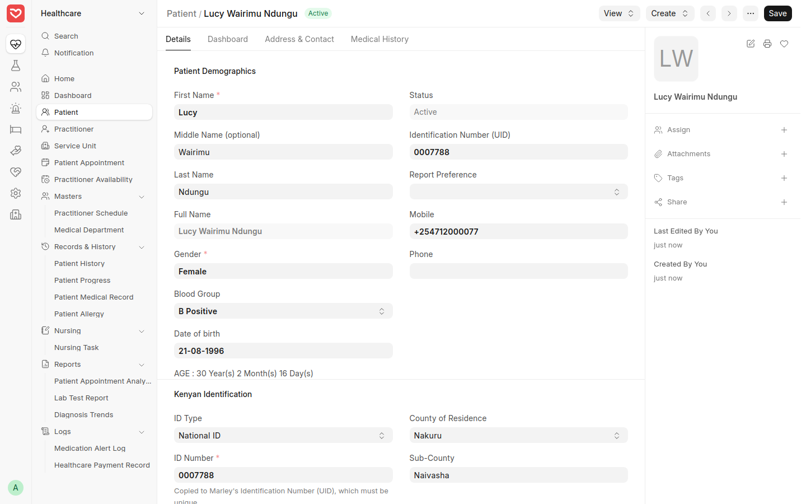

*The registered patient with Kenyan identifiers.*

## Step 2 — Book the appointment

**Who:** reception. **Where:** Outpatient › Patient Appointment › *+ Add*.

1. Choose the patient, appointment type (for example General Consultation) and the doctor.
2. Pick the department, consultation room, date and time, and add a short note on why the patient came.
3. Save. The appointment carries the consultation fee, and the doctor's encounter will link back to it.
4. When the patient arrives, press **Start Visit** to check them in: the appointment turns *Checked In* and the patient joins the triage waiting list.

The **Records** panel at the top of the appointment collects everything from the visit: encounters, vital signs and the medical record.

Demo record: HLC-APP-2026-00004, Dr Amina Achieng, OPD Room 1, 09:00.

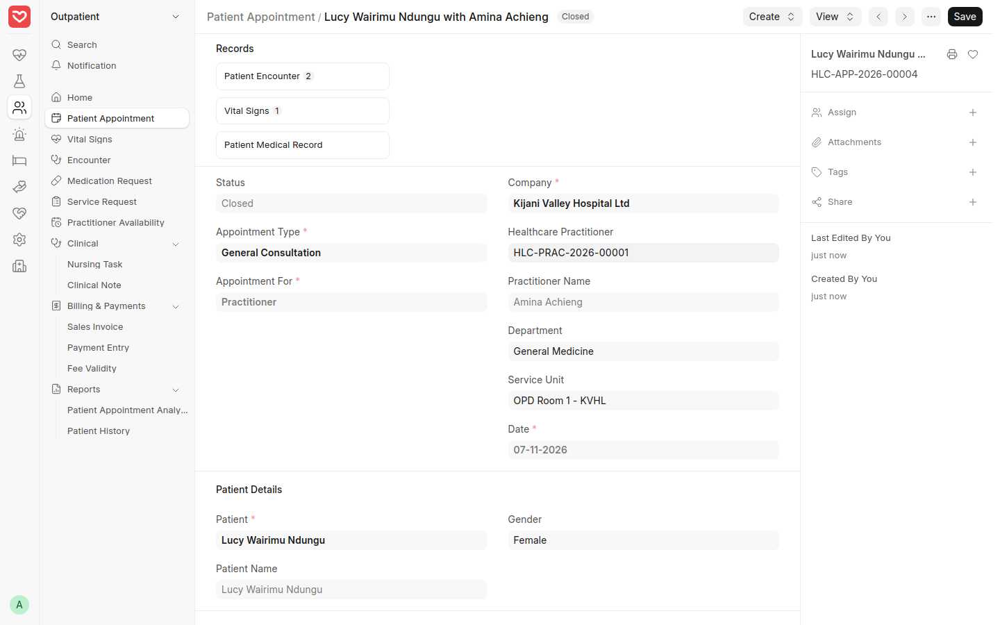

*The appointment, with the visit's encounters and vital signs collected under Records.*

## Step 3 — Triage and vital signs

**Who:** triage nurse. **Where:** Outpatient › Vital Signs › *+ Add*, or **Create › Vital Signs** on the appointment.

1. Choose the patient and link the appointment.
2. Record temperature, pulse, respiratory rate, blood pressure, height **in centimetres** and weight; BMI is worked out on the form.
3. Add a triage note (for example *Priority. Febrile, alert.*) and submit. Readings out of range for the patient's age are flagged **Abnormal** and shown in red.

The doctor sees these vitals when opening the consultation.

Demo record: HLC-VTS-2026-00005, temperature 38.6 °C, pulse 98.

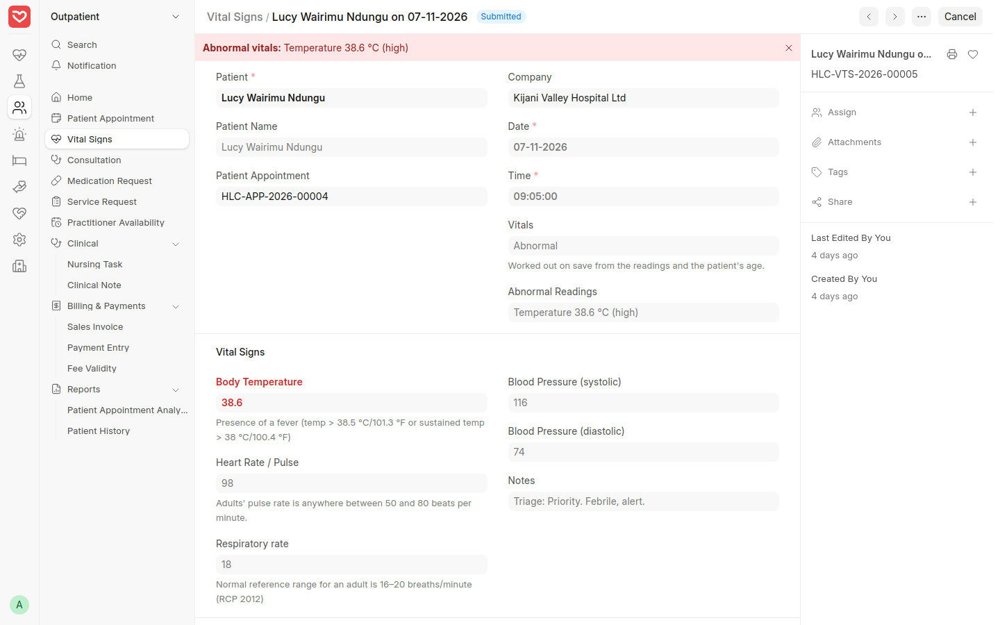

*Triage vital signs linked to the appointment.*

## Step 4 — Consultation and lab orders

**Who:** doctor. **Where:** on the visit, **Record › Consultation**; or Outpatient › Consultation › *+ Add*, or **Create › Consultation** on the appointment. (The system calls it *Consultation*; Marley's documentation says *Patient Encounter*, the same record.)

The consultation has tabs in the order the doctor works: **Patient → Observation → Requests → Results → Diagnosis → Prescription → Complete**, then Marley's *Consultation Details* and *Notes*.

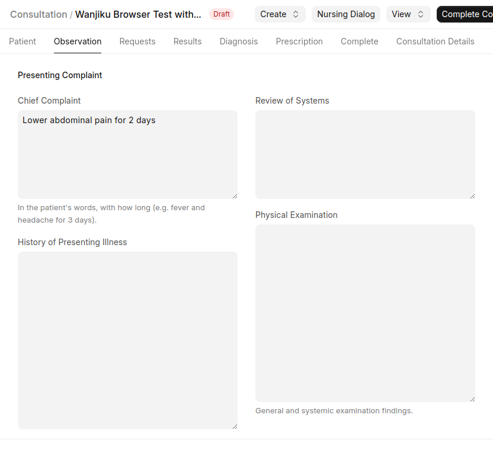

*The Observation tab: presenting complaint and examination, then the medical history.*

1. **Patient:** the patient, doctor, department and insurance fill in from the visit or the appointment. Symptoms, appointment type and source are taken at reception and are not on the consultation.
2. **Observation:** under **Presenting Complaint**, write the **Chief Complaint** (in the patient's words, with how long), the **History of Presenting Illness**, **Review of Systems** and **Physical Examination**.
3. **Medical History** (same tab) shows the patient's allergies, current medication, past medical and surgical history, family and social history from the patient's record. Correct or add to them here: when you save, the patient's record is updated, and the patient shows a note naming this consultation. The next clinician starts from the updated history. To clear a line, write *None* rather than leaving it blank (a blank field is refilled from the record).
4. For a woman, **Obstetric and Gynaecological History** has an **OBS/Gynae** box: LMP, gravida/para, contraception, menstrual and gynaecological history. It is not shown for male patients.
5. **Requests:** add the lab tests (for example malaria slide, Hb, WBC), imaging exams and procedures, then press **Send Requests**. Each request goes on the visit's bill and to its service point, and **the consultation stays open** for the results.
6. A box asks **Where does the patient go next?** For a cash patient whose requests aren't paid, the **Cashier** is suggested first (the requests reach the lab only once paid); otherwise the Laboratory or Radiology. Add a note if useful and **Send**, or choose *Stay with me* to keep the patient.

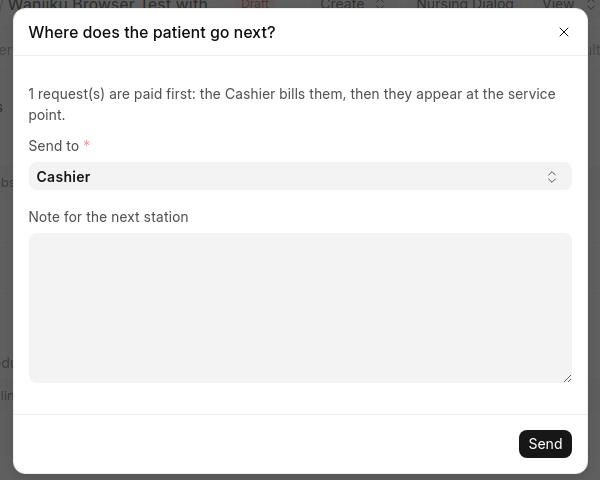

*After Send Requests: the test is paid first, so the Cashier is suggested.*

If the diagnosis is already clear, go straight to **Diagnosis** and **Prescription**, then **Complete Consultation** (Step 7).

Demo record: consultation HLC-ENC-2026-00009 orders BS for MPS, Hb and WBC.

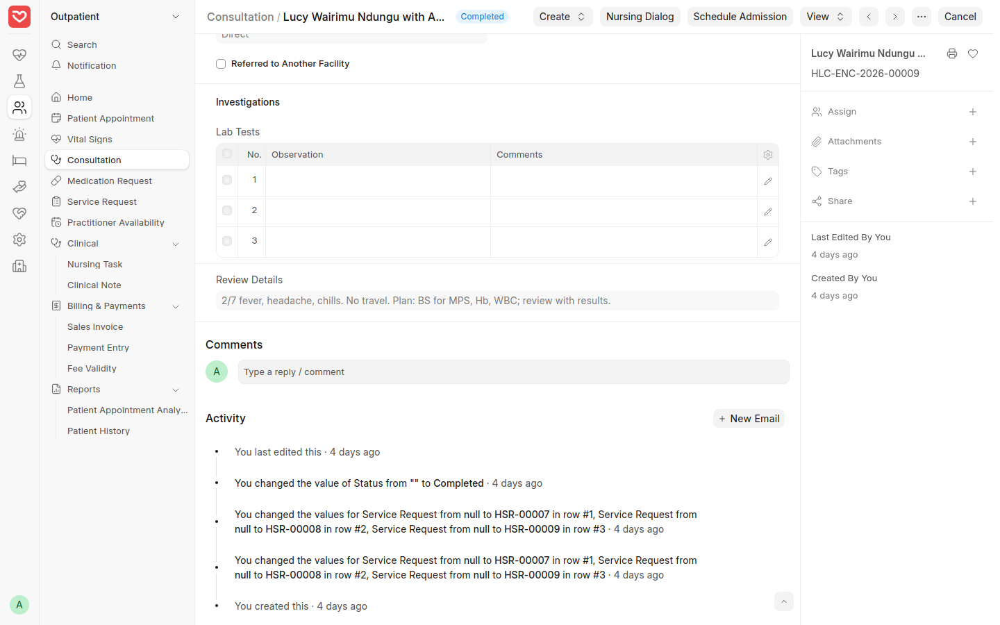

*The consultation's Lab Prescription: three tests ordered.*

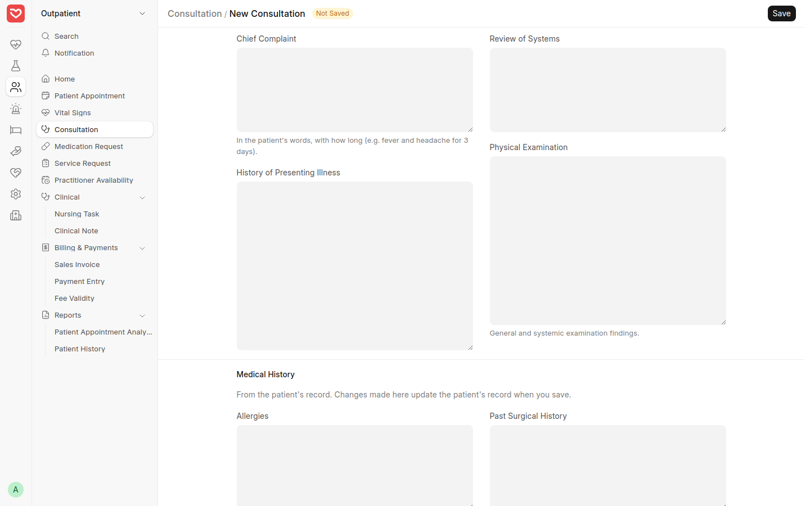

*A new consultation: Presenting Complaint, then the patient's Medical History, which is saved back to the patient.*

## Step 5 — Pay for consultation and tests

**Who:** cashier. **Where:** the patient's visit, **Bill** (Kenya Health › Patient Visit, Station = Cashier). Everything for billing is under **Kenya Health › Billing**: Patient Bills, Sales Invoice, Payment Entry, Cashier Shift and Bill Approval Request. Taking money needs the **Cashier** role and, if the hospital requires it, an open Cashier Shift.

A cash outpatient pays twice at the Cashier: the **consultation fee before triage** (on check-in, the patient waits at the Cashier first), then the **requests** after the doctor sends them. Insured patients don't stop at the Cashier. See the [Reception, queue and billing guide](12-reception-queue-billing.md), Steps 2 and 6.

A cash patient with lab tests, imaging or medicines not paid goes to the Cashier first, whichever station the doctor sends them to: the visit shows **After Paying, Goes To** (for example *Laboratory*). As soon as the payment is taken, the patient joins that service point's list by themselves.

1. On the patient's visit, **Bill › Create Bill**: the charges not billed yet are listed and ticked (the fee, or the tests the doctor requested). Untick anything the patient is not paying for now; it stays on the visit. **Create Invoice** opens the invoice with the ticked lines, linked to the visit. (Or, on a new invoice, choose the patient, then **Get Items From › Healthcare Services**.)
2. Save the invoice and press **Take Payment** (on the invoice, or on the visit under **Bill**). Choose how the patient pays and type the **Amount Received**: for cash, the **change to give** shows at once; less than the total is a part payment, and the rest stays owed. For M-Pesa, card or bank, type the transaction code: a non-cash payment without it is refused, and it can't be more than the bill (change is given only in cash). Take Payment submits the invoice and records the payment. (Paying on the invoice with **Include Payment**, or **Create › Payment**, still works.)
3. The invoice is sent to KRA eTIMS and comes back *Sent*, with a KRA receipt number and QR code.
4. Press **Patient Receipt** on the paid invoice and print it on the 80 mm receipt printer.

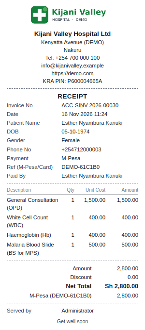

*The Patient Receipt for the receipt printer: patient details, the invoice, the M-Pesa code, items and totals.*

| Bill ACC-SINV-2026-00008 | KES |
| --- | --- |
| General consultation | 1,500 |
| Malaria blood slide | 500 |
| Haemoglobin | 400 |
| White cell count | 400 |
| **Total, paid by M-Pesa** | **2,800** |

KRA receipt 32. Medical services are VAT exempt, so no VAT is added.

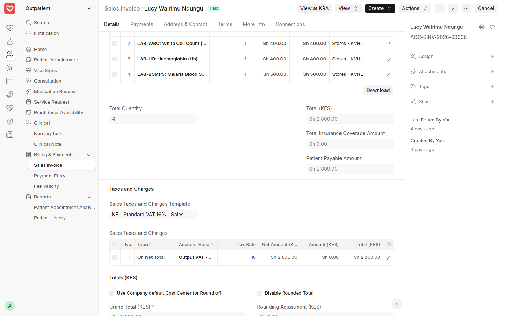

*Lines brought in by Get Items From › Healthcare Services.*

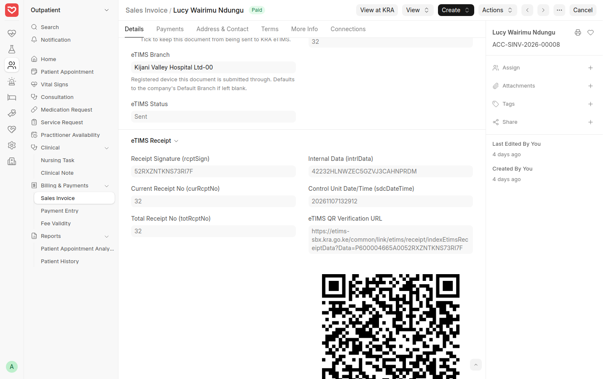

*The eTIMS section after submit: status Sent, KRA receipt number and QR code.*

## Step 6 — Laboratory results

**Who:** lab technologist. **Where:** Kenya Health › Laboratory › **Lab Worklist**.

The worklist shows one row per patient order, not one per test: the visit, the patient, who requested, how long ago, the tests (counted, and named), urgency, cash or insurance, and how far the tests have got. The tabs follow the lab's day:

| Tab | Shows orders with tests that are… |
| --- | --- |
| Requests | requested by the doctor, sample not yet taken |
| Results Entry | sample taken, no results yet |
| Validate Results | results typed in, not yet validated |
| Completed | validated and released to the doctor |
| Lab Register | every order in the dates chosen |

The list refreshes every minute. Change the dates at the top to look further back (the last seven days by default).

1. On **Requests**, click the patient's row. The order opens with each test, its urgency and its payment: *Paid*, *Insured*, *Inpatient*, *Credit approved* or *Not paid*.
2. Take the samples, tick those tests and press **Collect Samples**. A cash patient's unpaid tests can't be ticked: send the patient to the Cashier first (or a manager approves credit on the visit). The time and your name are recorded as the sample collection.
3. On **Results Entry**, open the order and press **Enter Results**. All its tests come up on one screen, each with its normal range. A number outside the range is flagged **H** or **L** as you type. Tests with antibiotic sensitivity or organisms have an *Open full form* link instead.
4. **Save** keeps the results as a draft (the order moves to *Validate Results*). **Save and Validate** releases them: the results can't be changed afterwards, the doctor sees them in their Results Inbox, and the printed Laboratory Report shows who validated and when.

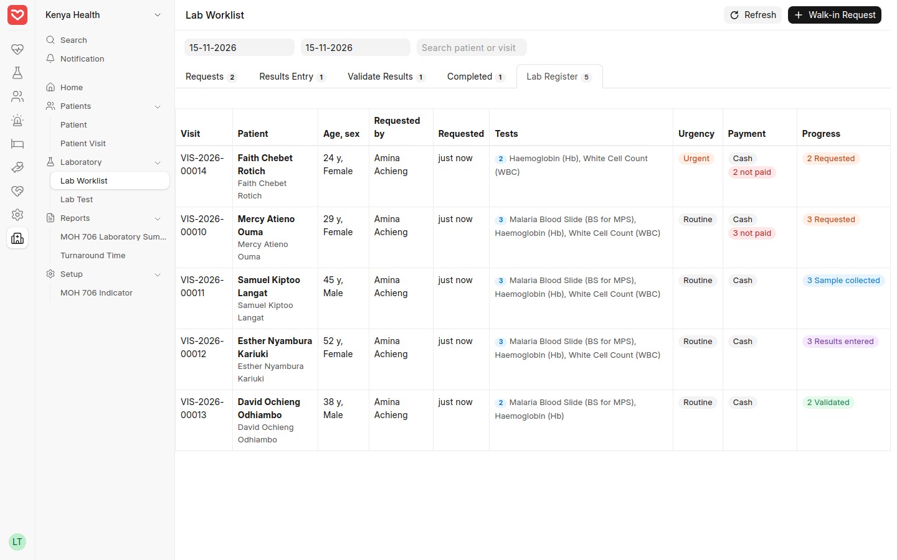

*The Lab Worklist for today: one row per order, from Faith's urgent walk-in request to David's validated results.*

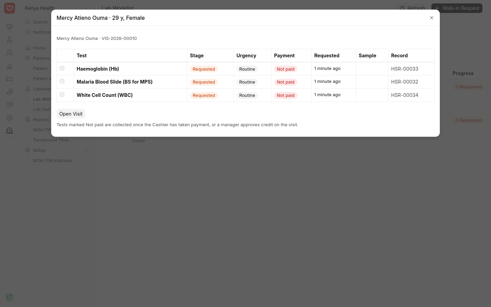

*Mercy's order: her three tests aren't paid yet, so they can't be ticked until the Cashier takes the payment.*

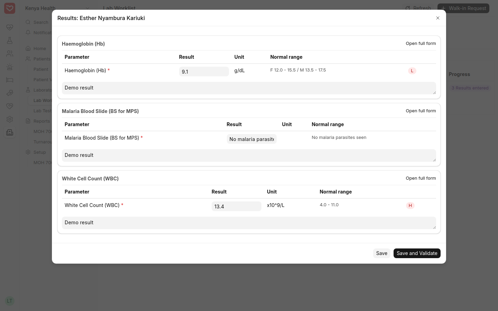

*Esther's three results on one screen: Hb 9.1 flagged L, white cells 13.4 flagged H.*

By default the person who entered the results validates them. To require a second person, an administrator ticks *A second person validates results* in Kenya Health Settings › Laboratory.

**Walk-in patients** (sent by an outside doctor, or asking for a test themselves): press **Walk-in Request**, choose the patient (reception registers new patients), the tests, and who referred them. The tests are requested on the patient's visit today, or on a new *Lab only* visit. A cash patient then pays at the Cashier (the visit's **Create Bill** picks the tests up) before you collect. If you leave *Requesting doctor* blank, the requests carry the default doctor set in Kenya Health Settings › Laboratory.

**Send SMS** on the lab test can notify the patient that results are ready.

**Turnaround time.** Kenya Health › Reports › **Turnaround Time** shows how long tests take from the doctor's order to the result: per test type the number done, the median and average minutes, the time 90% are done within, and the share within target. Tick **Each Request** to see every test with its steps: ordered, sample collected, received in the lab, result. Set a target per test in its Lab Test Template (*Target Turnaround (minutes)*); imaging exams have the same field on their Observation Template, and the report covers radiology too (order, performed, reported). The exact result time is recorded from v0.22; older tests are marked approximate.

Demo records: HLC-LAB-2026-00006 (malaria slide, positive), HLC-LAB-2026-00005 (Hb 12.4), HLC-LAB-2026-00004 (WBC 7.1).

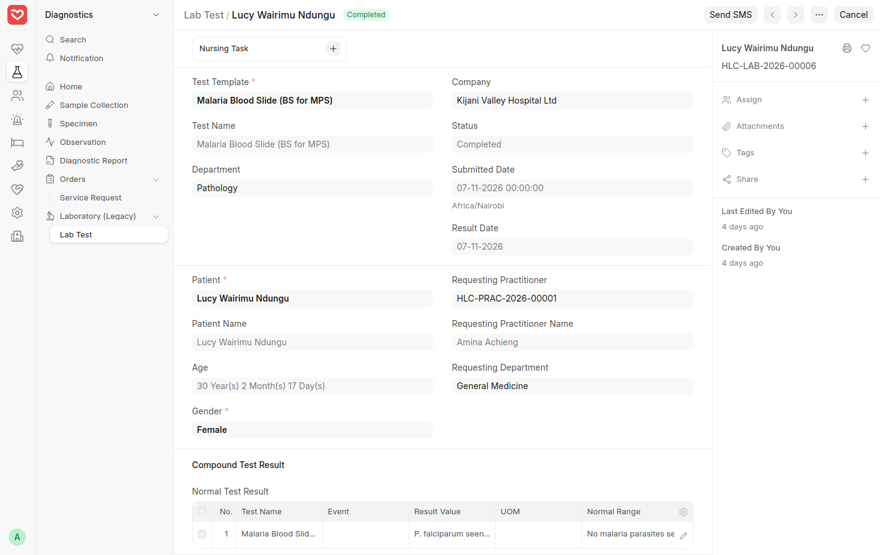

*The malaria slide result, completed, with the normal range beside it.*

## Step 7 — Review results and prescribe

**Who:** doctor. **Where:** the same consultation, still open from Step 4 (from your waiting list or **My Patients**).

1. Open the **Results** tab. Each request shows where it has got to: *Awaiting payment at the Cashier*, *Waiting at the lab*, *Sample collected*, *Results entered, awaiting validation*, then **Validated** with each result, its unit and normal range; abnormal results are in red. Imaging shows its findings and impression once reported. **Mark Seen** records that you have read it (it also leaves your Results Inbox).

   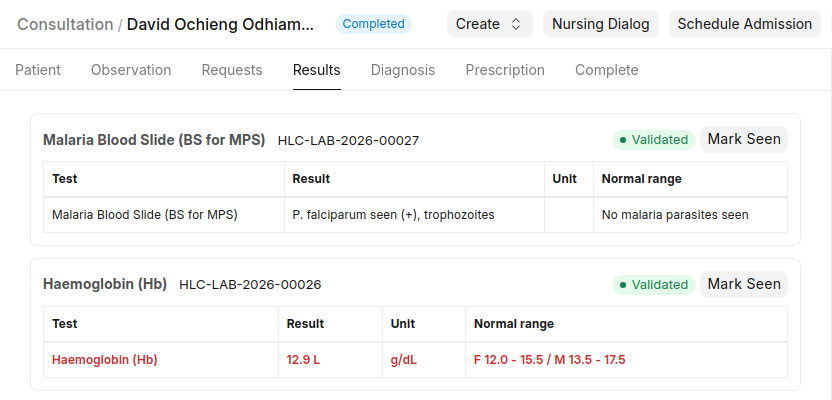

   *The Results tab: the white cell count is still awaiting payment at the Cashier.*
2. You can also read results in Kenya Health › Laboratory › **Results Inbox**: your patients' validated lab tests and reported imaging exams, newest first, marked *New* until you open them, with *Abnormal* on lab results outside their normal range. Untick *Unread only* to see the ones you have read; clear the *Consultant* box to see every consultant's. (The inbox opens on your own results when your login is set as the **User** on your Healthcare Practitioner record.) Then record the diagnosis.

   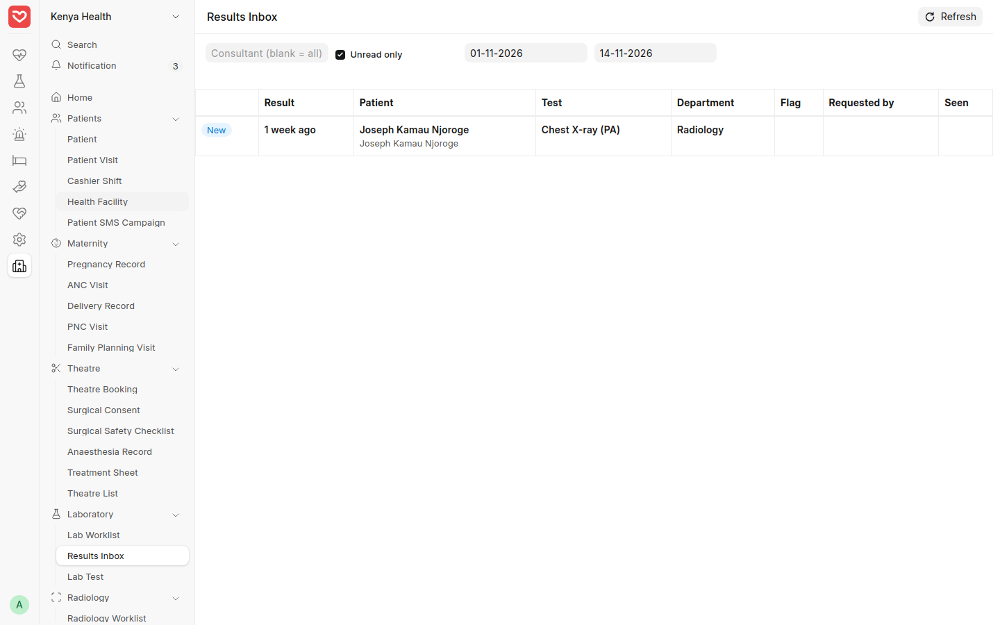

   *Dr Amina's Results Inbox: David's new results, his Hb marked Abnormal.*
3. **Diagnosis** tab: record the diagnosis.
4. **Prescription** tab: in **Drug Prescription**, add each drug with dosage, period and interval. The quantity to dispense is worked out from them: *4-0-4* for 3 days is 24 tablets, *1-1-1* for 3 days is 9. If the pharmacy sent a drug back, an orange note at the top of the consultation and a box on this tab show the drug and the pharmacist's note.
5. **Complete** tab: review notes and, if needed, **Referral** (*Referred to Another Facility* and where). Press **Complete Consultation** (on the tab, or the button at the top) and confirm. The consultation is submitted: each drug becomes a medication request for the pharmacy, and any request not sent yet is placed. The **Where does the patient go next?** box suggests **Pharmacy** when drugs are prescribed, or *Finish visit (patient goes home)*.

(Without **Send Requests** the older way still works: submit the first consultation with the tests, and record the review in a new consultation linked to the same appointment, so it is not charged twice.)

Demo record: review HLC-ENC-2026-00010: uncomplicated malaria; artemether-lumefantrine 4 tablets twice daily for 3 days, paracetamol 500 mg three times daily for 3 days.

A dosage's quantity comes from the tablets per dose set in Setup › Prescription Dosage. Add dosages such as *4-0-4* for medicines taken several tablets at a time.

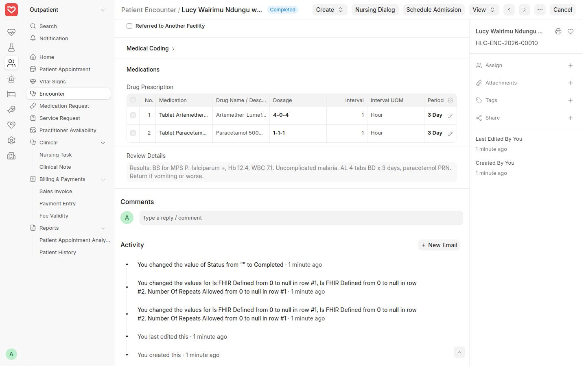

*The review's Drug Prescription with dosage, period and instructions.*

## Step 8 — Pay for and dispense medicine

**Who:** pharmacy, cashier, pharmacy. **Where:** Kenya Health › Pharmacy › **Pharmacy Worklist**, then the Cashier.

1. The patient's prescription is on the Pharmacy Worklist (*Waiting*). Open it: each drug shows the doctor's instructions and the stock in the pharmacy store.
2. **Bill Drugs** puts the drugs on the patient's bill. The patient pays at the Cashier (the visit's bill, M-Pesa or cash); the bill is signed by KRA eTIMS.
3. Back at the pharmacy the drugs now show *Paid*. Tick them and press **Dispense**: the drugs leave the store and the medicine labels print.

If a drug is out of stock, dispense what there is (the rest waits), let the patient **Buy Outside**, or **Send Back to Doctor** for a substitute. The pharmacist can't swap the medicine: a bill or dispensing record with a different drug from the one prescribed is refused, for everyone. Details: [Pharmacy and stock](06-pharmacy-and-stock.md), Step 4.

The cashier can still bill the drugs with **Update Stock** ticked and take the payment on the spot (the older way); the worklist then shows them as dispensed.

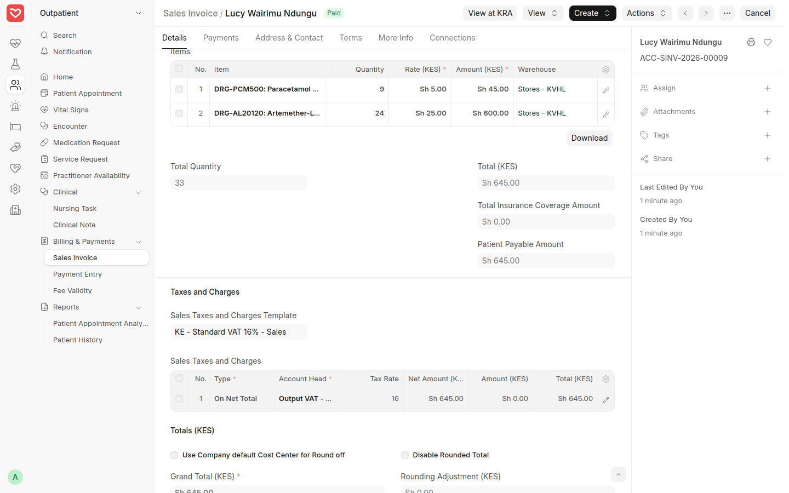

*The pharmacy bill: drugs issued from Stores, 24 and 9 tablets, paid.*
