# Inpatient Workflow — Step-by-Step Guide

How a patient moves through RoyceERP Health from registration to admission, medication and the final bill, shown on the demo hospital at hospital.royceltd.com.

## At a glance

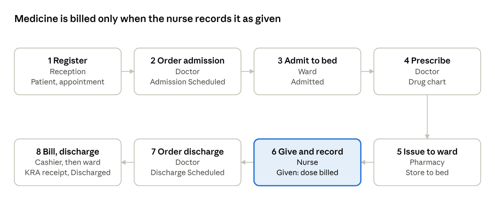

Each step below says who does it, where to click, and the demo record to open. The status under each box is what the Inpatient Record shows at that point.

**One-time setup** (Healthcare Settings): tick *Manage Inpatient Medication Stock* and *Auto Schedule Medication Doses*, and give each bed a store (Healthcare Service Unit › Warehouse). The demo hospital is set up this way.

## Step 1 — Register the patient

**Who:** reception. **Where:** Healthcare › Patient › *+ Add Patient*.

1. Enter first, middle and last name, sex, date of birth and mobile number (saved as +254).
2. Fill the Kenyan identifiers: ID type and number, SHA member number, county and sub-county.
3. Add next of kin, blood group and allergies (write *No known drug allergies* if none).
4. Save. A second patient with the same ID number is refused and the existing record is named.

Then book a **Patient Appointment** with the doctor (Outpatient › Patient Appointment) and record **Vital Signs** at triage.

Demo record: *Mary Atieno Odhiambo*, ID 0004521, with an appointment for Dr Amina Achieng at 07:30.

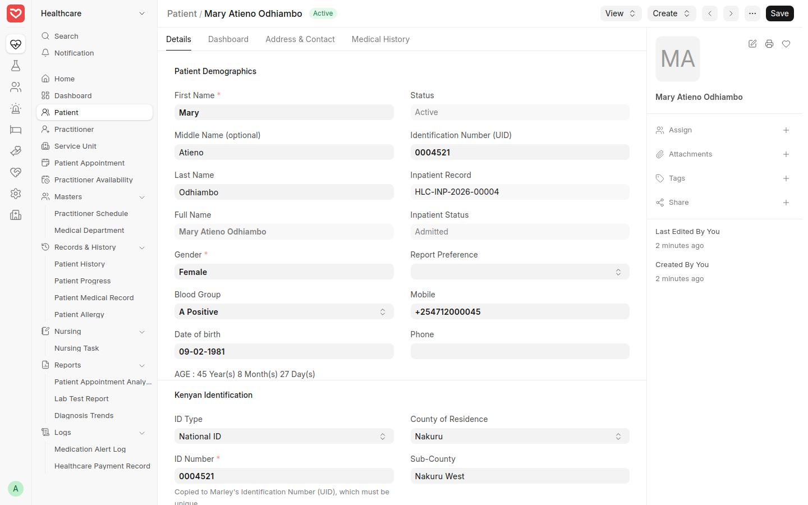

*The registered patient with Kenyan identifiers.*

## Step 2 — Consultation and admission order

**Who:** doctor. **Where:** Outpatient › Encounter, opened from the appointment.

1. Record symptoms, examination notes and the diagnosis.
2. Submit the encounter.
3. Click **Schedule Admission**. Choose the ward type (for example General Ward Bed), the doctor who will look after the patient, expected length of stay and admission instructions.

This creates an **Inpatient Record** with status *Admission Scheduled*, which the ward sees in its list.

Demo record: encounter HLC-ENC-2026-00007 by Dr Amina Achieng; admission ordered to General Ward under Dr Brian Kiprotich.

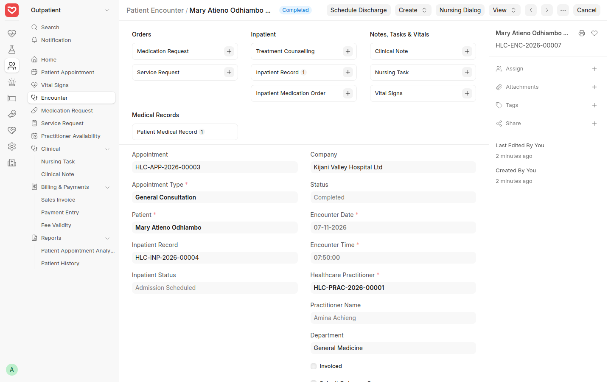

*The consultation after Schedule Admission: Inpatient Record linked, status Admission Scheduled.*

## Step 3 — Admit to a ward and bed

**Who:** ward nurse or admissions. **Where:** Inpatient › Inpatient Record, filter *Admission Scheduled*.

1. Open the patient's Inpatient Record.
2. Click **Admit**, pick a vacant bed (for example GW Bed 03) and the check-in time.
3. The status changes to *Admitted*, the bed shows *Occupied*, and bed charges start counting per night.

From here the record's top bar holds everything the ward needs: **Nursing Dialog**, **Schedule Discharge**, **Transfer** to another bed, and **Create** for orders.

Demo record: HLC-INP-2026-00004, admitted to GW Bed 03 at 08:00.

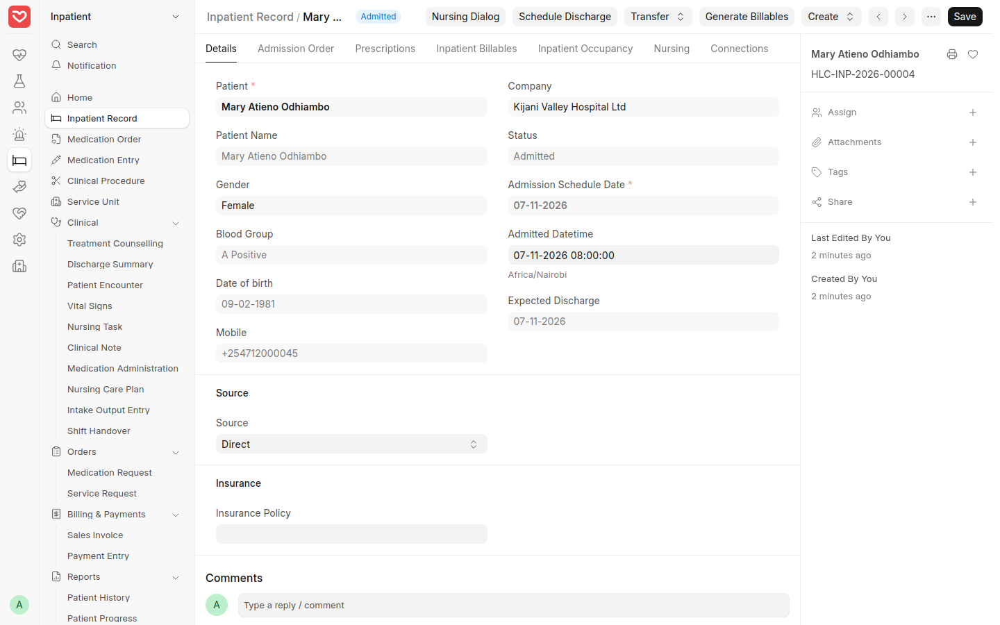

*The Inpatient Record once admitted, with Nursing Dialog, Schedule Discharge and Transfer in the top bar.*

## Step 4 — Ward round and prescribing

**Who:** doctor. **Where:** Inpatient › Patient Encounter, linked to the Inpatient Record.

1. Start a new encounter for the admitted patient; the Inpatient Record field links it to the admission.
2. In **Drug Prescription**, add each drug with a dosage that has set times (for example *1-1-1* gives 09:00, 14:00 and 21:00) and a period (for example *1 Day*).
3. Submit the encounter, then click **Create › Inpatient Medication Order**, check the doses and submit.

The medication order is the ward's drug chart: one row per dose with date, time and status. Its progress bar counts doses completed.

Demo record: ward round HLC-ENC-2026-00008 by Dr Brian Kiprotich prescribes amoxicillin 500 mg and paracetamol 500 mg three times daily; medication order HLC-IMO-2026-00001 holds 6 doses.

Dosages without set times (such as *1-0-1 (twice daily)*) produce no chart rows. Use the timed dosages, or add times to the dosage in Setup.

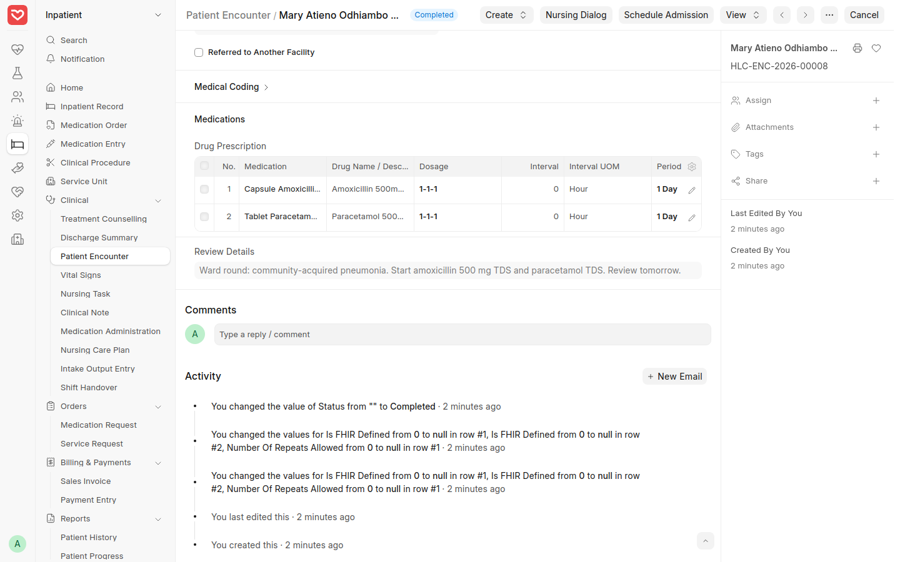

*Ward round encounter: the Drug Prescription table.*

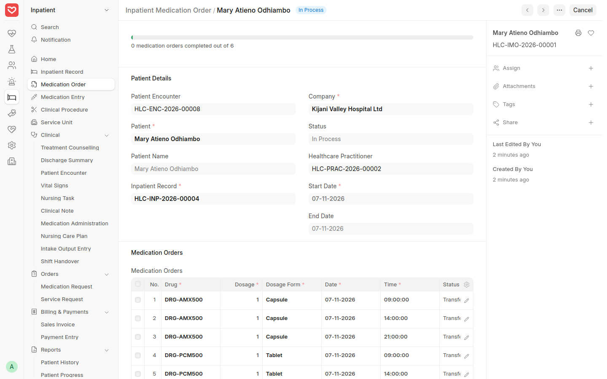

*The medication order: one row per dose, here at 09:00, 14:00 and 21:00.*

## Step 5 — Issue medicine from the pharmacy to the ward

**Who:** pharmacy. **Where:** Inpatient › Medication Entry › *+ Add*.

1. Set the date range (for example today) and, if you like, filter by patient or ward.
2. Click **Get Medication Orders**; every due dose on the drug charts appears.
3. Choose the pharmacy store as Medication Warehouse, keep **Update Stock** ticked and submit.

The drugs move from the pharmacy store to the store of the patient's bed. They are not billed yet: a dose is billed only when the nurse records it as given.

Demo record: HLC-IME-2026-00001 moves Mary's 6 doses from Stores to GW Bed 03.

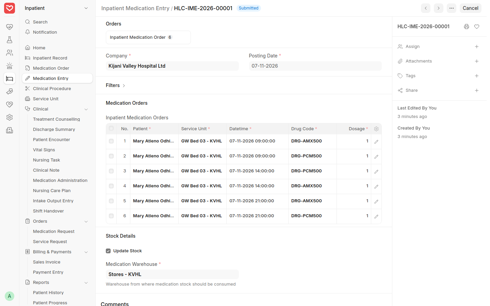

*The pharmacy's Medication Entry: each dose moves from Stores to GW Bed 03.*

## Step 6 — Give medicine and record each dose

**Who:** nurse. **Where:** Inpatient Record › **Nursing Dialog** › Medication.

1. Open the Nursing Dialog. The header shows the patient, bed, blood group and allergies; the right panel lists **Medication Due** (due doses in red).
2. Go to **Medication**. Each due dose has an **Actions** button.
3. After giving the dose, choose **Given** (with route, and a second checker where required). If not given, choose Held, Refused or Not Available and give the reason.

Recording *Given* issues that dose from the bed's store and adds it to the patient's bill. The dose record keeps the scheduled time, the time given and who gave it; once given it cannot be changed.

The same dialog records vitals and pain, intake and output, nursing tasks, notes and shift handover.

Demo records: the 09:00 doses HLC-MA-2026-00001 (amoxicillin) and HLC-MA-2026-00002 (paracetamol), both Given.

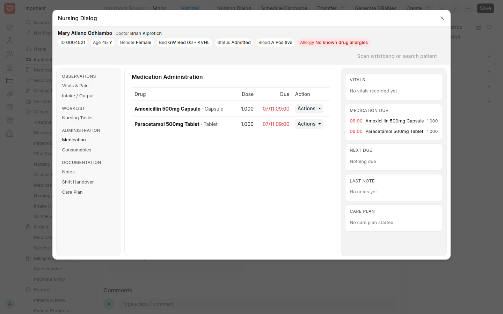

*Nursing Dialog › Medication: due doses with an Actions button each.*

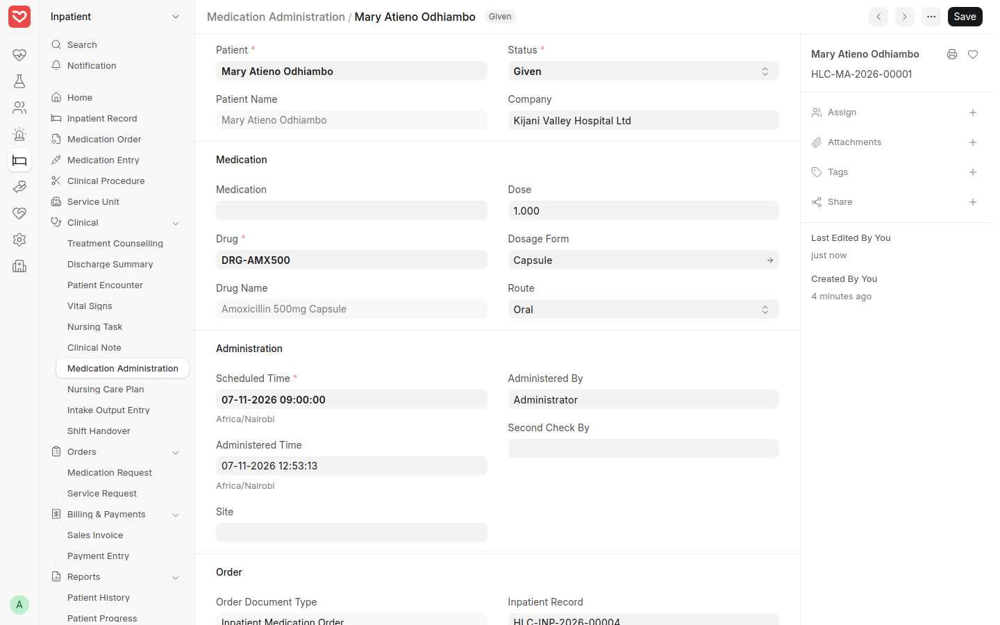

*A dose recorded as Given: scheduled and given times, route and who gave it.*

## Step 7 — Discharge order and discharge summary

**Who:** doctor. **Where:** Inpatient Record › **Schedule Discharge**.

1. Click **Schedule Discharge**. Enter discharge instructions, the discharge note and a follow-up date.
2. The status changes to *Discharge Scheduled*; the cashier can now raise the final bill.
3. Open the **Discharge Summary** created for the admission (Inpatient › Discharge Summary), check the details and click **Submit**.

Demo record: discharge ordered by Dr Brian Kiprotich with follow-up on 14 November; summary HLC-INP-2026-00005, shown here in Draft before the doctor submits it.

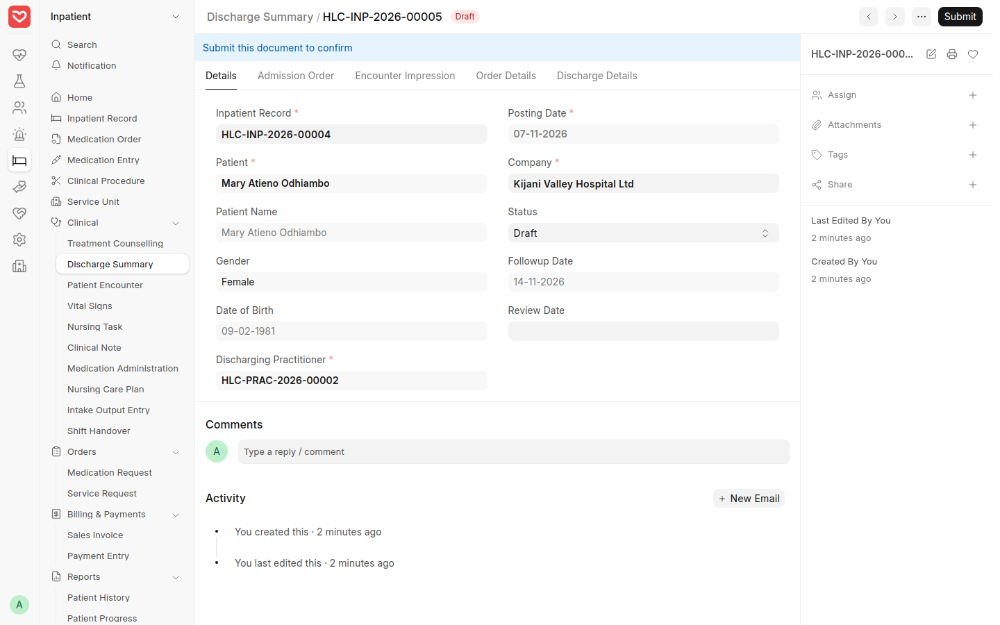

*The Discharge Summary before the doctor submits it.*

## Step 8 — Final bill, payment, KRA receipt and discharge

**Who:** cashier, then the ward. **Where:** Inpatient › Sales Invoice › *+ Add*.

1. Choose the patient, then **Get Items From › Healthcare Services**. Everything not yet billed comes in.
2. Check the lines, then submit.
3. Take payment (**Create › Payment**), choosing M-Pesa with its transaction code, or cash.
4. The invoice is sent to KRA eTIMS and comes back *Sent*, with a KRA receipt number and QR code for the printed receipt (**View at KRA** opens KRA's copy).
5. Back on the Inpatient Record, click **Discharge**. The bed is freed. Discharge is refused while any service is still unbilled, so the bill always comes first.

| Mary's bill, ACC-SINV-2026-00006 | Qty | KES |
| --- | --- | --- |
| General consultation (appointment) | 1 | 1,500 |
| Inpatient ward round | 1 | 2,000 |
| General ward bed, per night | 1 | 4,500 |
| Amoxicillin 500 mg, doses given | 1 | 15 |
| Paracetamol 500 mg, doses given | 1 | 5 |
| **Total** | | **8,020** |

Only the doses given are billed; the 4 doses still due at discharge are not.

**Correcting a signed bill:** KRA does not allow a signed invoice to be cancelled. Use **Create › Return / Credit Note** for the wrong lines, choose a refund reason (KRA accepts reasons 01 to 06), submit (KRA signs it) and refund the patient. In the demo, paracetamol was first billed as 18 tablets; credit note ACC-SINV-2026-00007 (KES 85, KRA receipt 31) corrected it and the KES 85 was refunded by M-Pesa.

Demo record: final bill ACC-SINV-2026-00006, paid by M-Pesa, KRA receipt 30; Mary discharged.

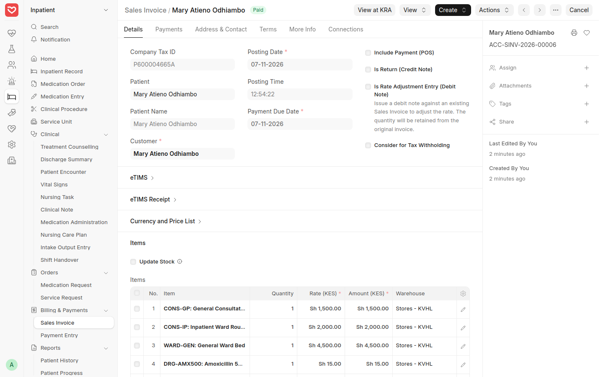

*The final bill, status Paid, with lines brought in from healthcare services.*

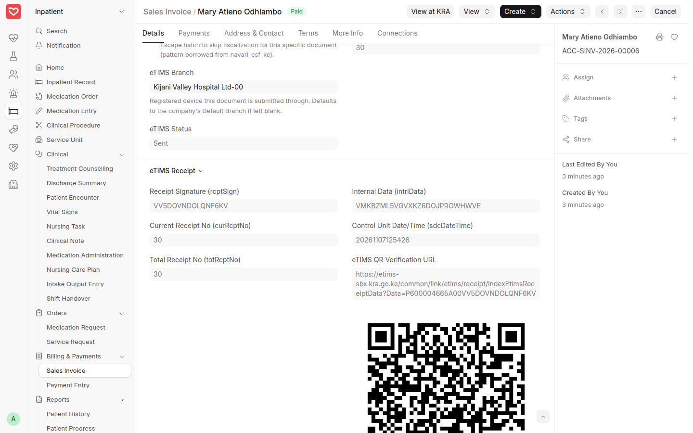

*eTIMS section of the bill: status Sent, KRA receipt number 30 and QR code.*

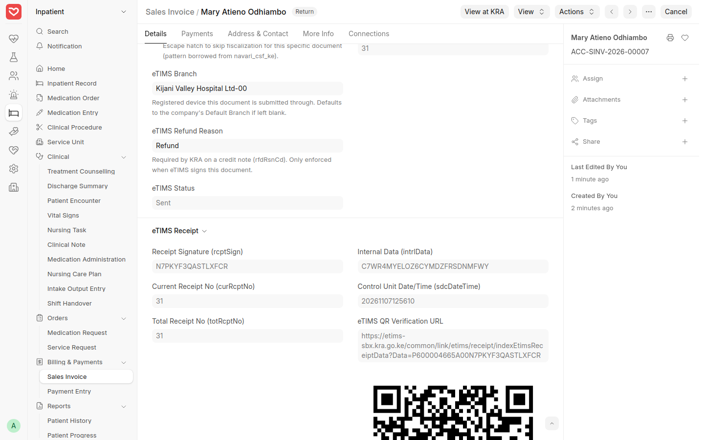

*The correcting credit note, signed by KRA as receipt 31.*

*The admission after discharge: status Discharged, bed freed.*
