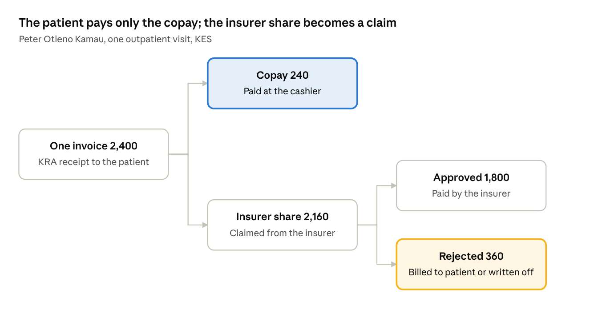
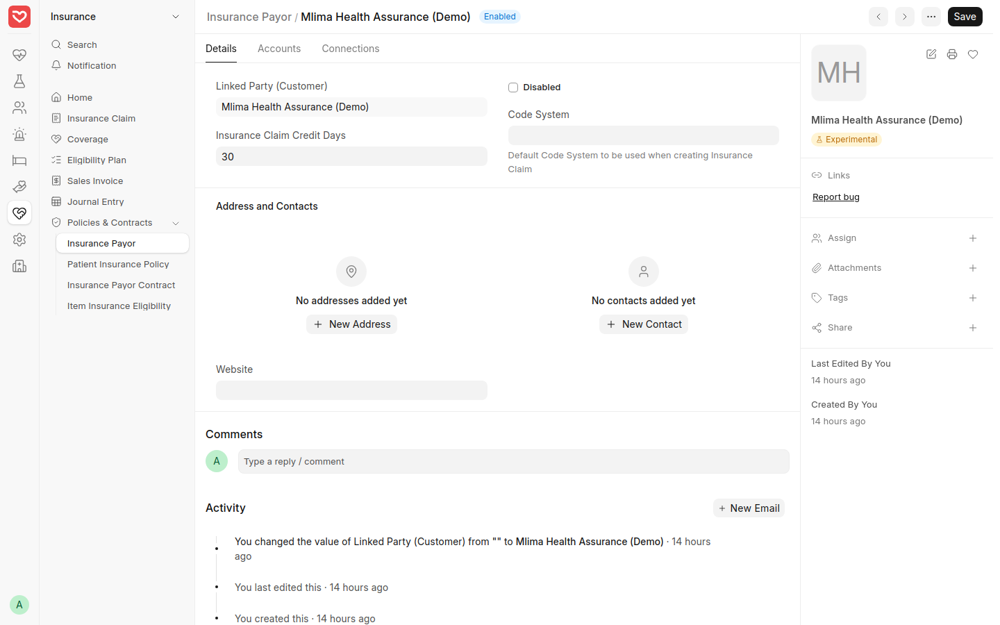
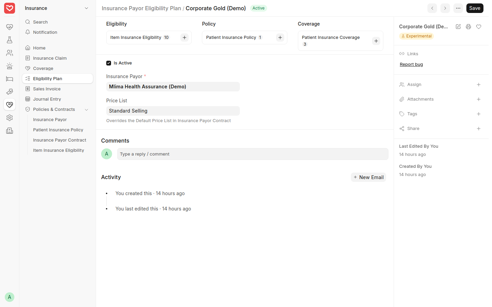
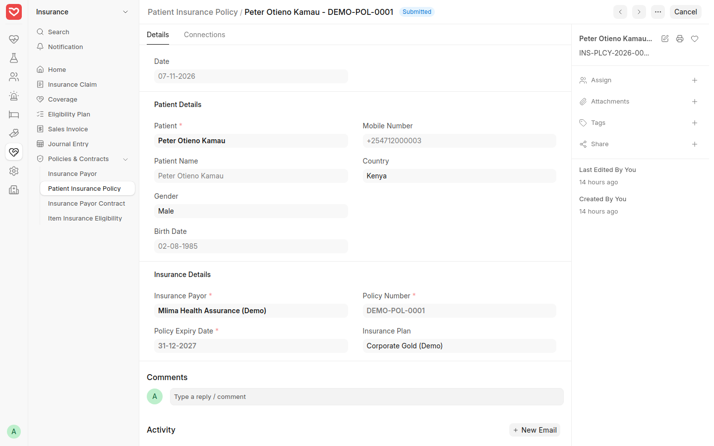
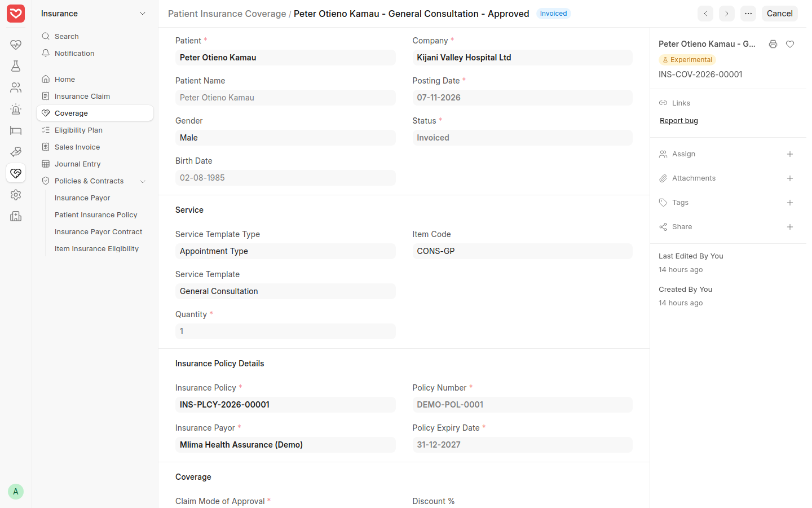
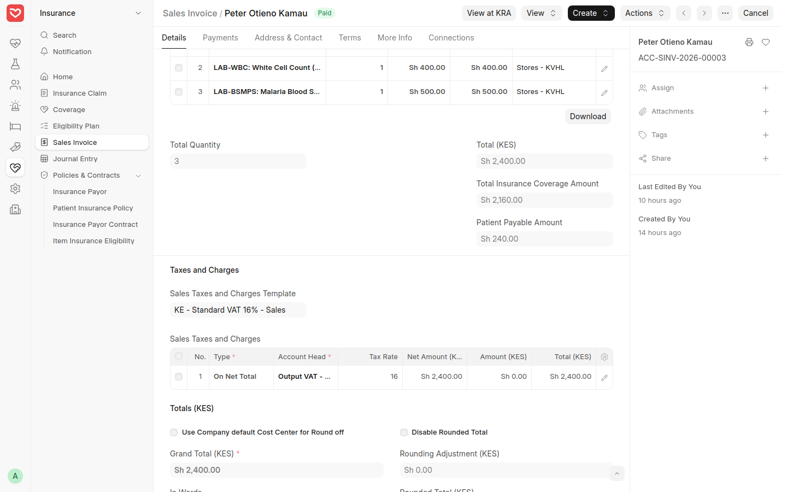
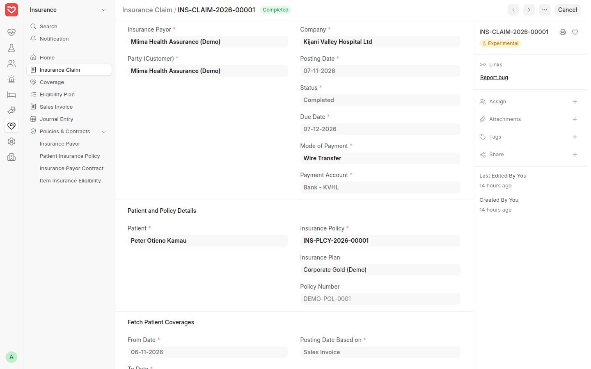
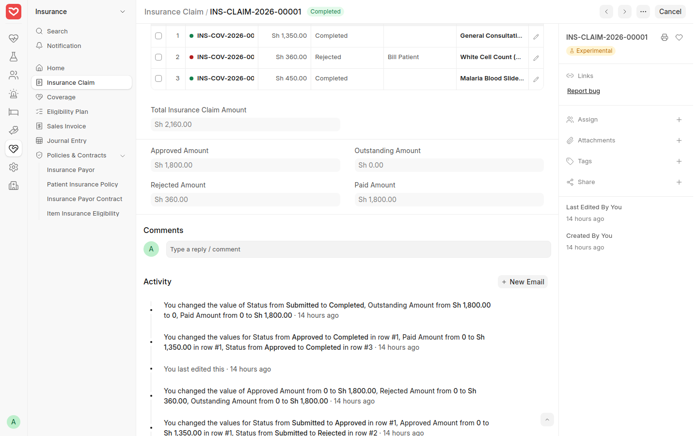
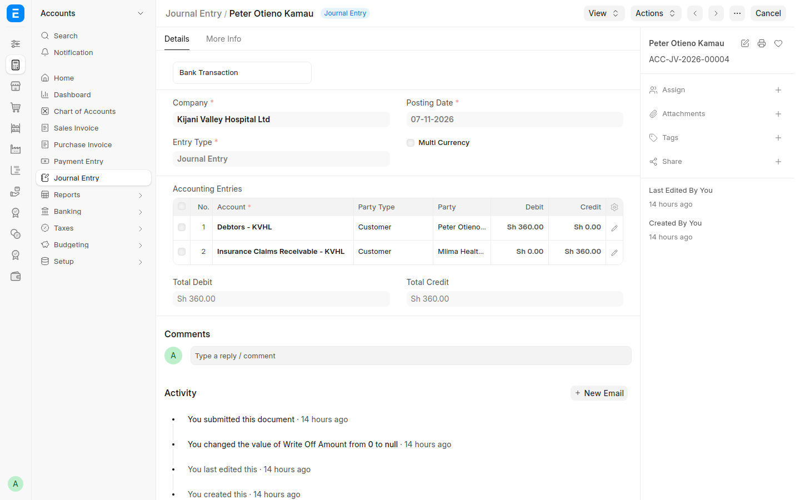
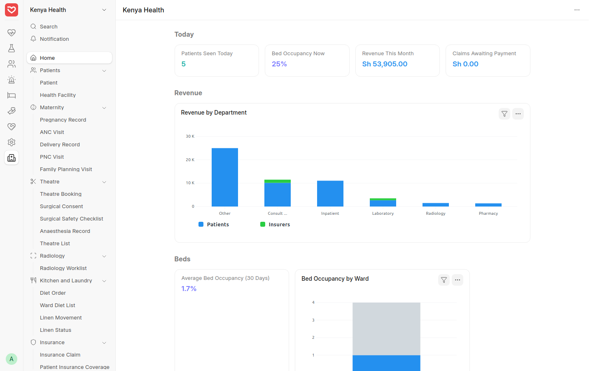

# Insurance Workflow — Step-by-Step Guide

How an insured patient is billed in RoyceERP Health: the patient pays only the copay, the insurer's share becomes a claim, and rejected lines are settled. Shown on the demo hospital at hospital.royceltd.com.

## At a glance

The insurer covers 90% on this plan, so Peter paid KES 240 at the cashier. One claim line was rejected and settled by billing Peter.

## Step 1 — Set up the insurer and plan (one-time)

**Who:** finance or administrator. **Where:** Insurance › Policies & Contracts.

1. **Insurance Payor:** the insurer's name, with its customer and claims receivable account so its share is tracked separately.
2. **Insurance Payor Contract:** the agreement with the insurer for the hospital, with its validity dates.
3. **Eligibility Plan:** each scheme the insurer sells (for example Corporate Gold).
4. **Item Insurance Eligibility:** for each service or drug on the plan, the share the insurer covers, for example 90% of consultation and lab, 100% of ward charges. Set *manual approval* where the insurer requires pre-authorisation.

Demo records: insurer *Mlima Health Assurance (Demo)*, plan *Corporate Gold (Demo)*, contract PAYOR-CONT-2026-00001.

*The insurer, with its own customer and claims account.*

*The plan the patient is on.*

## Step 2 — Record the patient's policy

**Who:** reception. **Where:** Insurance › Patient Insurance Policy › *+ Add*.

1. Choose the patient, the insurer and the plan.
2. Enter the policy or member number and the validity dates from the insurance card.
3. Save. From now on, services ordered for this patient can be covered by the policy.

Check the card at every visit: an expired policy means the patient pays in full.

Demo record: policy INS-PLCY-2026-00001 for *Peter Otieno Kamau* on Corporate Gold.

*The patient's policy: insurer, plan, number and validity.*

## Step 3 — Services ordered under the policy get coverage

**Who:** automatic, or the insurance desk for pre-authorisation. **Where:** Insurance › Coverage.

1. When the doctor orders a service for an insured patient (consultation, test, drug, bed), the system creates a **Patient Insurance Coverage** for it with the plan's share.
2. Items on automatic approval are approved straight away.
3. Items the insurer must pre-authorise wait for approval: enter the insurer's approval and set the coverage to *Approved*. If the insurer declines, the patient pays in full.

Demo records: coverages INS-COV-2026-00001 to 00003 for Peter's consultation, malaria slide and WBC, each at 90%.

*One coverage per service, with the insurer's share.*

## Step 4 — Bill the full amount and collect the copay

**Who:** cashier. **Where:** Insurance › Sales Invoice (or Outpatient › Sales Invoice) › *+ Add*.

1. Choose the patient, then **Get Items From › Healthcare Services**. Each covered line carries the insurer's share.
2. Submit. The invoice shows **Total Insurance Coverage Amount** (the insurer's share) and **Patient Payable Amount** (the copay).
3. Take the copay from the patient by M-Pesa or cash.
4. The insurer's share moves automatically to the insurer's claims receivable.

There is one KRA eTIMS invoice, to the patient, for the full amount.

| Peter's invoice ACC-SINV-2026-00003 | KES |
| --- | --- |
| Invoice total (consultation, WBC, malaria slide) | 2,400 |
| Insurer's share (90%) | 2,160 |
| **Copay paid by Peter** | **240** |

*The invoice: Total KES 2,400, Insurance Coverage 2,160, Patient Payable 240.*

## Step 5 — Create the claim and record the insurer's decision

**Who:** insurance or claims officer. **Where:** Insurance › Insurance Claim › *+ Add*.

1. Choose the insurer, plan, patient and policy. The billed coverages for the visit come in as claim lines.
2. Submit the claim and send it to the insurer with the supporting documents.
3. When the insurer replies, mark each line **Approved** or **Rejected**, with the approved amount. The claim shows the approved and rejected totals.

| Peter's claim INS-CLAIM-2026-00001 | KES | Insurer's decision |
| --- | --- | --- |
| General consultation | 1,350 | Approved |
| Malaria blood slide | 450 | Approved |
| White cell count | 360 | Rejected |
| **Claimed** | **2,160** | 1,800 approved, 360 rejected |

*The claim for Peter's visit.*

*Claim lines: two completed, one rejected and billed to the patient; approved 1,800, rejected 360, paid 1,800.*

## Step 6 — Settle rejected lines and record the insurer's payment

**Who:** claims officer and finance. **Where:** the Insurance Claim.

1. **Settle Rejected Lines:** for each rejected line choose **Bill Patient** (the amount moves to the patient's account, to be collected like any balance) or **Write Off** (to the Rejected Insurance Claims expense account). Each settlement is a journal entry; cancelling it reopens the line.
2. **Record the payment:** when the insurer pays, create the payment from the claim. The approved lines become *Completed* and the claim's outstanding amount drops to zero.

No new KRA invoice is needed when a rejected line is billed to the patient: the patient's invoice already carried the full amount.

Demo records: the KES 360 rejected WBC line was billed to Peter (journal entry ACC-JV-2026-00004); the insurer paid KES 1,800; claim status *Completed*.

*The settlement: the rejected KES 360 moved from the insurer's account to Peter's.*

## Tracking claims

The Kenya Health home page shows **Claims Awaiting Payment**, and the **SHA and insurance claims** chart shows, per insurer, what is not yet claimed, awaiting payment, paid and rejected. Revenue by department splits each department's income into the patients' and the insurers' share.

Still to come:

- **SHA claims** through DHA's Health Information Exchange: waiting for DHA sandbox approval, then DHA testing and certification. Keep using the SHA portal for SHA patients until then.
- **Slade360** for private insurers: waiting for API access. Until then, claims are prepared here and submitted the insurer's usual way.
- **A separate KRA invoice to the insurer:** awaiting a tax adviser's view.

*The Kenya Health home page: claims awaiting payment and revenue split into patients' and insurers' shares.*
