# Maternity Workflow — Step-by-Step Guide

How RoyceERP Health follows a mother from booking to postnatal care, using the MOH registers and the MOH Modified WHO Labour Care Guide, and bills the delivery as one package. Shown on the demo hospital at hospital.royceltd.com.

## At a glance

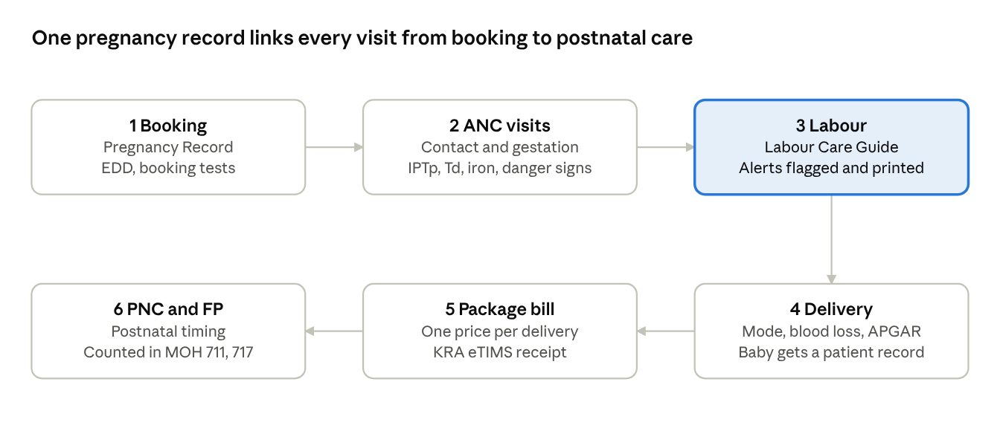

In the demo, follow *Faith Njeri Wambui* (fictional) through every step.

## Step 1 — Open the pregnancy record at booking

**Who:** ANC nurse or midwife. **Where:** Kenya Health › Maternity › Pregnancy Record › *+ Add*.

1. Choose the mother (register her first if new).
2. Enter the last menstrual period; the expected date of delivery is worked out (LMP + 280 days).
3. Record gravida and parity, booking tests (blood group, Hb, HIV, syphilis, hepatitis B) and risk factors.
4. Save. One record follows this pregnancy; every ANC visit, the delivery and postnatal visits link to it.

Demo record: PREG-2026-00001 for *Faith Njeri Wambui*, G2 P1+0, LMP 4 February 2026.

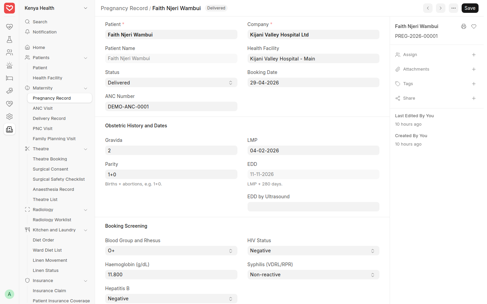

*The pregnancy record: LMP, EDD, parity and booking tests.*

## Step 2 — ANC visits

**Who:** ANC nurse or midwife. **Where:** Kenya Health › Maternity › ANC Visit › *+ Add*.

1. Choose the mother and her pregnancy record. The contact number and weeks of gestation are worked out.
2. Record the examination (blood pressure, weight, fundal height, fetal heart, presentation).
3. Record what was given: IPTp-SP, Td, iron and folate, insecticide-treated net.
4. Tick any danger signs and submit.

Demo records: ANC-2026-00001 to 00003 for Faith.

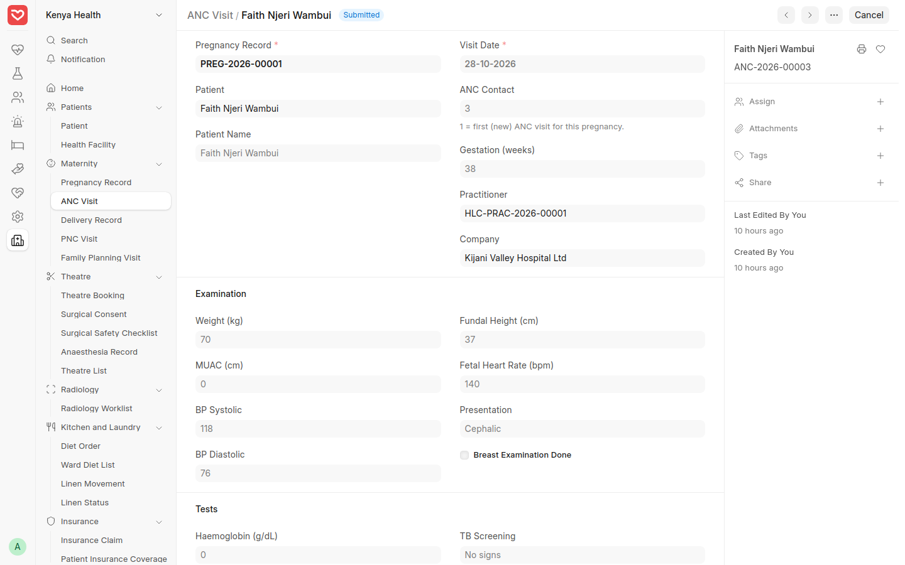

*An ANC visit with contact number and gestation worked out.*

## Step 3 — Labour: the Labour Care Guide

**Who:** midwife on the labour ward. **Where:** Kenya Health › Maternity › Delivery Record › *+ Add*.

1. Choose the mother and her pregnancy record. Parity, LMP, PMTCT, syphilis and hepatitis B fill in from it.
2. Record the labour onset, active labour diagnosis and when the membranes ruptured.
3. Add a row in **Labour Observations** at each check: supportive care, the baby (fetal heart, decelerations, liquor, position, caput, moulding), the woman (pulse, BP, temperature, urine), labour progress (contractions, cervix, descent), and the assessment and plan.
4. Every value in the guide's ALERT column is flagged, and so is slow cervical progress.
5. **Print Labour Care Guide** prints the chart like the paper MOH form, with alerts circled.

Demo record: DEL-2026-00001. At 01:00 the fetal heart rate was 165, above the 160 limit, and was flagged; the plan was left lateral position, oral fluids and a recheck in 15 minutes.

The alert limit for the fetal heart rate (110 by WHO) is set in Kenya Health Settings; set 120 if your form says so.

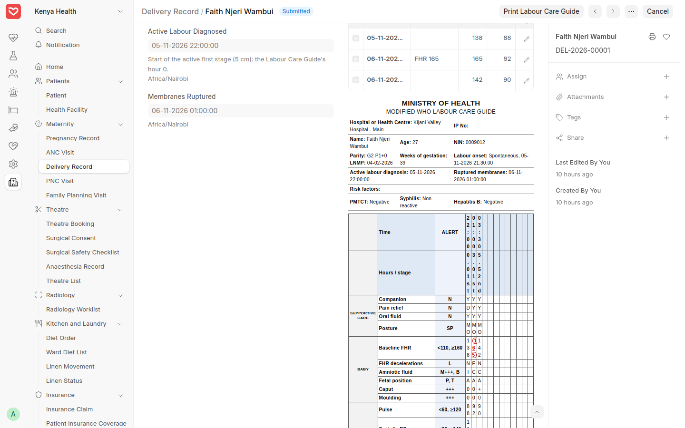

*Labour observations on the Delivery Record, one row per check.*

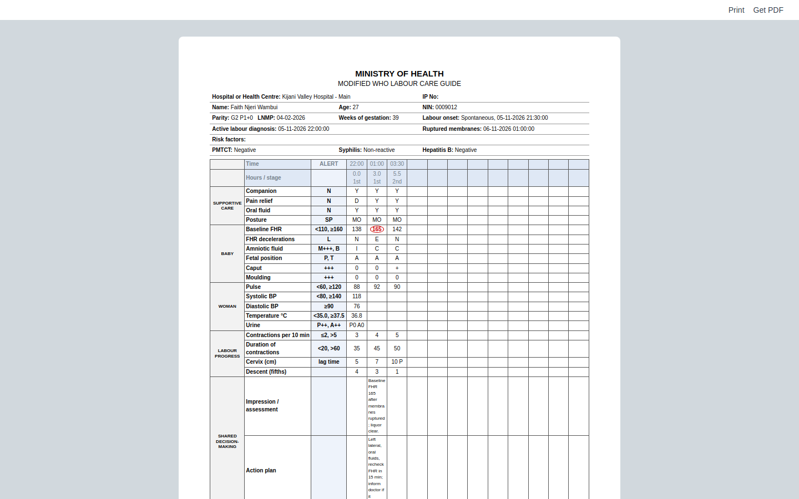

*The printed Labour Care Guide: the fetal heart rate of 165 at 01:00 is circled as an alert.*

## Step 4 — Delivery and the newborn

**Who:** midwife. **Where:** the same Delivery Record.

1. Record the mode of delivery, uterotonic given, blood loss and the perineum.
2. Tick any complications (APH, PPH, eclampsia, ruptured uterus, obstructed labour, sepsis) and the mother's condition.
3. In **Babies**, add each baby: sex, weight, APGAR scores, outcome and essential newborn care.
4. Submit. Each live-born baby gets its own Patient record, linked to the mother, ready for its own care and immunisation.

Demo record: Faith's normal delivery; her baby is registered as *Baby of Faith Wambui*.

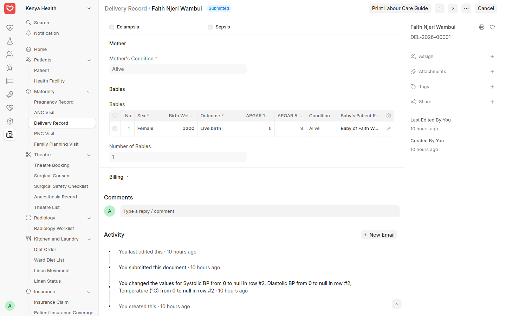

*The Babies section: each live-born baby gets a patient record.*

## Step 5 — Discharge bill with the maternity package

**Who:** cashier. **Where:** Outpatient › Sales Invoice › *+ Add* (the mother's first bill on or after the delivery).

1. **One-time setup:** in Kenya Health › Maternity Package, set each package: delivery type (vaginal or caesarean), price, insurer (blank for cash; SHA or another insurer for theirs), included ward nights and the items it covers. Enter your own tariffs; none are shipped.
2. The Delivery Record picks the package for its delivery type and the mother's insurer, or the cash package.
3. On the discharge bill, **Get Items From › Healthcare Services** brings in the package line. Charges it covers stay on the bill at zero, marked *Included in ...*, so the mother sees what the price covered. Ward nights beyond those included are billed as usual.
4. Submit, take payment, and the bill is signed by KRA eTIMS.

Demo record: ACC-SINV-2026-00004, *Normal Delivery (Cash)* package at KES 25,000 (a demo price, not an SHA tariff).

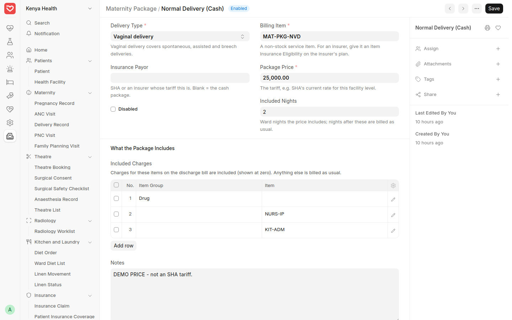

*A maternity package: type, price, included nights and items.*

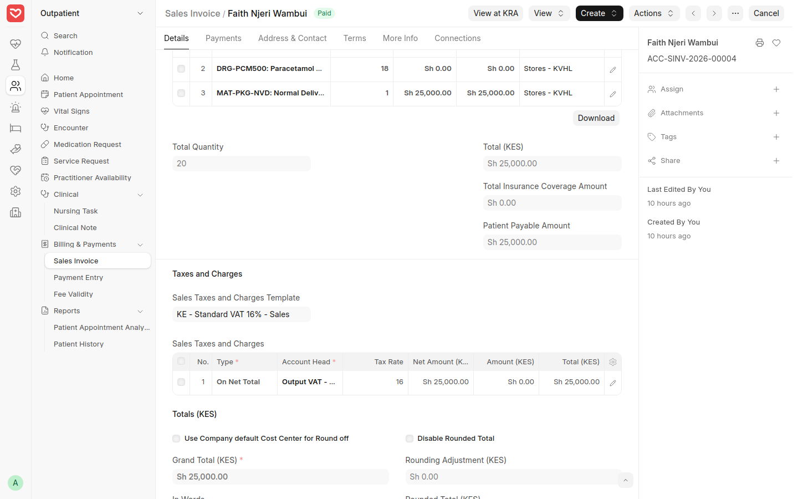

*The discharge bill: the package line at KES 25,000; covered items at zero.*

## Step 6 — Postnatal care and family planning

**Who:** postnatal or MCH nurse. **Where:** Kenya Health › Maternity › PNC Visit and Family Planning Visit.

1. **PNC Visit:** choose the mother and her pregnancy record. The visit number and MOH timing (within 48 hours, 3 days to under 6 weeks, after 6 weeks) are worked out. Record the mother's and baby's checks.
2. **Family Planning Visit:** record the method (pills, injectable, implant, IUCD, condoms, tubal ligation, vasectomy, natural), whether it is an insertion, reinsertion or removal, and the timing (postpartum, interval, post-abortion). New or revisit is worked out from earlier visits; methods for one sex only are checked against the patient.

Demo records: PNC-2026-00001 and family planning visit FP-2026-00001 for Faith.

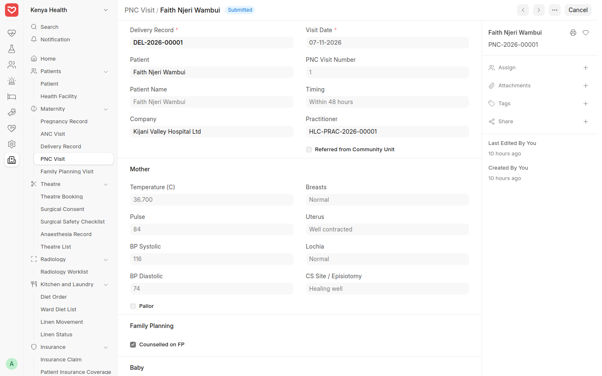

*A postnatal visit with its MOH timing.*

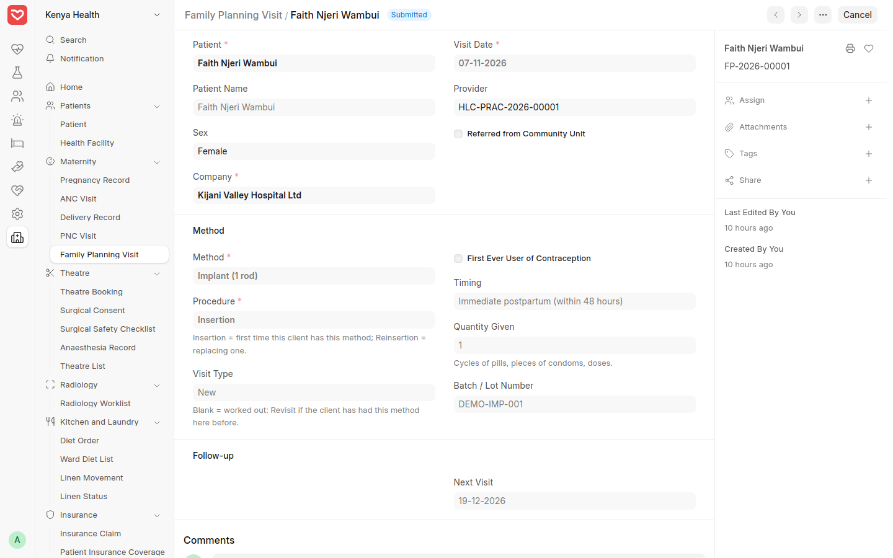

*A family planning visit: method, new or revisit, timing.*

## MOH 711 and 717

Maternity records count in the MOH reports with no extra data entry.

- **MOH 711 Integrated Summary** (Kenya Health › Reports): ANC and PMTCT, maternity and newborn, postnatal care and family planning, with first ANC visits by the mother's age group. Choose the company, year and month.
- **MOH 717 Service Workload:** ANC and PNC visits, deliveries by mode, births, stillbirths, neonatal deaths, low birth weight and maternal deaths.

The report opens on last month, the usual reporting period. Faith's delivery counts under *Normal Deliveries* for November 2026.

Fields follow the MOH ANC, maternity and PNC registers. During setup we align them with your hospital's own forms.

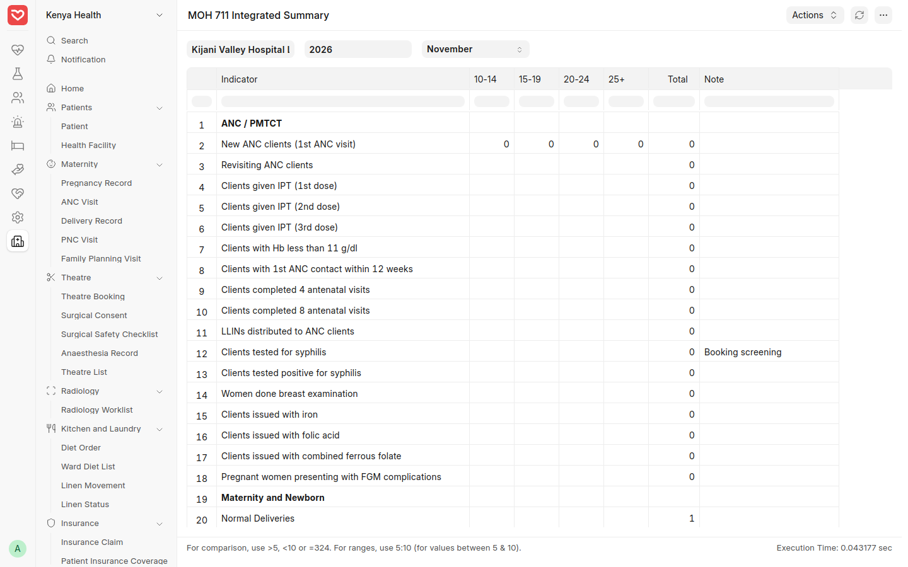

*MOH 711 for November 2026: one normal delivery counted.*
