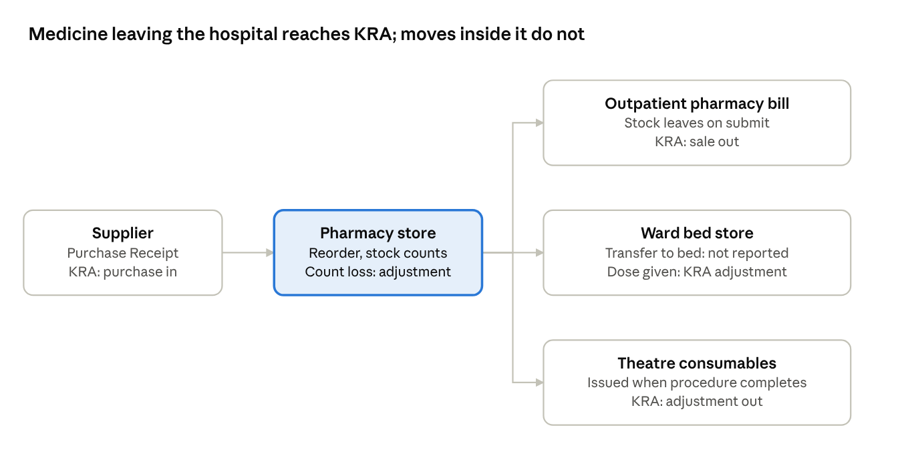
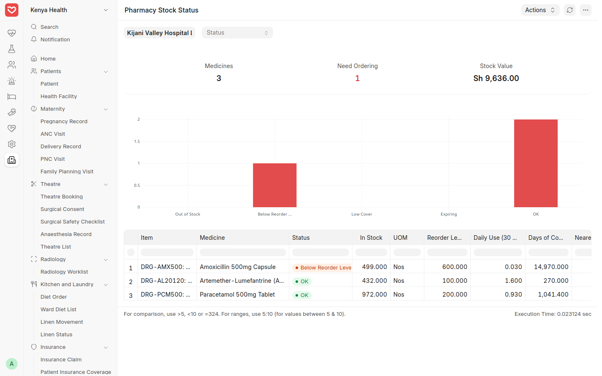
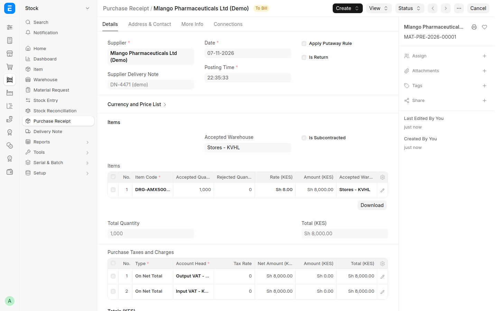
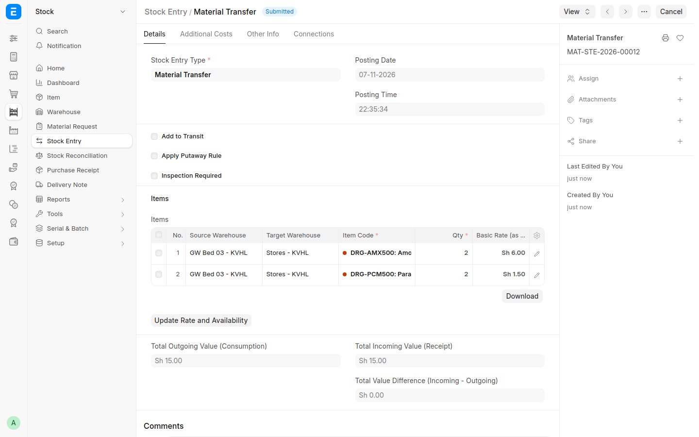
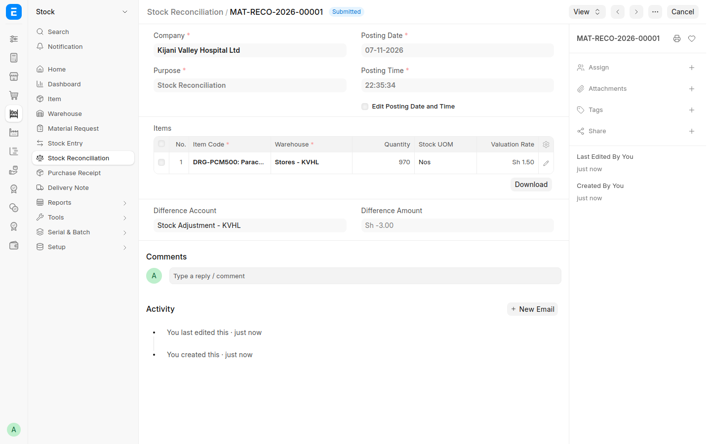
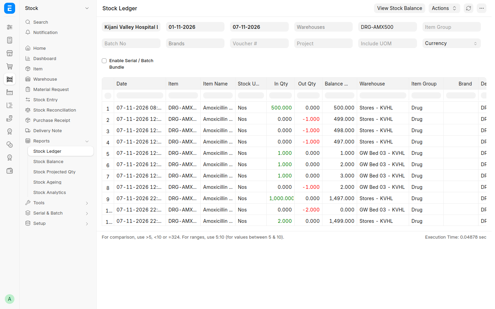
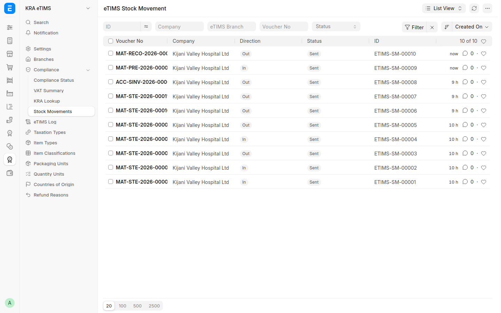

# Pharmacy and Stock — Step-by-Step Guide

How the pharmacy keeps medicine stock in RoyceERP Health: what to order, receiving from suppliers, issuing and dispensing, stock counts, and how every movement reaches KRA eTIMS. Shown on the demo hospital at hospital.royceltd.com.

## At a glance

The system reports stock to KRA eTIMS by itself; the pharmacist only records each movement.

## Step 1 — Check what to order

**Who:** pharmacist. **Where:** Kenya Health › Reports › **Pharmacy Stock Status** (also on the Kenya Health home page).

1. Open the report. The cards show how many medicines need ordering and the value of stock.
2. Each medicine shows its status: *Out of Stock*, *Below Reorder Level*, *Low Cover* (fewer days left than the minimum), *Expiring*, or *OK*.
3. Read **Daily Use** (average over 30 days) and **Days of Cover** to decide how much to order.
4. Filter by status to see only what needs action.

Reorder levels and quantities are set per medicine and store (Item › Reorder). The minimum days of cover (14) and expiry warning (90 days) are in Kenya Health Settings.

Demo: amoxicillin 500 mg is *Below Reorder Level* — 499 capsules against a level of 600.

*Pharmacy Stock Status: one medicine needs ordering; daily use and days of cover per medicine.*

## Step 2 — Receive medicines from the supplier

**Who:** pharmacist or stores clerk. **Where:** Stock › Purchase Receipt › *+ Add* (or from the Purchase Order with **Create › Purchase Receipt**).

1. Choose the supplier and enter their delivery note number.
2. Set the accepted warehouse (the pharmacy store).
3. Add each medicine with the quantity received and the unit cost. Put damaged or short items in *Rejected Quantity*.
4. Submit. Stock goes up at once, and the delivery is reported to KRA eTIMS as a purchase.

Finance then records the supplier's invoice (**Create › Purchase Invoice**) to pay them.

Demo record: MAT-PRE-2026-00001 — 1,000 amoxicillin 500 mg capsules from *Mlango Pharmaceuticals Ltd (Demo)* at KES 8 each, KES 8,000.

*The delivery received into Stores: 1,000 capsules at KES 8.*

## Step 3 — Issue to wards and dispense to patients

Medicines leave the pharmacy store three ways:

| Where to | How | Guide |
| --- | --- | --- |
| Outpatient | The pharmacy bill with **Update Stock** ticked; stock leaves when the bill is submitted | [Outpatient](02-outpatient.md), Step 8 |
| Inpatient | **Medication Entry** moves the due doses to the patient's bed; each dose leaves when the nurse records it as *Given* | [Inpatient](03-inpatient.md), Steps 5–6 |
| Theatre | Consumables leave the theatre store when the procedure is completed | [Overview](01-overview.md), Theatre |

**Returning unused ward stock:** doses left at a bed after discharge go back to the pharmacy with a **Stock Entry** of type *Material Transfer* (Stock › Stock Entry › *+ Add*): from the bed's store to the pharmacy store. A transfer inside the hospital is not reported to KRA.

Demo record: MAT-STE-2026-00012 returns Mary Atieno Odhiambo's 2 amoxicillin and 2 paracetamol from GW Bed 03 to Stores.

*Unused doses moved from the bed's store back to Stores.*

## Step 4 — Count the stock and correct differences

**Who:** pharmacist, with a witness. **Where:** Stock › Stock Reconciliation › *+ Add*.

1. Count the medicines on the shelf.
2. Add each medicine and store with the **counted** quantity; the system shows the difference from its own figure.
3. Submit. Stock is corrected, the difference is posted to the stock adjustment account, and it is reported to KRA eTIMS as an adjustment.

Count high-value and controlled medicines more often, for example weekly.

Demo record: MAT-RECO-2026-00001 — paracetamol counted at 970 tablets against 972 in the system; the 2 missing tablets were written off and reported to KRA.

*The stock count: counted quantity entered, difference posted.*

## Step 5 — See every movement

**Stock Ledger** (Stock › Reports › Stock Ledger): every movement of a medicine, in and out, with the running balance per store. Filter by medicine, store and dates.

**eTIMS Stock Movements** (KRA eTIMS › Compliance › Stock Movements): every stock change reported to KRA, with its direction and status. *Sent* means KRA accepted it; a *Failed* one shows the reason and is retried every 15 minutes.

| Movement | Reported to KRA as |
| --- | --- |
| Delivery from a supplier | Purchase (in) |
| Sale with stock update (outpatient pharmacy bill) | Sale (out) |
| Dose given on the ward, theatre consumables, stock count loss | Adjustment (out) |
| Transfer between stores (pharmacy to bed, bed back to pharmacy) | Not reported: stock stays in the hospital |

KRA refuses to sign a sale of a medicine it holds no stock for, so every receipt must be recorded before that medicine is sold.

Still to come: batch and expiry tracking per delivery, a dispensing queue with labels, and a controlled drugs register.

*Stock Ledger for amoxicillin: opening stock, ward doses, the 1,000 received and the return from the bed.*

*Every stock change sent to KRA, all Sent.*
