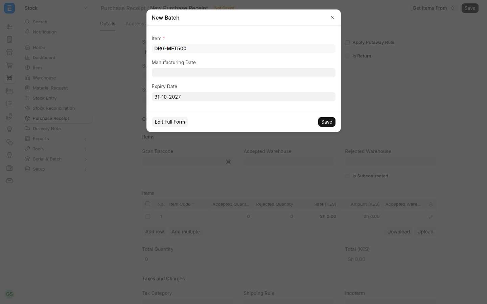
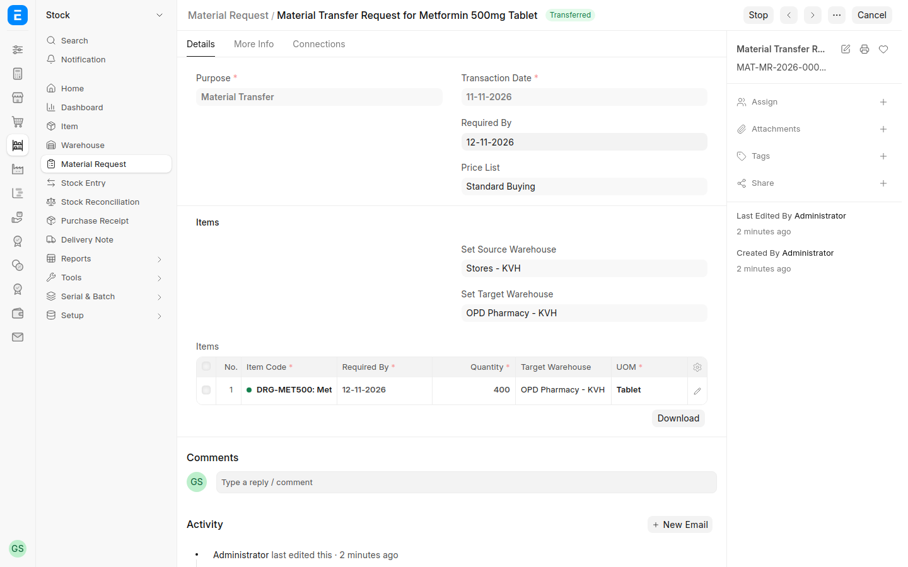
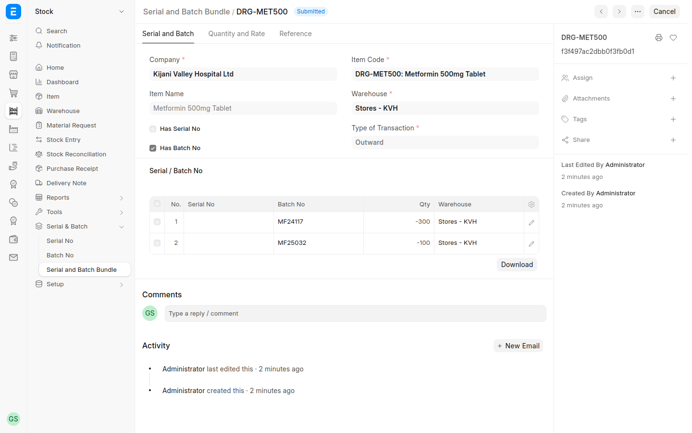
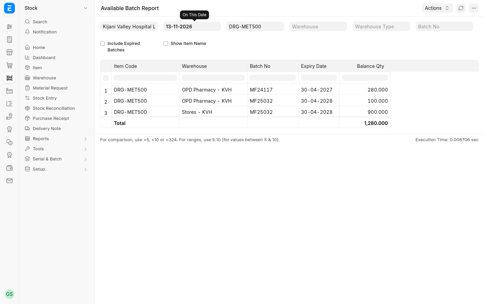
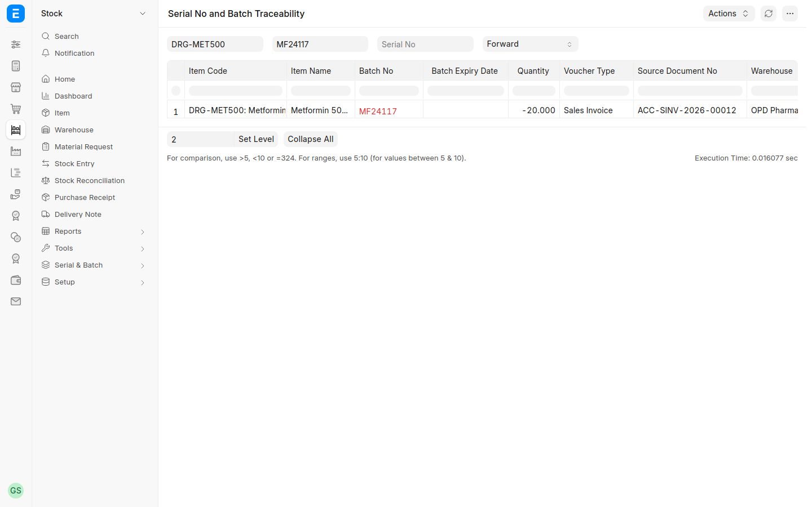

# Pharmacy and Stock — Step-by-Step Guide

How the pharmacy keeps medicine stock in RoyceERP Health: what to order, receiving from suppliers with batch numbers and expiry dates, moving stock from the main store to the pharmacy, issuing and dispensing, stock counts, expiry and recall reports, and how every movement reaches KRA eTIMS. Shown on the demo hospital at hospital.royceltd.com.

Setting up the stores, medicines and prices, and moving them over from another system, is in [Pharmacy and stock setup and data upload](15-pharmacy-setup-and-upload.md).

## At a glance

The system reports stock to KRA eTIMS by itself; the pharmacist only records each movement.

**Batches and expiry dates.** Every pack of medicine carries the manufacturer's batch (lot) number and an expiry date. For each medicine marked *Has Batch No*, the system keeps stock per batch:

- every delivery, transfer, sale and count says which batch moved;
- stock leaves in **expiry order** (first expiry, first out), so short-dated stock is used before it lapses;
- an expired batch can't be sold or issued;
- a recall can be traced to the bills that received the batch.

One patient can receive tablets from two batches, for example the last 10 of an old batch and 20 from a new one. The system records both.

## Step 1 — Check what to order

**Who:** pharmacist. **Where:** Kenya Health › Reports › **Pharmacy Stock Status** (also on the Kenya Health home page).

1. Open the report. The cards show how many medicines need ordering and the value of stock.
2. Each medicine shows its status: *Out of Stock*, *Below Reorder Level*, *Low Cover* (fewer days left than the minimum), *Expiring*, or *OK*.
3. Read **Daily Use** (average over 30 days) and **Days of Cover** to decide how much to order.
4. Filter by status to see only what needs action.

Reorder levels and quantities are set per medicine and store (Item › Inventory › Reorder). A level on the main store is ordered from a supplier (*Purchase*). A level on the pharmacy is refilled from the main store (*Transfer*). The minimum days of cover (14) and the expiry warning (90 days) are in Kenya Health Settings.

Demo: amoxicillin 500 mg is *Below Reorder Level* — 499 capsules against a level of 600.

*Pharmacy Stock Status: one medicine needs ordering; daily use and days of cover per medicine.*

## Step 2 — Receive medicines from the supplier

**Who:** pharmacist or stores clerk. **Where:** Stock › Purchase Receipt › *+ Add* (or from the Purchase Order with **Create › Purchase Receipt**).

1. Choose the supplier and enter their delivery note number.
2. Set the accepted warehouse (the main store).
3. Add each medicine with the quantity received and the unit cost. Put damaged or short items in *Rejected Quantity*.
4. **Units:** receive in the unit on the supplier's invoice, for example *Strip* or *Box*. The system converts to tablets: 30 strips of 10 become 300 tablets.
5. **Batch and expiry:** for a medicine with batches, open the line and fill **Batch No**:
   - a batch you have received before: pick it from the list;
   - a new batch: type the batch number from the pack and choose *Create a new Batch*. In the box that opens, enter the **Expiry Date** printed on the pack (and the manufacturing date if you have it) and save.

   Two batches in one delivery go on two lines, one per batch. A pack that shows only a month (EXP 04/2027) expires on the last day of that month.
6. Submit. Stock goes up at once, and the delivery is reported to KRA eTIMS as a purchase.

The system refuses a batch without an expiry date for these medicines, and refuses to submit a line without a batch.

Finance then records the supplier's invoice (**Create › Purchase Invoice**) to pay them.

Demo records:
- MAT-PRE-2026-00001: 1,000 amoxicillin 500 mg capsules from *Mlango Pharmaceuticals Ltd (Demo)* at KES 8 each, KES 8,000.
- Metformin 500 mg (DRG-MET500), a medicine with batches: 30 strips of batch **MF24117** (expires in about 5 months) and 100 strips of batch **MF25032** (expires about a year later), on delivery note MPL-DN-4471.

*The delivery received into Stores: 1,000 capsules at KES 8.*

*A new batch typed on a receipt line: enter the expiry date from the pack and save.*

## Step 3 — Move stock from the main store to the pharmacy

**Who:** pharmacist (asks), stores clerk (issues). **Where:** Stock › Material Request › *+ Add*.

The main store holds the bulk stock. The OPD pharmacy, wards, theatre and lab each ask the store for what they need.

1. **The pharmacy asks.** Set *Purpose* to **Material Transfer**, *Set Source Warehouse* to the main store and *Set Target Warehouse* to the pharmacy. Add each medicine and quantity, then submit.
2. **The store issues.** On the submitted request, click **Create › Material Transfer**. Check the quantities you are really sending and submit the Stock Entry.
3. You don't choose the batch. The system takes the batch that expires first and splits the quantity across batches when one runs out.

A transfer inside the hospital is not reported to KRA.

Demo: the OPD Pharmacy asked for 400 metformin tablets. The transfer took all 300 left in batch MF24117, which expires first, and 100 from MF25032.

*The OPD pharmacy's request to Stores: 400 tablets, now Transferred.*

*The batches the transfer took (open the Stock Entry line, then its Serial and Batch Bundle): 300 from MF24117, then 100 from MF25032.*

## Step 4 — Issue to wards and dispense to patients

Medicines leave the pharmacy three ways:

| Where to | How | Guide |
| --- | --- | --- |
| Outpatient | The pharmacy bill with **Update Stock** ticked and the payment taken on it; stock leaves when the bill is submitted. Or a **Delivery Note** from the bill once it is paid | [Outpatient](02-outpatient.md), Step 8 |
| Inpatient | **Medication Entry** moves the due doses to the patient's bed; each dose leaves when the nurse records it as *Given* | [Inpatient](03-inpatient.md), Steps 5–6 |
| Theatre | Consumables leave the theatre store when the procedure is completed | [Overview](01-overview.md), Theatre |

**Batches:** leave *Batch No* empty and the system takes the first-expiring batch when the bill or entry is submitted. Choose a batch yourself only when you are handing over a particular pack. A batch past its expiry date is refused ("The batch … has already expired"). Move expired stock out with a Stock Entry of type *Material Issue* and record why.

**Loose tablets and strips:** a medicine is counted in its smallest unit (tablet, capsule) and can also be sold by the strip or box. On the bill line, choose the **UOM** (*Tablet* or *Strip*). The price is the one set for that unit, and stock goes down by the right number of tablets. In the demo, 2 strips of metformin take 20 tablets from batch MF24117.

**Paid first:** for a cash patient, a bill that issues stock must be paid on the spot (Include Payment), and a Delivery Note against an unpaid bill is refused. Insured patients, inpatients, casualty and visits a manager has approved are served first. The switch is in Kenya Health Settings › Payment Before Service.

**Returning unused ward stock:** doses left at a bed after discharge go back to the pharmacy with a **Stock Entry** of type *Material Transfer* (Stock › Stock Entry › *+ Add*): from the bed's store to the pharmacy store. A transfer inside the hospital is not reported to KRA.

Demo record: MAT-STE-2026-00012 returns Mary Atieno Odhiambo's 2 amoxicillin and 2 paracetamol from GW Bed 03 to Stores.

*Unused doses moved from the bed's store back to Stores.*

## Step 5 — Count the stock and correct differences

**Who:** pharmacist, with a witness. **Where:** Stock › Stock Reconciliation › *+ Add*.

1. Count the medicines on the shelf. For a medicine with batches, count **each batch separately**.
2. Add each medicine and store with the **counted** quantity, one line per batch. The system shows the difference from its own figure.
3. Submit. Stock is corrected, the difference is posted to the stock adjustment account, and it is reported to KRA eTIMS as an adjustment.

Count high-value and controlled medicines more often, for example weekly.

Demo record: MAT-RECO-2026-00001 — paracetamol counted at 970 tablets against 972 in the system; the 2 missing tablets were written off and reported to KRA.

*The stock count: counted quantity entered, difference posted.*

## Step 6 — Expiry dates and recalls

**What is expiring.** Stock › Reports › **Available Batch Report**: every batch in stock with its store, expiry date and quantity. Filter by medicine or store. Tick *Include Expired Batches* to find expired stock still on the shelf. Pharmacy Stock Status (Step 1) marks a medicine *Expiring* when its nearest batch expires within the warning period.

**A recall.** When the Pharmacy and Poisons Board or the supplier recalls a batch:

1. Open Stock › Reports › **Serial No and Batch Traceability**. Choose the medicine and the batch, with *Traceability Direction* set to **Forward**.
2. Every bill and stock entry that took that batch is listed, with the quantity, the store and, further right, the customer (the patient). Open each bill to reach the patient.
3. Stop the remaining stock: open the batch (Stock › Batch) and tick **Disabled**, then move the packs to a quarantine store until the supplier collects them.

Still to come: a one-click recall list with patients' names and phone numbers.

Demo: batch MF24117 is in the OPD pharmacy (280 tablets) and went to one patient's bill, ACC-SINV-2026-00012.

*Metformin by batch and store: the first-expiring batch is already at the OPD pharmacy.*

*Where batch MF24117 went: 20 tablets on a patient's bill from the OPD pharmacy.*

## Step 7 — See every movement

**Stock Ledger** (Stock › Reports › Stock Ledger): every movement of a medicine, in and out, with the running balance per store. Filter by medicine, store and dates.

**eTIMS Stock Movements** (KRA eTIMS › Compliance › Stock Movements): every stock change reported to KRA, with its direction and status. *Sent* means KRA accepted it; a *Failed* one shows the reason and is retried every 15 minutes.

| Movement | Reported to KRA as |
| --- | --- |
| Delivery from a supplier | Purchase (in) |
| Sale with stock update (outpatient pharmacy bill) | Sale (out) |
| Dose given on the ward, theatre consumables, stock count loss | Adjustment (out) |
| Transfer between stores (store to pharmacy, pharmacy to bed, bed back to pharmacy) | Not reported: stock stays in the hospital |

KRA refuses to sign a sale of a medicine it holds no stock for, so every receipt must be recorded before that medicine is sold.

Still to come: a dispensing queue with labels, and a controlled drugs register.

*Stock Ledger for amoxicillin: opening stock, ward doses, the 1,000 received and the return from the bed.*

*Every stock change sent to KRA, all Sent.*
