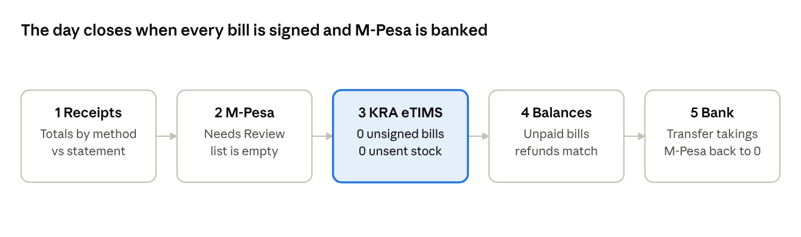
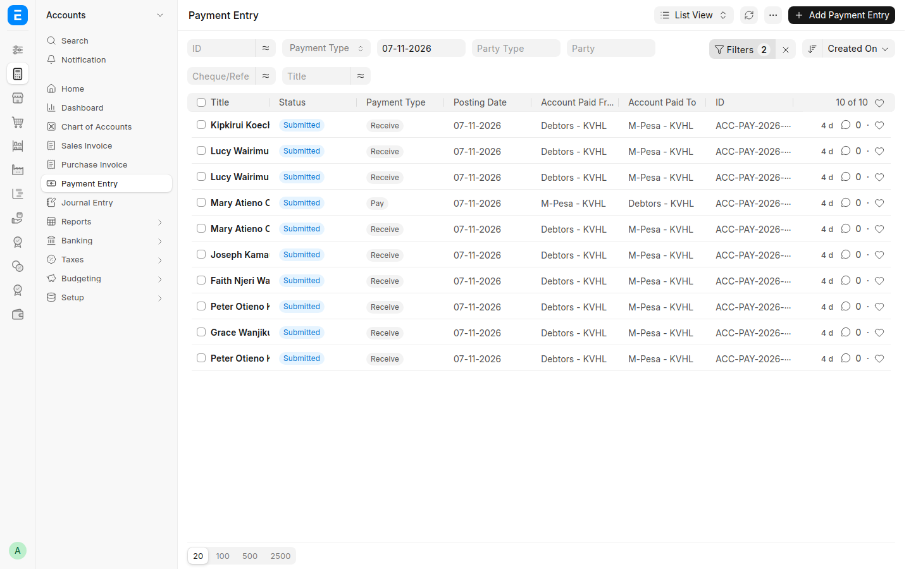
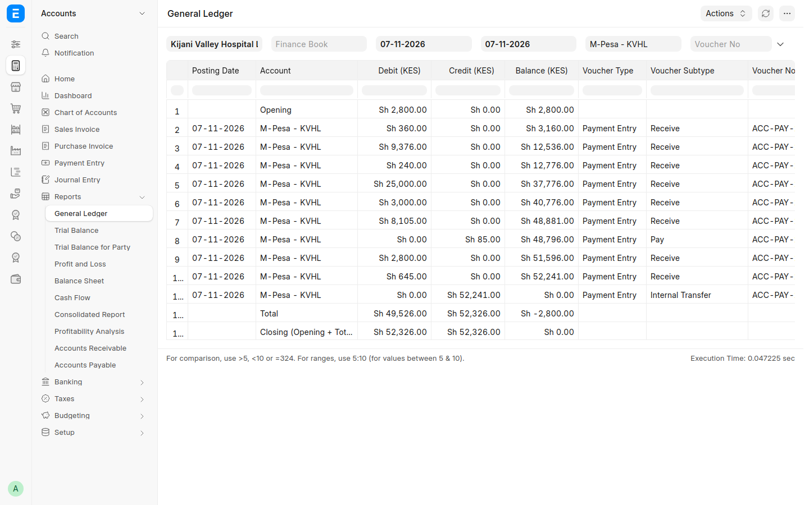
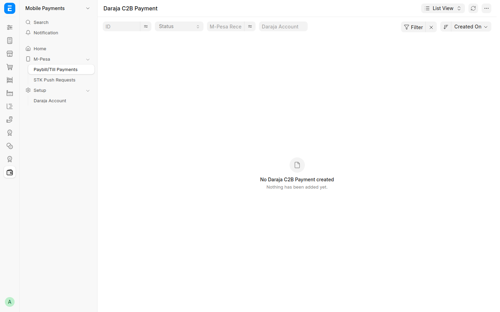
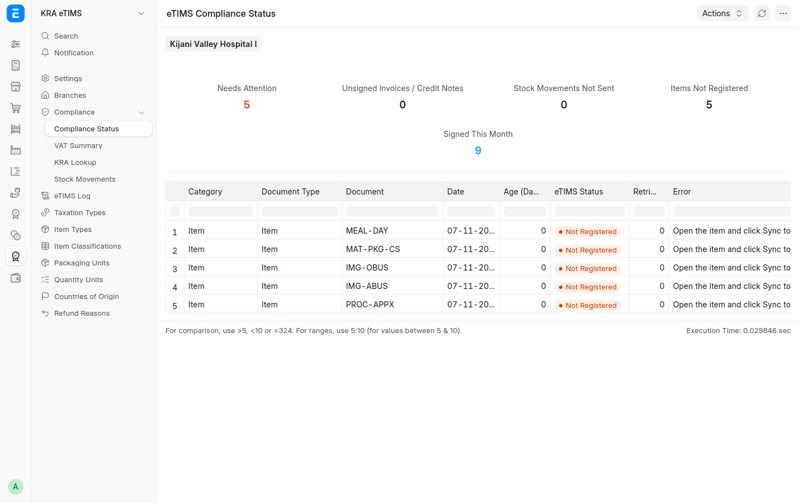
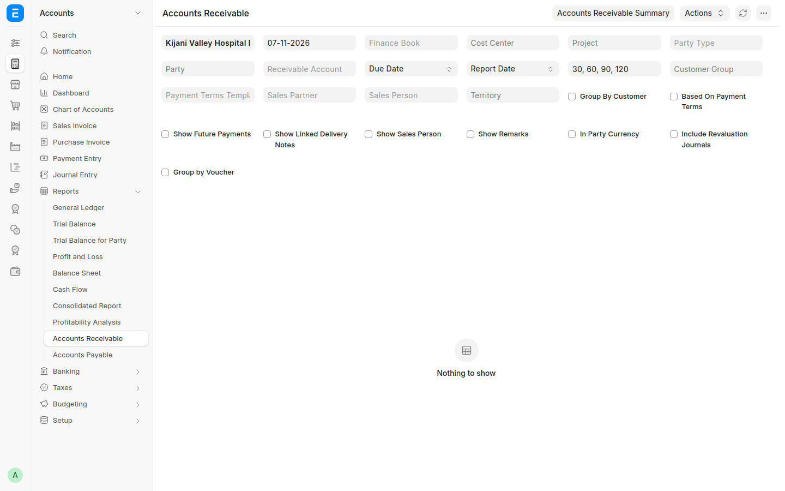
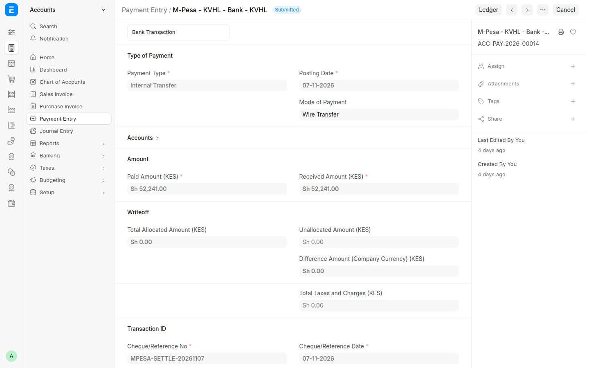

# Cashier Day-End — Step-by-Step Guide

The checks a cashier or accountant runs at the end of each day in RoyceERP Health, so that every shilling received is recorded, every bill is signed by KRA, and the takings reach the bank. Shown on the demo hospital at hospital.royceltd.com.

## At a glance

Run the checks in this order at the end of every day, once the last bills are in.

## Cashier shifts

With *Payments need an open cashier shift* on (Kenya Health Settings › Cashiers), each cashier works in their own shift:

1. **Open:** Kenya Health › Cashier Shift › *+ Add*. Your name and the company fill in. Enter the **Opening Float** (change in the drawer). If you have your own cash drawer account, choose it as **Cash Account**: your cash payments go there. Save.
2. **Take payments** as usual. Each payment (Payment Entry, or payment on the invoice) is recorded on your open shift. Without an open shift, a payment is refused with *Open your cashier shift first*.
3. **Close:** open the shift and press **Refresh Takings**. The table shows, per mode of payment, how many payments and the amount expected (cash includes the float, refunds are taken off). Enter what you **Counted**: the cash in the drawer, and for M-Pesa and cards the statement's total. Any difference shows per line and in total; if there is one, explain it in **Notes**. Press **Close Shift**.

One shift is open per cashier at a time. Managers (Accounts Manager) see every shift and can open one for a cashier; a cashier sees their own. M-Pesa payments confirmed automatically (Paybill/Till) are not on a shift: they are checked in Step 2.

## Step 1 — The day's receipts by payment method

**Who:** cashier or accountant. **Where:** Accounts › Payment Entry, filtered on today's date.

1. Filter **Posting Date** = today and **Mode of Payment** = M-Pesa (then Cash, Card). With shifts on, the closed **Cashier Shift** records give the same per cashier, with their counts.
2. Check each receipt: patient, amount, and *Account Paid To* matching the method (M-Pesa receipts into the M-Pesa account, cash into the cash account).
3. Compare the M-Pesa total with the Safaricom statement for the day, and the cash total with the cash in the drawer.
4. Refunds show as *Pay*; each must match a credit note.

The **General Ledger** for the M-Pesa account (Accounts › Reports › General Ledger, account M-Pesa) gives the same receipts with a running balance.

Demo: 9 M-Pesa receipts and 1 refund of KES 85 on 7 November.

*The day's M-Pesa payment entries, each paid into the M-Pesa account.*

*General Ledger for the M-Pesa account: receipts, the refund, and the transfer to the bank bringing it to zero.*

## Step 2 — M-Pesa: confirmed payments and payments needing review

**Who:** cashier. **Where:** Mobile Payments › M-Pesa › Paybill/Till Payments.

With the hospital's Paybill or Till connected (Mobile Payments › Setup › Daraja Account):

- **Request M-Pesa Payment** on a bill sends a PIN prompt to the patient's phone; the payment is confirmed with Safaricom and posted against the bill.
- Payments patients make straight to the Paybill are confirmed with Safaricom and matched by the account number they typed (bill number or patient).
- Anything unmatched or unconfirmed waits here with status **Needs Review**. At day-end this list should be empty: match each one to its bill.
- A bill cannot be submitted with an M-Pesa amount Safaricom has not confirmed, so M-Pesa cannot be keyed in for money that never arrived.

The demo hospital is not connected to Safaricom, so its M-Pesa receipts were recorded directly and this list is empty.

*Paybill/Till Payments: at day-end nothing should be waiting for review.*

## Step 3 — Every bill signed by KRA eTIMS

**Who:** cashier or accountant. **Where:** KRA eTIMS › Compliance › **Compliance Status**.

1. Check **Unsigned Invoices / Credit Notes** is 0. A bill KRA has not signed is not a valid tax invoice.
2. Check **Stock Movements Not Sent** is 0.
3. Open anything listed under *Needs Attention*: the error says what to fix. Failed sends retry every 15 minutes; **Retry eTIMS** on the bill sends it at once.
4. **Items Not Registered** lists items never registered with KRA. Register one before it is first sold (open the item and sync it).

Demo: 0 unsigned bills and 0 unsent stock movements; 9 bills signed this month. Five items that have not been sold yet are not registered with KRA.

*Compliance Status: no unsigned bills, no unsent stock; five unused items still to register.*

## Step 4 — Unpaid balances and credit notes

**Who:** accountant. **Where:** Accounts › Reports › **Accounts Receivable**.

1. Run the report for today. It lists every bill with money still owed, by patient or insurer, and how many days it is overdue.
2. Follow up patient balances (for example a rejected insurance line billed to the patient) before they leave or by phone.
3. Insurers' balances are followed up through their claims (see the [Insurance guide](04-insurance.md)).
4. Check each credit note issued today has its refund recorded, and each refund has a credit note.

Demo: nothing outstanding — every bill was paid, including Peter's rejected KES 360. The one credit note (ACC-SINV-2026-00007, KES 85) matches the M-Pesa refund in Step 1.

*Accounts Receivable for the day: nothing outstanding.*

## Step 5 — Move the day's takings to the bank

**Who:** accountant. **Where:** Accounts › Payment Entry › *+ Add*, type **Internal Transfer**.

1. When Safaricom settles the M-Pesa balance to the bank (or cash is banked), create an Internal Transfer.
2. **Paid From:** the M-Pesa (or cash) account. **Paid To:** the bank account.
3. Enter the amount and the settlement or deposit slip reference, then submit.
4. The M-Pesa account should come back to zero (or to what Safaricom still holds); the bank account rises by the same amount.

Demo record: ACC-PAY-2026-00014 — KES 52,241 from M-Pesa to Bank, reference MPESA-SETTLE-20261107; the M-Pesa account is back to zero.

*The internal transfer: KES 52,241 from M-Pesa to Bank.*
