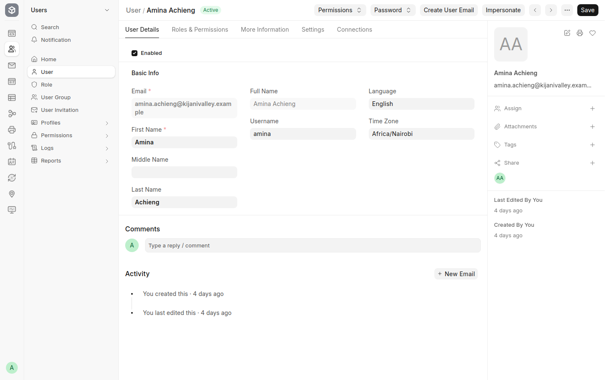
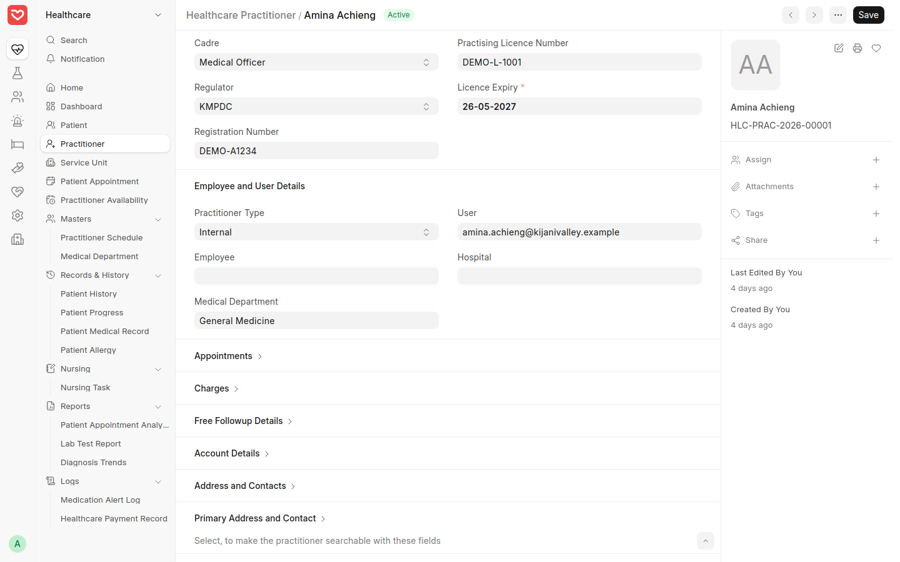
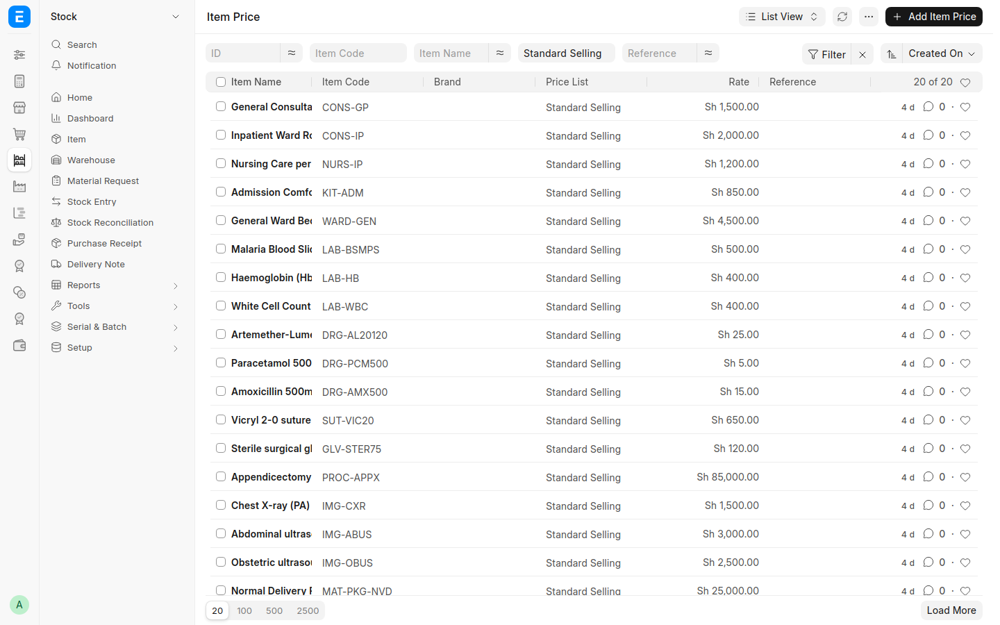
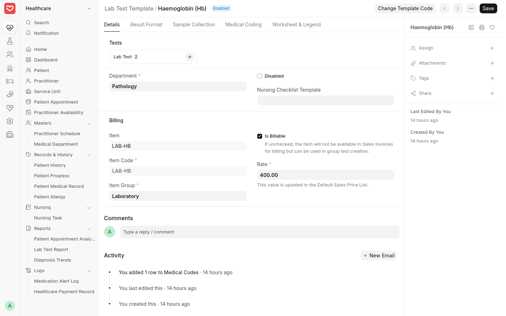
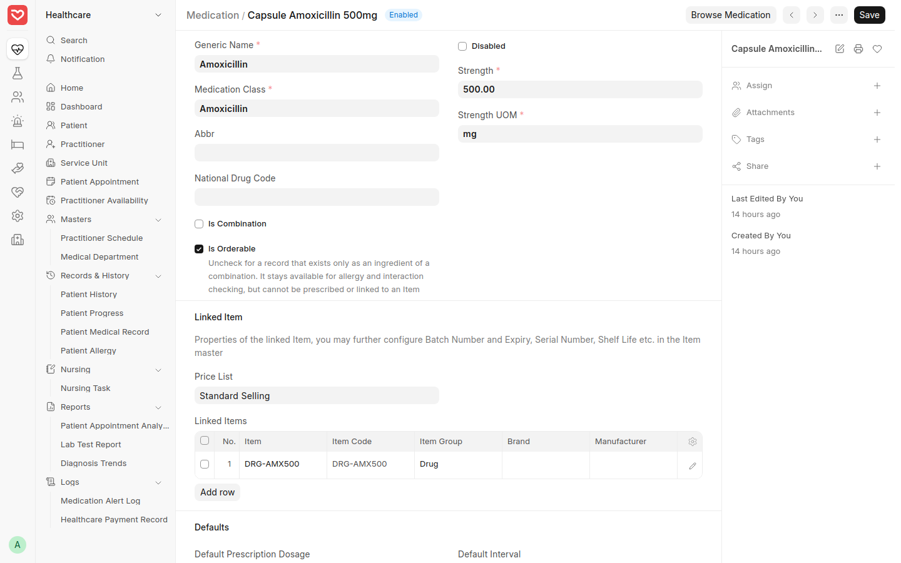
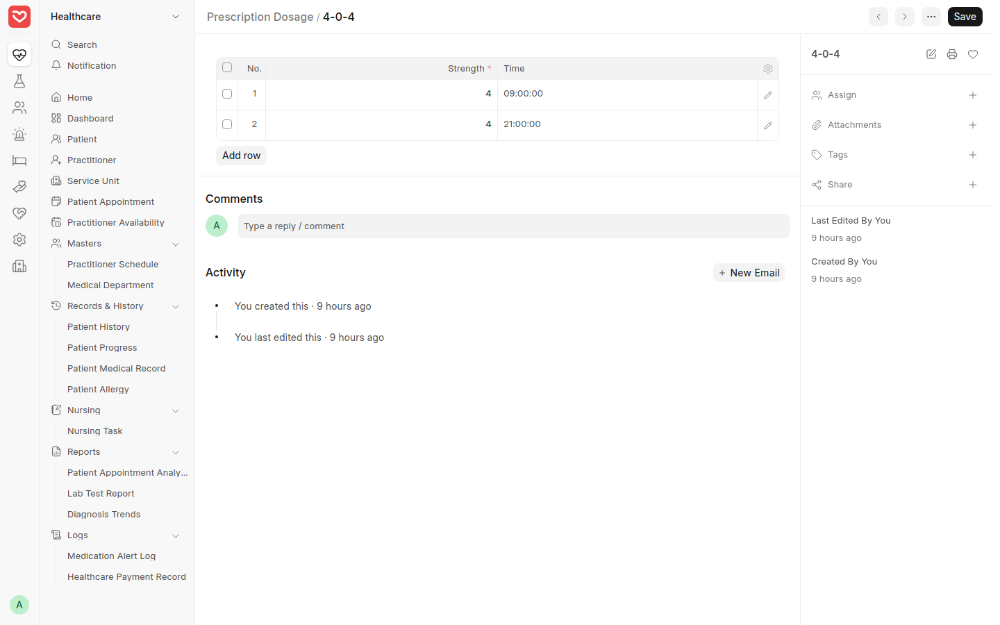
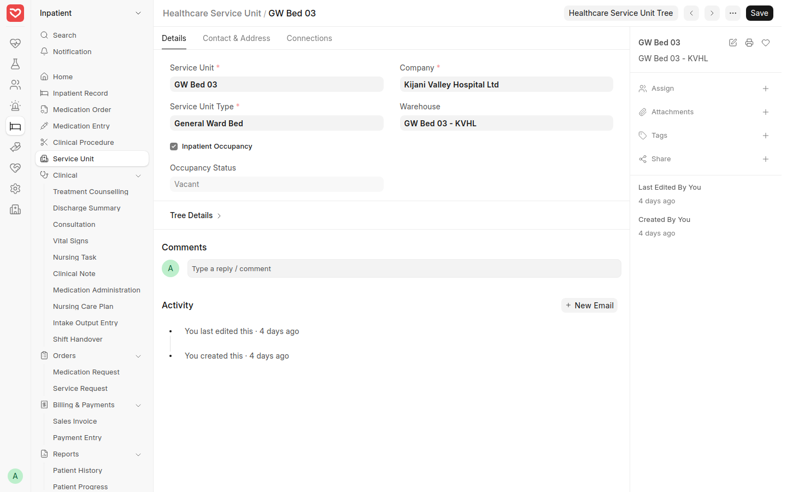
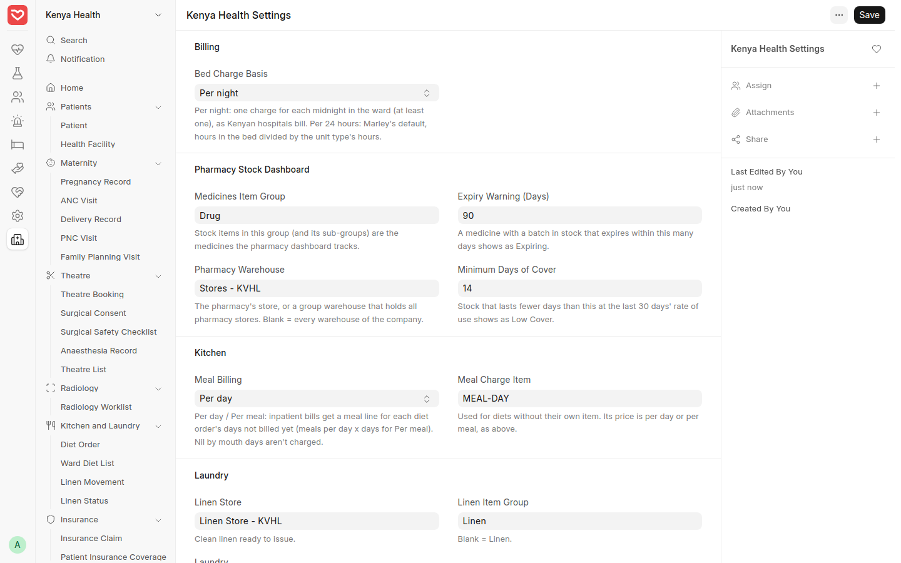

# Administrator Setup — Step-by-Step Guide

What the hospital's system administrator sets up in RoyceERP Health before staff start work, and keeps up to date afterwards. Shown on the demo hospital at hospital.royceltd.com.

## At a glance

Set these up in this order before staff start; each later step uses the ones before it.

| # | What | Where | Done by |
| --- | --- | --- | --- |
| 1 | Staff users and roles | Users › User | Administrator |
| 2 | Practitioners and licences | Healthcare › Practitioner | Administrator, HR |
| 3 | Services and prices | Stock › Item, Item Price | Finance |
| 4 | Lab tests, medicines, dosages | Healthcare › Setup | Lab manager, pharmacist |
| 5 | Wards, beds and their stores | Healthcare › Service Unit | Administrator |
| 6 | Hospital-wide settings | Healthcare Settings, Kenya Health Settings | Administrator |

The company, chart of accounts, VAT, KRA eTIMS and payroll are set up by Royce during installation.

## Step 1 — Staff users and roles

**Where:** Users › User › *+ Add User*.

1. Enter the staff member's work email, first and last name. Untick *Send Welcome Email* if you will hand over the login yourself.
2. On **Roles & Permissions**, tick only the roles the job needs:

| Job | Roles |
| --- | --- |
| Reception | Receptionist (registers and checks in patients, records insurance policies, sees phone and ID numbers) |
| Doctor | Physician (set their login as the **User** on their Healthcare Practitioner record, so their Results Inbox and My Patients open on their own patients) |
| Nurse, midwife | Nursing User |
| Lab technologist | Laboratory User (works from the Lab Worklist: collects samples, enters and validates results, takes walk-in requests) |
| Pharmacist | Pharmacist and Stock User (the Pharmacy Worklist: bills drugs for the Cashier, dispenses, takes returns and counter sales; Stock User for receiving and moving stock) |
| Cashier | Cashier (takes patients' payments, opens and closes their own shift; add Accounts User only if they also do accounts work) |
| Manager who approves services before payment, discounts and waivers | Healthcare Administrator or Accounts Manager |
| Kitchen, laundry | Kitchen User, Laundry User |
| Hospital administrator | Healthcare Administrator |

3. Save, then set a password under **Password** or let the welcome email do it.
4. When someone leaves, untick **Enabled**. A user who has worked in the system can't be deleted (the audit trail keeps their name); disable them instead. For a locum, intern or contract, set **Valid Until**: the account is disabled automatically the day after, and can only be enabled again with a new date.

**Security settings** (applied when RoyceERP Health is installed or updated, only where you haven't set your own): an account is locked for 10 minutes after 5 failed logins, passwords must be strong (score 3), and a login ends after 12 hours without activity (Setup › System Settings). The screen also locks after 10 minutes without activity and the user's password unlocks it, keeping unsaved work (Kenya Health Settings › **Idle Screen Lock (minutes)**; 0 switches it off). **Kenya Health › Setup › Compliance Check** shows each safeguard as *Pass*, *Fail* or *Advice*, live, for you and for auditors.

Roles decide what each person sees: a nurse does not see revenue, only administrators read the patient record access log, and only Receptionist, Healthcare Administrator and System Manager see patients' phone and ID numbers (others see XXXXXXXX). Who sees them can be changed in Role Permissions Manager (the Mask column).

Each cashier needs their own login: payments and shifts are recorded under the person who took them. In **Kenya Health Settings › Cashiers**, *Only cashiers take payments* stops other service points (lab, pharmacy, wards) from receiving money: they can bill, but only users with the Cashier, Accounts Manager or System Manager role can record a payment. *Payments need an open cashier shift* makes each cashier open a shift first (see the [Cashier Day-End guide](07-cashier-day-end.md)). Both are off until you switch them on.

Demo users: *amina.achieng@kijanivalley.example* (Physician) and *nurse.wanjiru@kijanivalley.example* (Nursing User), both fictional.

*A staff user; roles are on the Roles & Permissions tab.*

## Step 2 — Practitioners and their licences

**Where:** Healthcare › Practitioner › *+ Add*.

1. Enter the name, department and **User** (the login from Step 1), so encounters and orders carry the right doctor.
2. In the registration section, enter the **cadre**, **regulator** (KMPDC, NCK, COC, PPB, KMLTTB), registration number, practising licence number and **licence expiry**.
3. Under **Charges**, set the **OP consulting charge item** and fee for every doctor who sees outpatients. Without it the consultation can't be priced, and the visit's bill says so.
4. Add a **Practitioner Schedule** for the days and times they see patients, with their **room** (service unit) on each schedule row. This books appointments, and it decides who is **on duty**: patients sent to Consultation without a doctor are shared out among the doctors whose schedule covers that moment, and sent to the room on the schedule. Keep schedules current; a doctor on leave should have the schedule row removed or the schedule disabled for that time.
5. With more than one facility in a company (Bethesda Main and Kobujoi), give each **Health Facility** its service unit group, and give each reception and triage user a default facility: **User Permission** on *Health Facility* with **Is Default** ticked. Each visit then takes that facility, and only doctors with rooms in it are assigned.

Healthcare Administrators are notified 30, 14, 7 and 1 day before a licence expires, then weekly once it has expired.

Demo record: Dr Amina Achieng, Medical Officer, KMPDC, licence expiring 26 May 2027 (demo numbers).

*The practitioner's cadre, regulator, licence and expiry, linked to their login.*

## Step 3 — Services and prices

**Where:** Stock › Item (each billable service) and Stock › Item Price.

1. Each service the hospital charges for is an **Item**: consultations, lab tests, imaging, procedures, bed per night, nursing, meals. Services are non-stock items; medicines and consumables are stock items.
2. Give each item its **Item Tax Template**: medical services are VAT exempt; taxable goods carry 16%. The KRA eTIMS tab fills in from it.
3. Set the price in **Item Price** on the *Standard Selling* price list (the cash price). Each insurance scheme with its own tariff gets its own price list, which several schemes can share: see *Pricebooks* in the [Insurance guide](04-insurance.md), Step 1.
4. Register new items with KRA eTIMS before they are first sold (the item's KRA eTIMS tab, or the Compliance Status report).

Demo prices: general consultation KES 1,500, haemoglobin KES 400, general ward bed KES 4,500 per night.

### The consultation fee

The consultation fee is an **item** (for example *General Consultation*), and its price comes from the **price list**, like every other service. Which item applies, the first that is set:

| Order | Where | Example |
| --- | --- | --- |
| 1 | The doctor: Healthcare › Practitioner › Charges › *Out Patient Consulting Charge Item* and its amount | A consultant gynaecologist → *Specialist Consultation*, 1,000 |
| 2 | The Service Type: Healthcare › Appointment Type › Billing, a row for the department (or one row for every department) | *Review* → *Review Consultation*; *Gynae clinic* → *Gynae Consultation* |
| 3 | The hospital default: Kenya Health Settings › **Default Consultation Item** | *General Consultation* |

What it costs:

- the item's price on the patient's price list: the cash price list (*Standard Selling*) for a cash patient, the scheme's pricebook for an insured patient;
- unless an amount is typed next to the item: a doctor's own item always has one (the form asks for it), and that amount is used. On a Service Type's row, leave the amount at 0 to use the price list;
- a price of **0** means no fee: for example a free review within a week. Those patients don't stop at the Cashier.

A hospital with one fee for everyone needs only the default item and its price, and leaves the doctors' consultation item empty. To change the fee, change the item's price once (Item Price), not each doctor. Add a clinic fee by giving the Service Type its own item, or a doctor's own fee by giving that doctor an item and amount.

The same rule prices the fee before triage, the visit's bill, **Get Items From › Healthcare Services** on an invoice, and an insured patient's consultation cover. When a cash patient is checked in and no fee can be found, reception sees *No consultation fee* with what is missing, and the patient goes straight to triage. (Inpatient visit charges are set as before, on the doctor and in Healthcare Settings.)

*Item Price on the Standard Selling price list.*

## Step 4 — Lab tests, medicines and dosages

**Lab Test Template** (Healthcare › Setup): one per test the lab runs — its billing item and price, sample type, result lines with units and normal ranges. The lab maps each test to its MOH 706 row.

**Medication** (Healthcare › Setup): one per medicine on the formulary — the stock item it dispenses, strength, dosage form, and whether it is billable. Drug interaction and allergy checks use it when doctors prescribe.

**Prescription Dosage** (Healthcare › Setup): each dosage pattern with its times and tablets per dose. The quantity to dispense and the ward drug chart are worked out from it, so:

- Give every dosage set times, for example *1-1-1* at 09:00, 14:00 and 21:00.
- Add patterns for medicines taken several tablets at a time, for example *4-0-4* for artemether-lumefantrine (4 tablets at 09:00 and 21:00).

Demo records: *Haemoglobin (Hb)* template, *Capsule Amoxicillin 500mg* medication, *4-0-4* dosage.

*A lab test template.*

*A medication on the formulary.*

*The 4-0-4 dosage: 4 tablets at 09:00 and 21:00.*

## Step 5 — Wards, beds and their stores

**Where:** Healthcare › Service Unit (use **Healthcare Service Unit Tree** to see the whole hospital).

1. Build the tree: hospital › wards and departments › rooms and beds. Consultation rooms, labs and theatres are service units too.
2. For each bed, choose its **Service Unit Type** (for example General Ward Bed, which carries the price per night) and tick **Inpatient Occupancy**.
3. Give each bed a **Warehouse**: ward medicines are moved there by the pharmacy and issued from there when a dose is given.
4. On each ward, set the *MOH 717 Ward* category and its linen store.

Demo record: GW Bed 03 in the General Ward, type General Ward Bed, warehouse GW Bed 03 - KVHL.

*A bed: service unit type, inpatient occupancy and its own store.*

## Step 6 — Hospital-wide settings

**Healthcare Settings** (Healthcare › Setup): tick *Manage Inpatient Medication Stock* and *Auto Schedule Medication Doses* so ward doses are tracked bed by bed (see the [Inpatient guide](03-inpatient.md)), and set the inpatient visit charge item.

**Kenya Health Settings** (Kenya Health › Setup):

| Setting | Recommended |
| --- | --- |
| Bed Charge Basis | Per night |
| Medicines Item Group | Drug |
| Pharmacy Warehouse | The pharmacy store |
| Expiry Warning (Days) | 90 |
| Minimum Days of Cover | 14 |
| Meal Billing | Included in bed charge, per day, or per meal |
| Linen Store and Laundry | Your linen stores |
| Fetal heart rate alert limit | 110 (WHO) or 120 if your form says so |
| Patient record access log | On |
| Require full registration details | On |
| Payment before service: consultation fee before triage | On (a cash outpatient pays the consultation fee at the Cashier, then joins the triage list) |
| Default Consultation Item | *General Consultation*, priced on the cash price list (see Step 3) |
| Payment before service: laboratory, radiology, pharmacy | On (cash patients pay first and their requests reach the worklists once paid; insured, inpatient and casualty are served first) |
| Payment: waiver account | An expense account such as "Patient Waivers" (blank: the company's write-off account) |
| Pharmacy: customer for walk-in counter sales | Blank (a customer named *Walk-in Customer* is made the first time) |
| Laboratory: requesting doctor for walk-ins | The lab's medical officer in charge |
| Laboratory: a second person validates results | Off (whoever entered the results validates them), until the lab wants a second check |
| Consultation: observation before requests | On: Chief Complaint, History of Presenting Illness and Physical Examination are filled before the doctor sends requests or prescribes (not for casualty or inpatients). Tick Review of Systems too if the hospital wants it |
| Consultation: submitting triage vital signs sends the patient to the doctor | On: saving vital signs marks the patient seen at Triage; submitting them sends the patient to the Doctor's Queue |
| Billing: draft bill for cash patients automatically | On: the consultation fee (at check-in) and the doctor's lab, imaging and procedure requests go on the visit's draft bill; the cashier checks it and takes the payment |

Save the page once after installation, even if you change nothing, so every default is stored. Since v0.35.1 an update no longer switches back on a setting you turned off.

**Forms laid out for the hospital** (set once at installation; Customize Form can change them afterwards, and an update leaves your changes alone):

- **Patient:** one contact number (*Mobile*); *Phone* is hidden.
- **Vital Signs:** height is entered in centimetres.
- **Consultation:** tabs in the order *Patient, Observation, Requests, Results, Diagnosis, Prescription, Complete*; symptoms, appointment type and source are hidden (taken at reception).
- **Sales Invoice payments:** *Reference No* (the M-Pesa or card code) is a column of the payments table.
- **Consultation requests:** the lab requests table shows a **Lab Test** column and an **Imaging** column (imaging exams only). Lab tests are set up as *Lab Test Templates*; an *Observation Template* is for imaging (category *Imaging*). A lab test set up as an Observation Template is refused when ordered, because no worklist picks it up.
- **Patient:** *Invite as User* (a patient portal login) starts unticked.
- **Patient Visit:** company, facility, date, arrival time, doctor, room and appointment are under **More Details** (collapsed): they fill in by themselves.
- **Who may do what:** each role's access is fixed in a role matrix (`royce_health_ke/role_access.py`). Only Reception and the Healthcare Administrator edit a patient's registration; doctors, nurses, the lab and the pharmacy read it. Reception and the Cashier see no consultation, diagnosis or result. The **Compliance Check** row *Each role has only the access the hospital's role matrix gives it* fails, naming the role, if a role is given more in Role Permissions Manager.
- **Registration SMS:** Healthcare Settings › *Patient Registration* SMS goes through Frappe's SMS Settings, not RoyceTalk. It is switched off at each update while no SMS gateway is set there, so saving a patient no longer shows "Please Update SMS Settings".

*Kenya Health Settings: bed charges, pharmacy, kitchen and laundry.*
