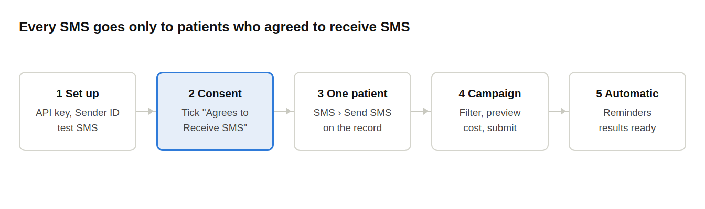
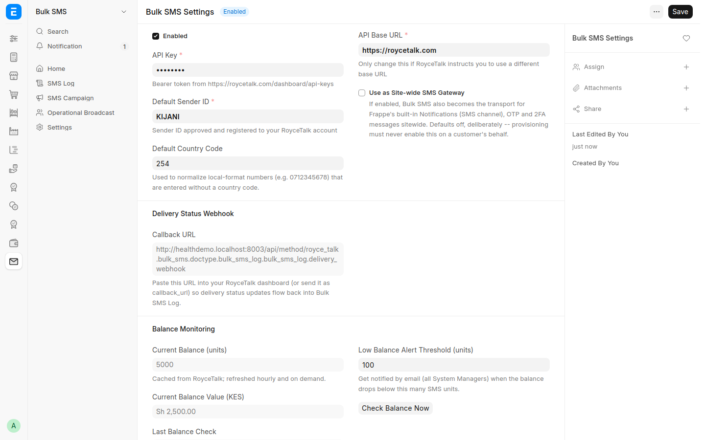
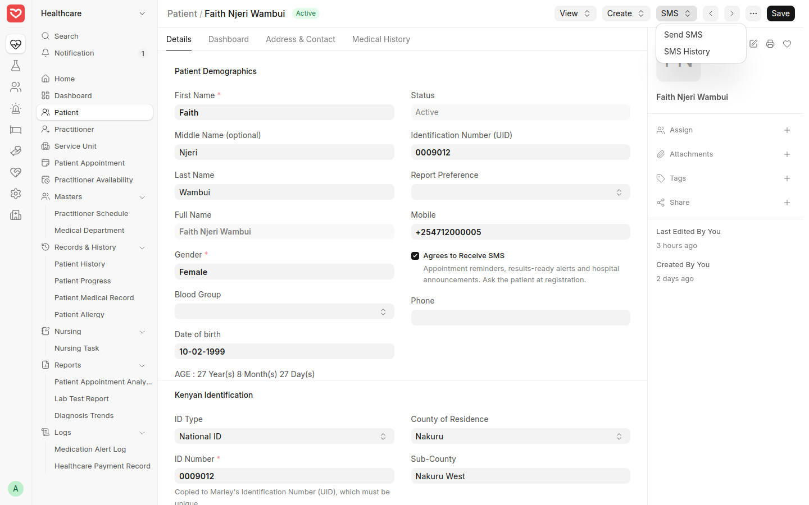
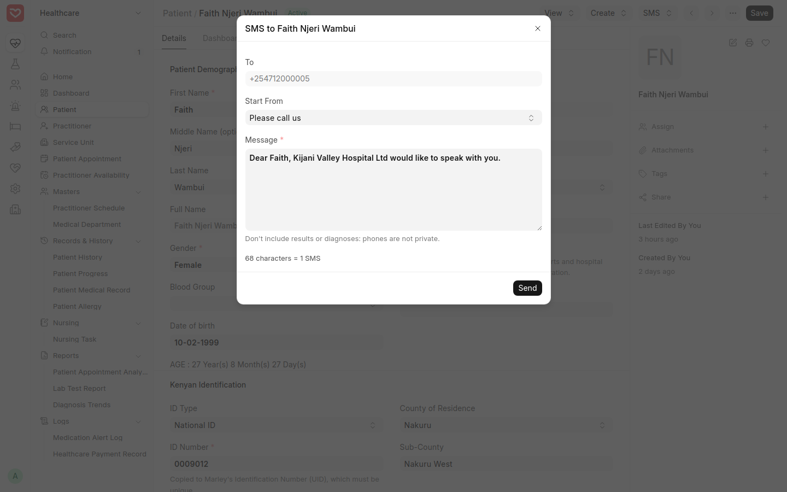
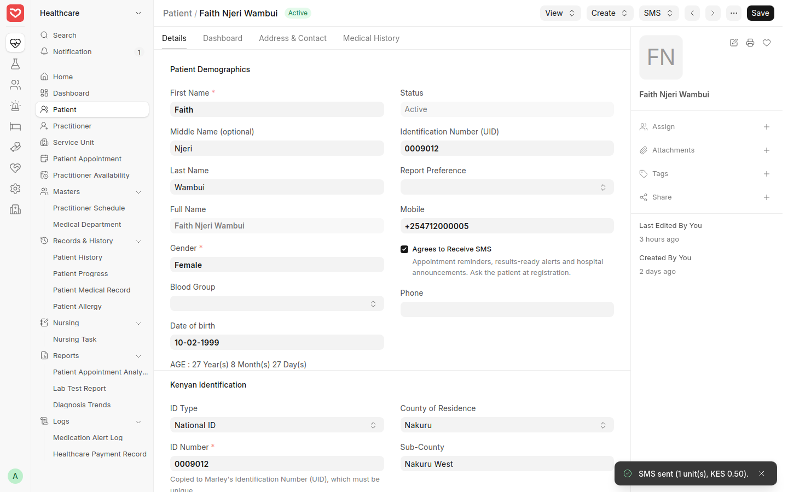
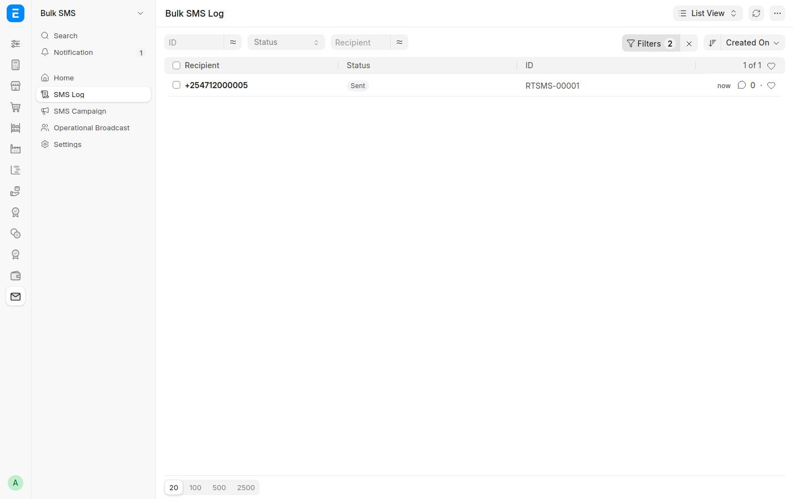
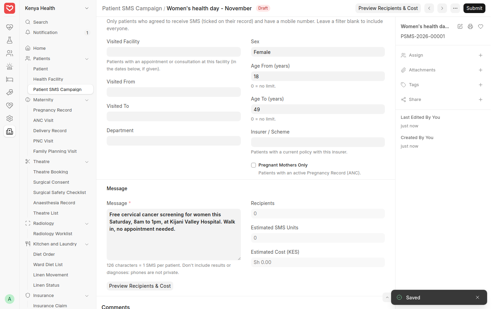
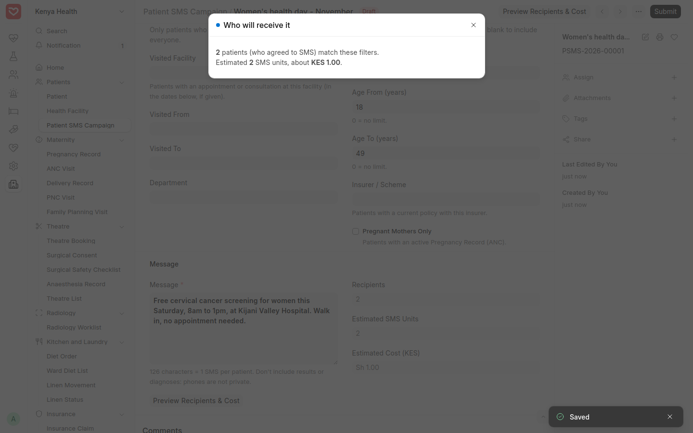
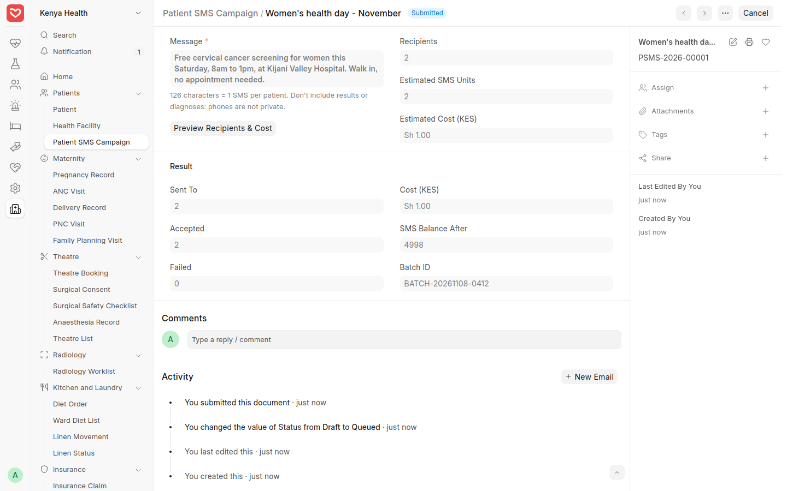
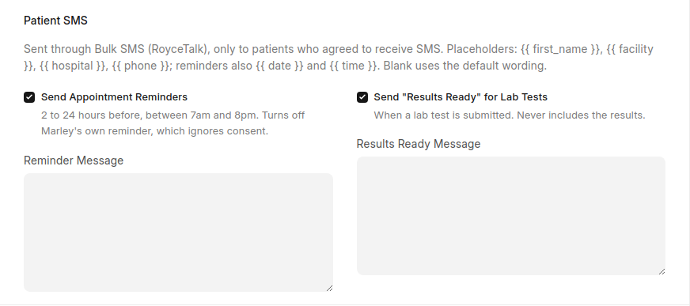

# Patient SMS — Step-by-Step Guide

How to send SMS to patients from RoyceERP Health: one message to one patient, a campaign to a group of patients, and the automatic appointment reminders and "results ready" messages. Messages go out through **Bulk SMS** (RoyceTalk) and are paid for from the hospital's RoyceTalk SMS balance.

Shown on the demo hospital (Kijani Valley Hospital Ltd, fictional). The demo is connected to a test SMS service, so the costs and balances in the screenshots are examples, not RoyceTalk's prices.

## At a glance

| You want to... | Use |
| --- | --- |
| Tell one patient something (call us, results ready, medicine ready) | Patient › **SMS › Send SMS** (Step 3) |
| Reach a group (all women 18–49, ANC mothers, patients of one insurer, everyone seen at Kobujoi last month) | **Patient SMS Campaign** (Step 4) |
| Remind patients of tomorrow's appointments, or tell them lab results are ready | Switch on once in **Kenya Health Settings** (Step 5) |

**Privacy rule for everyone:** never put results, diagnoses or medicines for sensitive conditions in an SMS. A phone screen is not private, and Kenya's Data Protection Act treats health information as sensitive. Ask the patient to come in or call instead.

## Step 1 — Connect the SMS account (once)

**Who:** system administrator. **Where:** Bulk SMS › Settings (**Bulk SMS Settings**).

1. Tick **Enabled**.
2. **API Key**: paste the key from the RoyceTalk dashboard (roycetalk.com › API keys). It is stored encrypted and shows as dots.
3. **Default Sender ID**: the name patients see as the sender, for example *BETHESDA*. It must be approved and registered on your RoyceTalk account.
4. **Default Country Code**: 254, so numbers typed as 07... are sent correctly.
5. Save. Then enter your own number in **Test Phone Number** and click **Send Test SMS**. You should receive it within a minute.
6. **Check Balance Now** shows the SMS units left. Set **Low Balance Alert Threshold**: System Managers get an email when the balance falls below it.

Leave **Use as Site-wide SMS Gateway** off unless you also want system messages (for example login codes) sent by SMS.

*Bulk SMS Settings: enabled, the API key hidden, Sender ID and the current balance.*

## Step 2 — Record the patient's consent

**Who:** reception, at registration (and whenever a patient changes their mind). **Where:** Healthcare › Patient.

1. Make sure **Mobile** is the patient's own number.
2. Ask: *"May we send you SMS for appointment reminders, results-ready alerts and hospital announcements?"*
3. If yes, tick **Agrees to Receive SMS** and save. If no, or if they later ask to stop, leave it unticked.

Campaigns and the automatic messages **skip every patient without this tick**. A new patient is unticked until someone asks.

Demo: Faith Njeri Wambui has a mobile number and has agreed to receive SMS.

*The patient record: "Agrees to Receive SMS" under the mobile number, and the SMS menu at the top.*

## Step 3 — Send an SMS to one patient

**Who:** reception, nurses, lab, pharmacy, cashier (anyone who can edit the patient). **Where:** open the patient › **SMS › Send SMS**.

1. Open the patient and click **SMS › Send SMS**. The dialog shows the number it will go to.
2. Pick a starting point in **Start From** (Please call us, Results ready, Missed appointment, Medicine ready), or type your own message. The wording uses the patient's first name and the hospital's name, and you can edit it.
3. Watch the count under the message: up to 160 characters is 1 SMS; longer messages cost 2 or more.
4. Click **Send**. A green note confirms it was sent and what it cost.

If the patient has not agreed to receive SMS, the dialog warns you first. You can still send a message about their own care, such as asking them to call.

*Send SMS to Faith Njeri Wambui: number, "Please call us" wording, and the character count.*

*Sent: the note at the bottom right shows the SMS units used and the cost.*

**SMS › SMS History** on the patient lists every SMS sent to them, with its status (Sent, Delivered or Failed). Open a line to see the message, cost and any error.

*SMS History for Faith Njeri Wambui.*

## Step 4 — Send a campaign to a group of patients

**Who:** hospital administrator, health promotion or marketing officer. **Where:** Kenya Health › Patients › **Patient SMS Campaign** › New.

1. **Title**: for your own reference, for example *Women's health day - November*. Patients don't see it.
2. **Who Receives It**: fill only the filters you need. Blank means "everyone".
   - **Visited Facility**, **Visited From / To**, **Department**: patients with an appointment or consultation there, in those dates.
   - **Sex**, **Age From / To**: 0 means no limit.
   - **Insurer / Scheme**: patients with a current policy with that insurer.
   - **Pregnant Mothers Only**: patients with an active pregnancy record (ANC).
3. **Message**: type it. The count shows how many SMS each patient costs.
4. **Send At** (optional): schedule it, for example for 8am tomorrow. Blank sends as soon as you submit.
5. Save, then click **Preview Recipients & Cost**: it shows how many patients match (only those who agreed to SMS) and the estimated cost. Adjust the filters and preview again until it is right.
6. Click **Submit** and confirm. The system checks your SMS balance first and refuses if the balance is too low. Then it sends in the background.

Demo: *Women's health day - November*, female patients aged 18 to 49: 2 patients, 1 SMS each.

*Campaign: female patients aged 18–49, and the message (126 characters = 1 SMS).*

*Preview: 2 patients who agreed to SMS match, about KES 1.00.*

After a minute, reopen the campaign. **Status** changes to *Completed* and the **Result** section shows how many were accepted and failed, the cost, the SMS balance left and RoyceTalk's batch number. If it says *Failed*, the **Errors** box says why. The usual causes are a wrong API key or no balance: fix Bulk SMS Settings, then **Cancel** the campaign and **Amend** it to send again.

*Result: sent to 2, accepted 2, failed 0, cost KES 1.00.*

## Step 5 — Automatic reminders and "results ready"

**Who:** system administrator, once. **Where:** Kenya Health › Setup › **Kenya Health Settings** › Patient SMS.

- **Send Appointment Reminders**: each patient with an appointment in the next 2 to 24 hours gets one reminder, sent between 7am and 8pm only, so nobody gets a message at night. Cancelled and no-show appointments are skipped.
- **Send "Results Ready" for Lab Tests**: when a lab test is submitted, the patient is told the results are ready and to see their clinician. The results themselves are never in the SMS.
- Leave the message boxes blank to use the standard wording, or write your own using these placeholders: `{{ first_name }}`, `{{ facility }}` (for example *Bethesda Kobujoi*), `{{ hospital }}`, `{{ phone }}`, and for reminders `{{ date }}` and `{{ time }}`.

Standard reminder: *"Dear Faith, this is a reminder of your appointment at Bethesda Main on Mon 9 Nov at 10:00. To reschedule, call 0725 932 397."*

Both go only to patients who agreed to SMS. Each message is listed in **Bulk SMS › SMS Log** against its appointment or lab test.

*Kenya Health Settings › Patient SMS: reminders and results-ready messages switched on.*

## Costs and balance

- Each SMS of up to 160 characters is 1 unit; 161–306 characters is 2 units; longer messages use 1 unit per 153 characters.
- Top up the RoyceTalk account before it runs out: campaigns are refused when the balance is too low, and single messages and reminders fail.
- **Bulk SMS** › Home shows SMS sent, spend and failures this month.

## Questions

**A patient says they didn't get the SMS.** Open their **SMS History**. *Failed* shows the reason (often a wrong or landline number). *Sent* but not *Delivered* usually means the phone was off or out of network. Reminders and results messages are in **Bulk SMS › SMS Log**, not on the patient's SMS History.

**A patient asks us to stop.** Untick **Agrees to Receive SMS** on their record. They will be left out of campaigns and automatic messages from that moment.

**Can patients reply?** No. The Sender ID can't receive replies, so always include the hospital's phone number when you want them to respond.
