# Theatre Workflow — Step-by-Step Guide

How RoyceERP Health takes a patient through theatre, from the booking to the return to the ward, using the hospital's own paper forms:

- Consent for Operation
- Theatre pre- and post-operative checklist
- WHO Surgical Safety Checklist
- Swab and instrument count
- GOK/KSA Anaesthesia Record and monitoring chart
- Operation notes and the inpatient continuation sheet
- Treatment sheet (post-operative drug orders)

Shown on the demo hospital at hospital.royceltd.com.

## At a glance

| Step | Who | Record | Must be done before |
| --- | --- | --- | --- |
| 1 Book the operation | Theatre in-charge, surgeon | Theatre Booking | — |
| 2 Consent | Surgeon | Surgical Consent | Into Theatre |
| 3 Ward preparation and handover | Ward nurse, theatre nurse | Surgical Safety Checklist › Ward Preparation | Into Theatre (except emergencies) |
| 4 Pre-anaesthetic assessment | Anaesthetist | Anaesthesia Record › Pre-op Assessment | — |
| 5 Sign In, then Into Theatre | Anaesthetist, theatre nurse | Checklist › WHO Checklist | Into Theatre |
| 6 Time Out, anaesthesia chart | Whole team, anaesthetist | Checklist, Anaesthesia Record | Complete |
| 7 Counts and Sign Out | Scrub and circulating nurses | Checklist › Counts, Sign Out | Complete |
| 8 Operation note, Complete | Surgeon | Operation Note (Clinical Procedure) | Complete |
| 9 Recovery and return to the ward | Recovery nurse, ward nurse | Checklist › Post-operative, Anaesthesia Record › Recovery | — |
| 10 Progress notes (continuation sheet) | Surgeon, theatre and recovery nurses | Theatre Booking › Continuation Notes | — |
| 11 Post-operative treatment sheet | Surgeon or anaesthetist | Treatment Sheet | — |

In the demo, follow *Daniel Mutua Kioko* (fictional): an emergency open appendicectomy on 7 November 2026, booking THB-2026-00001.

Every step is in **Kenya Health › Theatre** on the left menu. From a booking, the **Records** button opens the consent, checklist, anaesthesia record and operation note that belong to it, or starts the ones not yet written.

## Step 1 — Book the operation

**Who:** theatre in-charge or surgeon. **Where:** Kenya Health › Theatre › Theatre Booking › *+ Add*.

1. Choose the patient and the procedure. If the patient is admitted, choose their inpatient record.
2. Choose the priority: Elective, Urgent or Emergency.
3. Choose the theatre, the start time and the duration. The duration comes from the procedure when left empty, and the end time is worked out.
4. Choose the surgeon, assistant and anaesthetist, and type the scrub nurse.
5. For an insured patient, set **Pre-authorisation** to Pending, Approved or Declined, and add the insurer's reference.
6. Save.

A booking is refused if it clashes with another open booking in the same theatre, or for the same surgeon, anaesthetist or patient. The message names the other booking.

**Kenya Health › Theatre › Theatre List** shows the day's operations by theatre.

Demo record: THB-2026-00001, Main Theatre, 7 November 2026 09:00, 60 minutes, Dr Brian Kiprotich and Dr Halima Abdi.

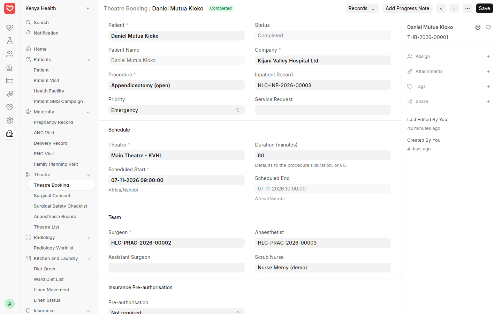

*The theatre booking: patient, procedure, priority, theatre, time and team.*

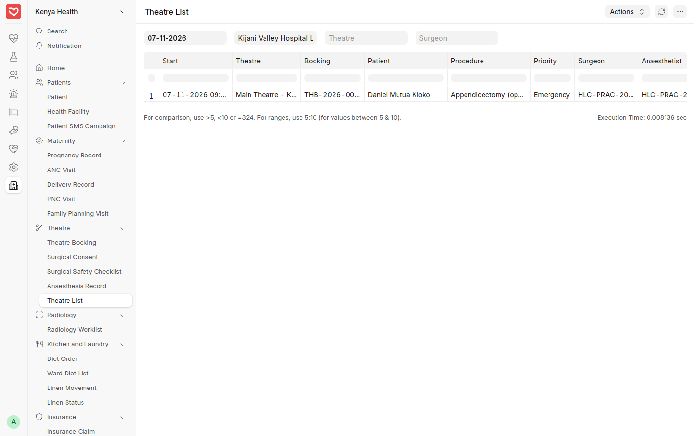

*The theatre list for the day.*

## Step 2 — Consent for operation

**Who:** the surgeon. **Where:** on the booking, *Records › Record Consent*.

1. The patient and procedure come from the booking.
2. Write what was explained: the operation and its benefit, the risks, and the alternatives.
3. Tick what the patient agrees to: the anaesthetic, a blood transfusion if needed, and further procedures found necessary during the operation.
4. Say who is consenting: the patient, or a relative or guardian with their relationship and why the patient is not signing.
5. Add the witness, and the interpreter or language if one was used.
6. Print **Consent for Operation**. The patient (or relative), the doctor and the witness sign it. A patient who cannot sign leaves a thumbprint.
7. Attach the scan of the signed form under **Signed Form (scan)** and submit.

The printed form uses the hospital's own wording: *"I, … of P.O. Box …, hereby consent to Dr … performing the operation of …"*.

Demo record: CONS-2026-00001.

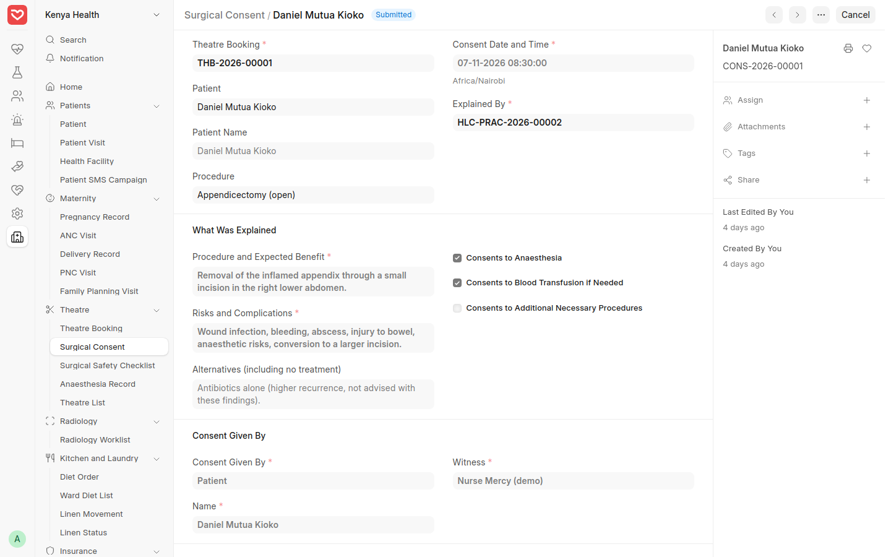

*The consent record.*

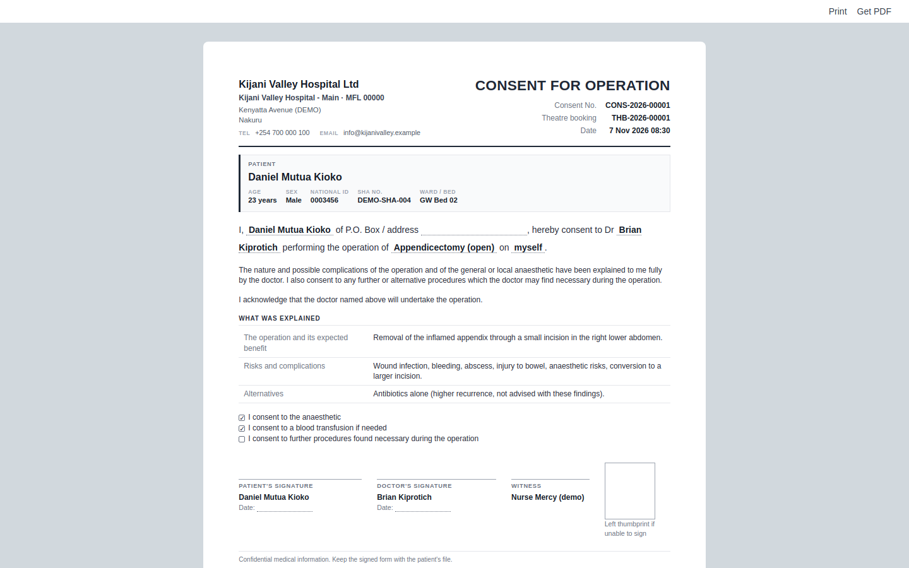

*The printed Consent for Operation, ready to sign.*

## Step 3 — Ward preparation and handover

**Who:** the ward nurse prepares the patient; the theatre nurse receives them. **Where:** on the booking, *Records › Start Safety Checklist*, tab **Ward Preparation**.

This is the paper theatre pre-operative checklist. One checklist per operation holds the ward preparation, the WHO checklist, the counts and the post-operative checklist.

1. **Ward** fills in from the patient's bed. **Consent for operation signed** ticks itself once the consent is submitted.
2. Tick or answer each preparation item:
   - identification band and theatre gown
   - shaving and bath
   - jewellery, wigs and hairpins removed, nail varnish removed
   - dentures and artificial limb
   - fasting and the time of the last feed
   - IV line, catheter and nasogastric tube
3. **Investigations and blood:**
   - full haemogram, UEC, serology and X-ray
   - blood group, cross-match and units of blood available
4. **Observations and pre-medication:**
   - BP, temperature, pulse, respiration and the fetal heart rate for a mother
   - pre-medication, when it was given and by whom
5. **Handover:**
   - who prepared the patient
   - who handed them over to theatre
   - who received them in theatre
6. Save. When the key items are answered, Ward Preparation turns **Done** and the handover times are stamped. The key items are consent, ID band, gown, jewellery, dentures, fasting and the three names.

A planned operation cannot go into theatre until Ward Preparation is Done. An emergency can, with a warning.

Demo record: SSC-2026-00001.

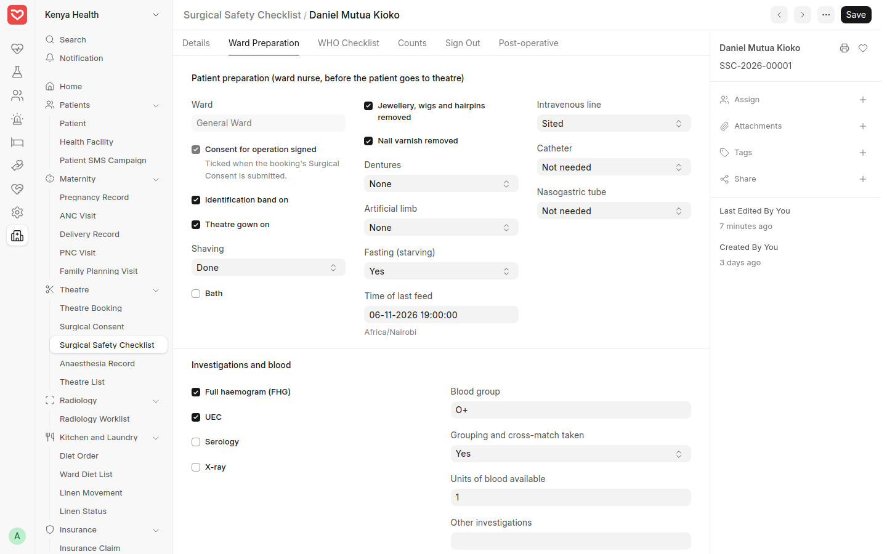

*Ward preparation on the Surgical Safety Checklist.*

## Step 4 — Pre-anaesthetic assessment

**Who:** the anaesthetist. **Where:** on the booking, *Records › Anaesthesia Record*, tab **Pre-op Assessment**.

This follows page 1 of the GOK/KSA Anaesthesia Record.

1. Pre-operative diagnosis, weight and height, history of the presenting illness and other significant history. Record smoking, alcohol and other drug use.
2. **Examination:**
   - heart rate, BP, respiratory rate and SpO2
   - pallor and cyanosis
   - GCS: enter E, M and V and the total is worked out
3. **Systems review:** the 24 conditions on the form, grouped by system (cardiovascular, respiratory, endocrine, neurological, renal and hepatic, others). They are listed for you; answer Yes or No and add a comment where needed.
4. **Airway:** loose teeth, dentures, anatomical abnormalities and Mallampati class.
5. **Medication and allergies:** current medication and steroid use. Allergies come from the patient's file.
6. **Lab results:** Hb, Hct, platelets, WBC, PT, INR and APTT fill in from the patient's lab results in the last 30 days. Press **Fetch Lab Results** to refresh them after a new result. Record renal, liver, glucose and sickling results, and the chest X-ray, ECG, echo and any other tests. Write the positive findings and recommendations.
7. **ASA class** (I–VI), tick E for an emergency, confirm fasting, and write the pre-operative orders.

Demo record: ANR-2026-00001, ASA I E, GCS 15.

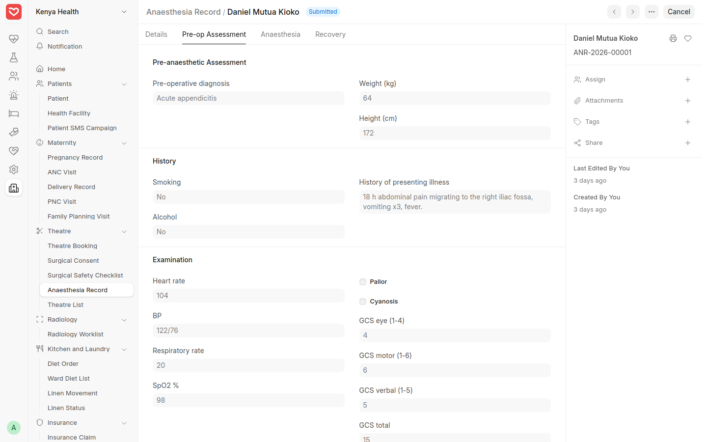

*The pre-anaesthetic assessment.*

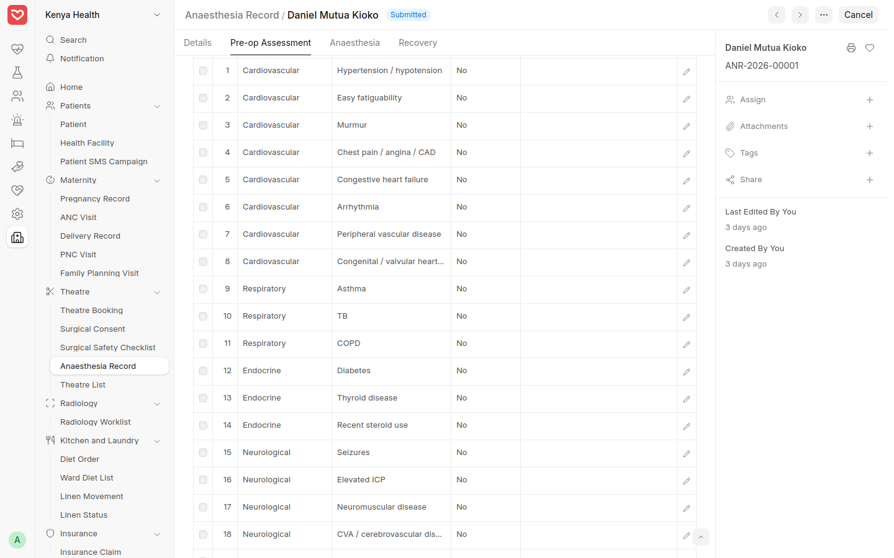

*The systems review, one line per condition on the KSA form.*

## Step 5 — Sign In, then into theatre

**Who:** anaesthetist and theatre nurse, before induction. **Where:** Surgical Safety Checklist, tab **WHO Checklist**, section **Sign In**.

1. Answer each Sign In item:
   - identity, site, procedure and consent confirmed
   - site marked
   - anaesthesia machine and medication check
   - pulse oximeter on and working
   - known allergy
   - difficult airway or aspiration risk
   - risk of more than 500 ml blood loss
2. Enter who did the Sign In and save. Sign In turns Done and its time is stamped.
3. On the booking, press **Into Theatre**.

**Into Theatre** checks that:

- the consent is submitted
- Ward Preparation is Done; an emergency may go in without it, with a warning
- Sign In is Done
- pre-authorisation is not Declined, and not Pending; an emergency may go in while it is Pending
- the theatre store has the procedure's consumables

The booking turns **In Theatre**, and the operation note (a Clinical Procedure) is created.

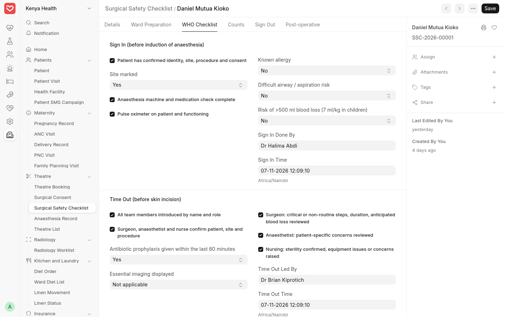

*Sign In and Time Out, each stamped with who did it and when.*

## Step 6 — Time Out and the anaesthesia chart

**Who:** the whole team before the skin incision; the anaesthetist throughout. **Where:** checklist tab **WHO Checklist**, section **Time Out**; Anaesthesia Record tab **Anaesthesia**.

1. **Time Out:**
   - team introduced, and patient, site and procedure confirmed
   - antibiotic in the last 60 minutes and essential imaging displayed
   - the surgeon's, anaesthetist's and nurses' concerns reviewed
2. Time Out can only be done after Sign In, and Sign Out only after Time Out.
3. On the Anaesthesia Record, record:
   - type of anaesthesia, airway and E.T.T. size, and position
   - pre-medication and when it was given, induction and maintenance agents
   - start and end of anaesthesia, and start and end of surgery. The end cannot be before the start.
4. Add each drug with its time, dose and route. Add a monitoring row for each check: pulse, BP, SpO2, EtCO2, temperature and remarks.
5. Record IV fluids, blood loss, urine output, blood transfused and any anaesthetic complications.

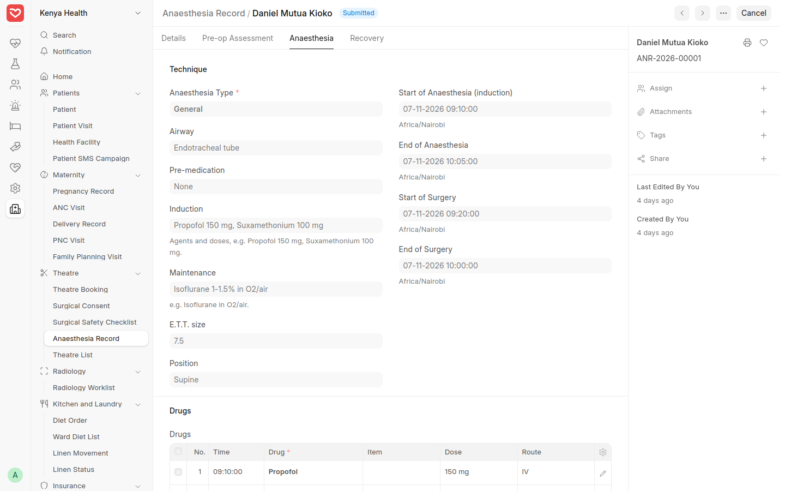

*The anaesthetic chart: technique, agents and times, then drugs and monitoring.*

## Step 7 — Counts and Sign Out

**Who:** scrub nurse and circulating nurse. **Where:** checklist tabs **Counts** and **Sign Out**.

1. The count table starts with abdominal packs, gauze swabs, instrument set, blades and needles. Add any other item with **Add row**.
2. Enter the **start** count, anything **added** during the operation, and the **end** count. Each line shows *Correct*, *Missing 2* or *1 extra*.
3. Name the scrub nurse and the circulating nurse.
4. On **Sign Out**, record:
   - procedure name recorded
   - counts correct
   - specimen labelled
   - recovery concerns reviewed
   - any equipment problems
   - who did the Sign Out

**Counts correct** cannot be confirmed while any line does not balance (end = start + added), or while either nurse is not named. The message lists the lines that are out.

Demo: 10 gauze swabs at the start, 5 added, 15 at the end: Correct.

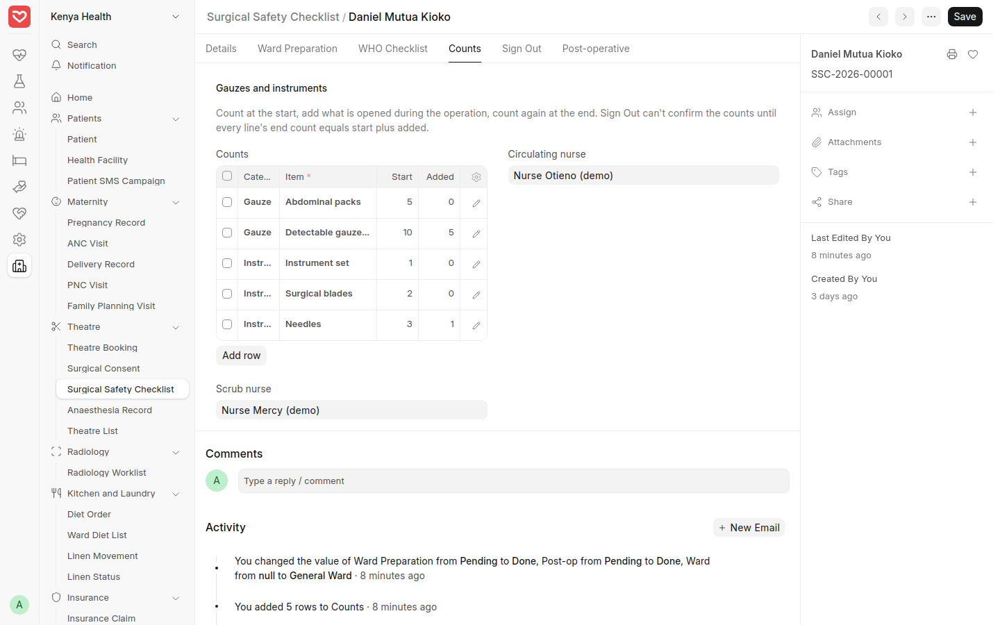

*The swab and instrument count.*

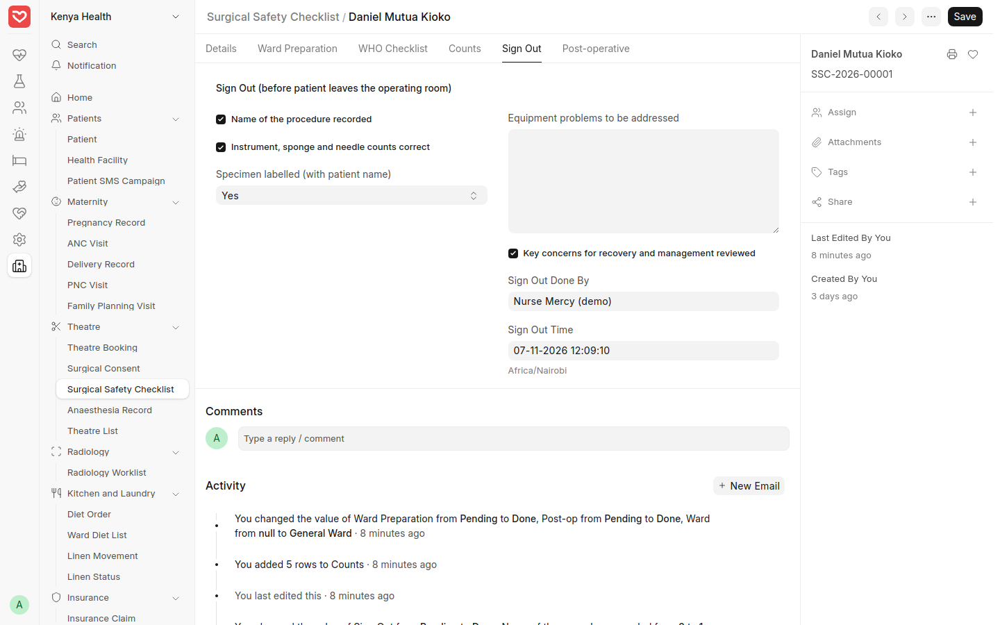

*Sign Out, after the counts balance.*

## Step 8 — Operation note and Complete

**Who:** the surgeon. **Where:** on the booking, *Records › Operation Note*.

1. Write the indication, findings and **incision**.
2. Write the **Procedure Details**: the steps and the closure. The booking cannot be completed without them.
3. Record specimens sent, implants or drains, complications and post-operative instructions.
4. On the booking, press **Complete**. It needs Time Out, Sign Out and the procedure details. Completing completes the procedure, which issues its consumables from the theatre store.

The printed **Operation Note** also shows the team, the anaesthesia type and agents, ASA and airway from the anaesthesia record.

Demo record: HLC-CPR-2026-00001.

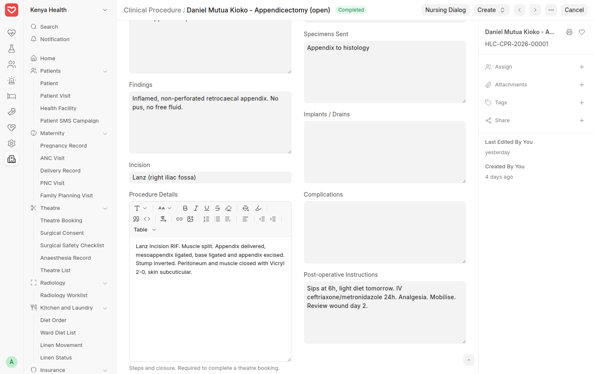

*The operation note: findings, incision, procedure details, specimens and instructions.*

## Step 9 — Recovery and back to the ward

**Who:** recovery nurse, then the ward nurse. **Where:** checklist tab **Post-operative**; Anaesthesia Record tab **Recovery**.

1. On the checklist, record the patient before they leave recovery:
   - observations: BP, temperature, pulse, respiration, SpO2, blood loss and level of consciousness
   - drains, pain, oxygen, vomiting, catheter and dressing
   - analgesia, infusions, NG tube and post-operative drugs
   - investigations ordered, and remarks
2. Enter who handed the patient over and who received them back in the ward, and save. **Post-op** turns Done and the time back in the ward is stamped. It can only be done after Sign Out.
3. On the Anaesthesia Record, record the Aldrete score, the time of discharge from recovery, recovery notes and the post-operative instructions for the ward, then submit.

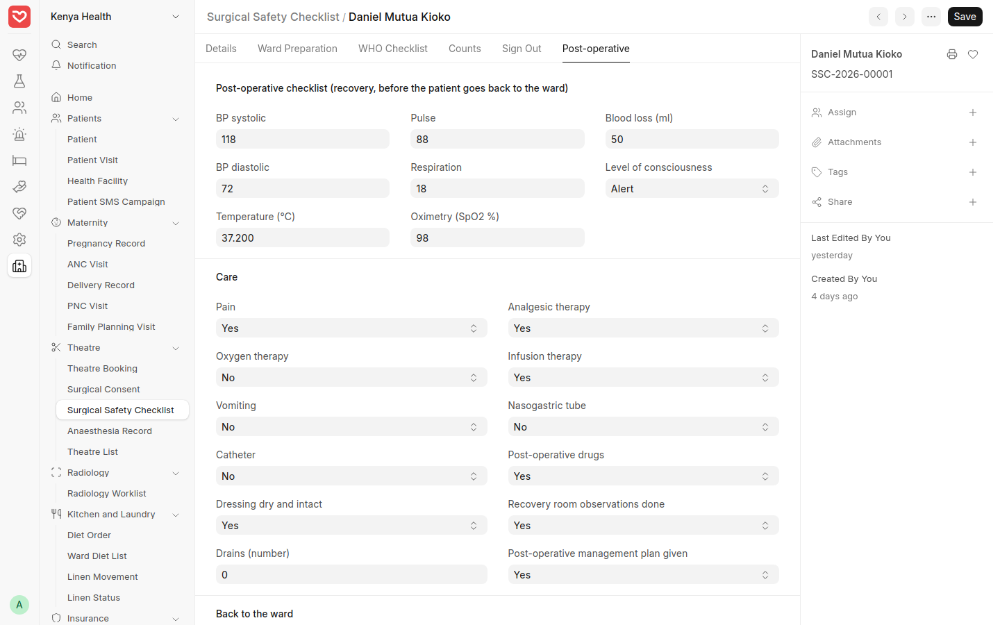

*The post-operative checklist back to the ward.*

## Step 10 — Progress notes (the continuation sheet)

**Who:** the surgeon, the theatre and recovery nurses. **Where:** on the booking, **Add Progress Note** (once the patient is in theatre).

1. Choose the stage: *In theatre*, *Recovery* or *Back to ward*. The time starts as now; change it if you are writing a little later.
2. Write the note and press **Save Note**. It is added to **Continuation Notes** on the booking with your name.
3. A saved note can't be changed or removed. To correct one, add a new note that says what was wrong.

Print **Continuation Sheet** from the booking: the operation header (diagnosis, operation, anaesthetic agent, surgeon, assistants, anaesthetist, incision), the procedure and findings from the operation note, then every note with its time, stage and writer, and blank lines to continue by hand.

Demo record: THB-2026-00001 has four notes, from the closure to the handover in the ward.

## Step 11 — Post-operative treatment sheet

**Who:** the surgeon or anaesthetist, in theatre or recovery. **Where:** on the booking, *Records › Write Treatment Sheet* (or Kenya Health › Theatre › Treatment Sheet).

1. The patient, admission and company fill in from the booking, and the allergies from the patient's record (check them; write *None* if there are none). Choose yourself as **Prescriber** and enter the weight.
2. Under **Regular and PRN Drugs**, one row per drug:
   - **Drug**, the **Dose** as you would write it (*500 mg*, *1 g*), and the **Route** (PO, IV, IM…).
   - **Every (hours)**: 8 for three times a day, 6 for four times. **For (days)**. **First Dose**: blank means now.
   - Tick **PRN** for a drug given when required: it is on the sheet for the ward but has no fixed times.
   - **Quantity per Dose** is what the ward issues and bills each time, in the drug's stock unit (2 for two 500 mg tablets).
3. Under **Once Only**, drugs given once, with the time to give them (blank means now).
4. **Other Orders**: fluids, oxygen, observations, diet.
5. **Submit** to sign the sheet. The ward gets an **Inpatient Medication Order** with every scheduled dose (every 8 hours for 5 days is 15 doses). The ward nurses give them from the Inpatient Record as for any ward order: the drug is issued from the ward store and billed.

To change the orders, cancel the sheet and amend it, as long as the ward has not given any dose. Once a dose has been given, stop the remaining doses on the medication order and write a new sheet. A patient without an admission (a day case) can have a sheet, kept as a record, but no ward order is made.

Print **Treatment Sheet**: laid out like the paper sheet, with the drugs in capitals, an administration grid for the initials and codes (X taken, D declined, V vomited, S spat, R repeated, OS out of stock), and the once-only drugs.

Demo record: TRS-2026-00001: amoxicillin 500 mg every 8 hours for 5 days, paracetamol 1 g every 6 hours for 2 days and when required after that, and a first dose of paracetamol on arrival in the ward.

## Printing the theatre forms

Each record prints as the hospital's paper form, with the hospital header and the patient band (name, age, sex, ID, SHA number, ward and bed). Unanswered items print as empty boxes and lines. If the system is down, print a blank form and fill it by hand.

| Print | From | Pages |
| --- | --- | --- |
| Consent for Operation | Surgical Consent | 1 |
| Theatre Checklist | Surgical Safety Checklist | 1 ward preparation, 2 WHO checklist, 3 gauze and instruments, 4 post-operative |
| Anaesthesia Record | Anaesthesia Record | Pre-operative assessment, then the anaesthetic monitoring chart and recovery |
| Operation Note | Clinical Procedure | Team, anaesthesia, findings, incision, procedure, specimens, instructions |
| Continuation Sheet | Theatre Booking | Operation header, procedure and findings, progress notes |
| Treatment Sheet | Treatment Sheet | Drugs, administration grid, once-only drugs |

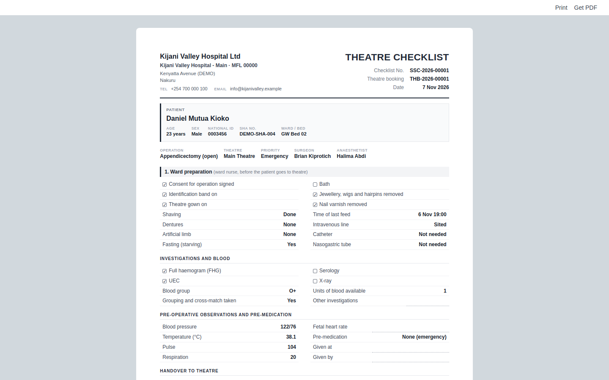

*The printed Theatre Checklist, part 1.*

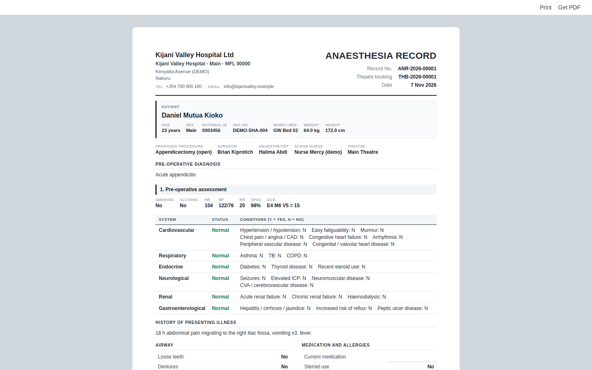

*The printed Anaesthesia Record.*

## Not built yet

- Recording each dose on screen with the X/D/V/S/R/OS codes (the ward cardex) comes with the inpatient charts. Until then the ward gives the scheduled doses through the Inpatient Record, and the printed treatment sheet has the grid for the codes.
- Page 3 of the KSA Anaesthesia Record (intra-operative) was not in the scan we received. The monitoring chart covers it until we see the page.
