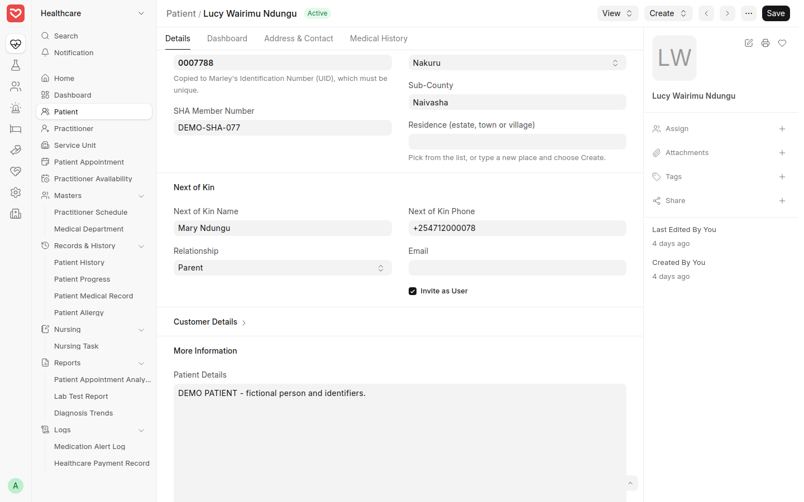
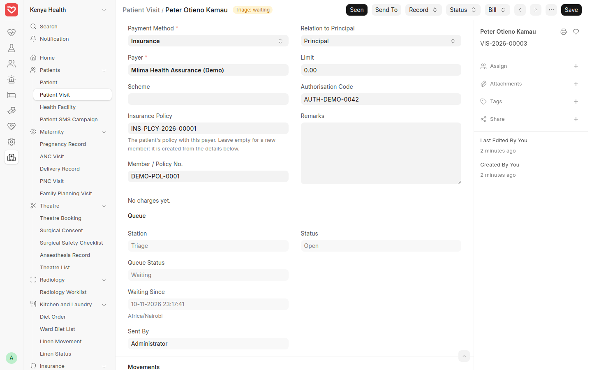
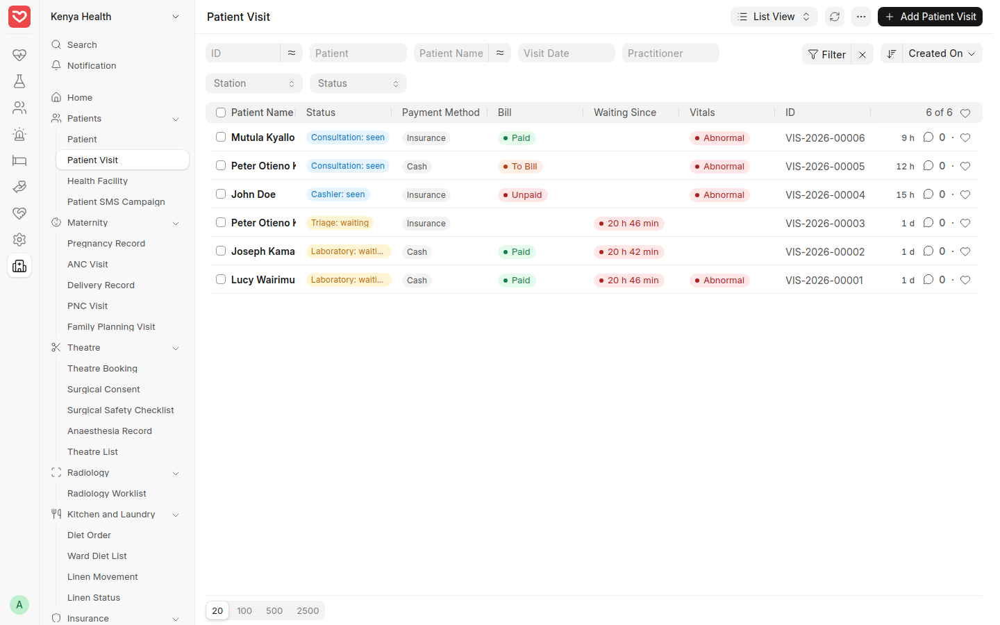
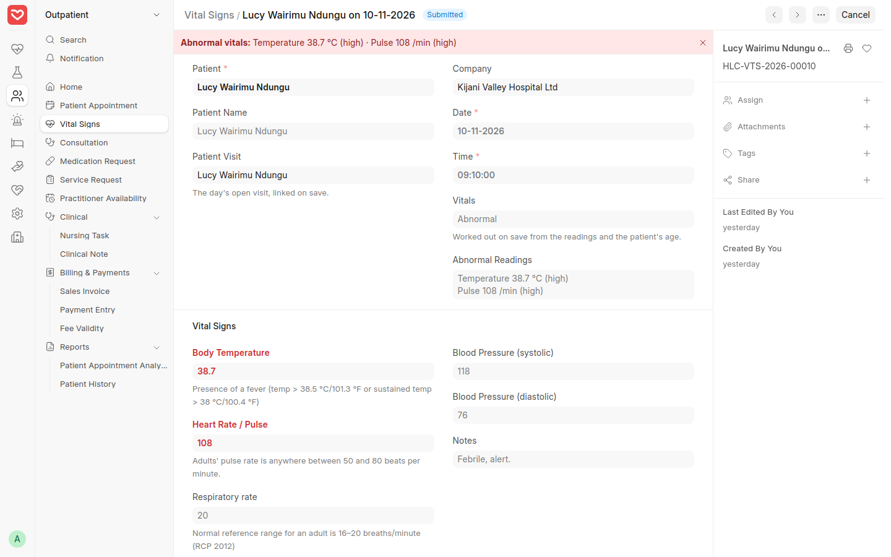
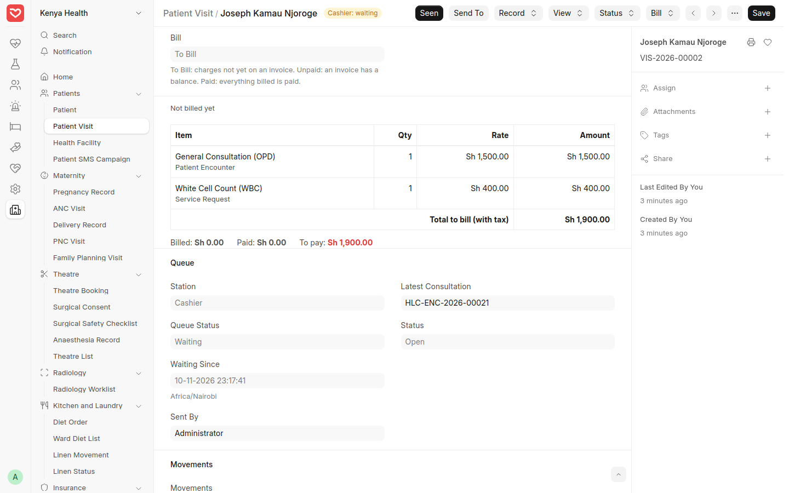
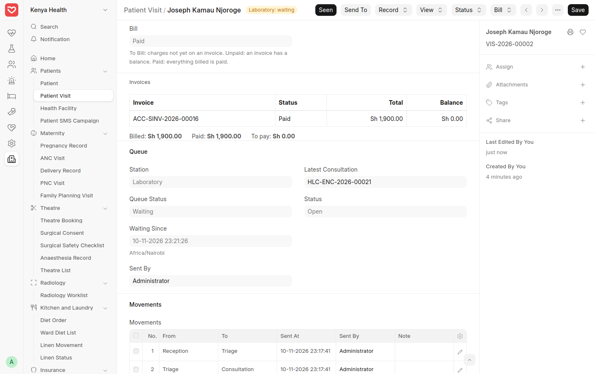
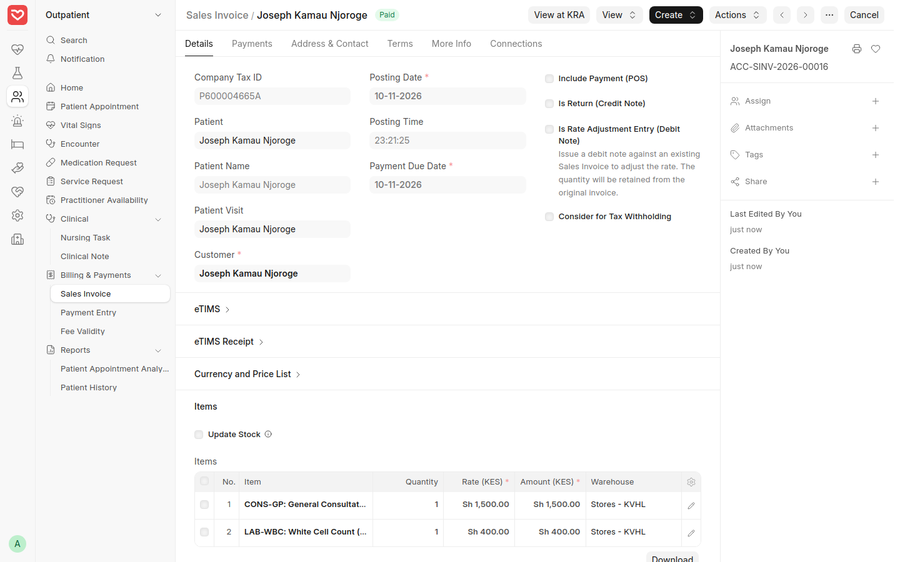
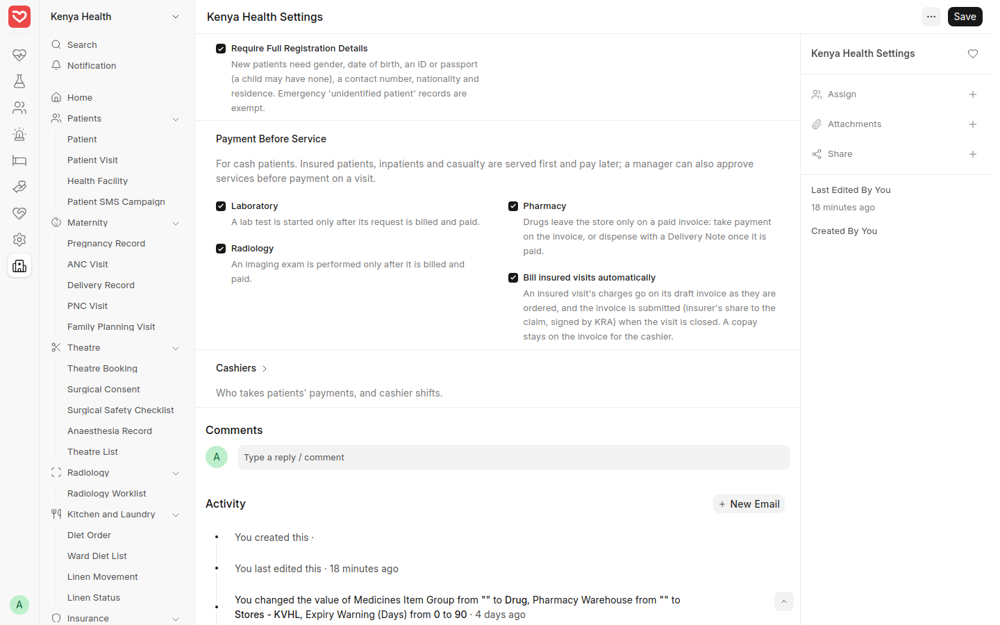

# Reception, Queue and Billing — Step-by-Step Guide

How a patient is registered, checked in, sent from station to station, billed as the visit goes, and served by the lab, radiology and pharmacy once paid. Shown on the demo hospital at hospital.royceltd.com.

## At a glance

| Step | Who | What happens |
| --- | --- | --- |
| 1. Register | Reception | Full details are required; phone and ID numbers are hidden from other staff |
| 2. Check in | Reception | A **Patient Visit** opens, cash or insurance. A cash outpatient goes to the **Cashier** first for the consultation fee, then to triage |
| 3. Waiting lists | Every station | Each station sees who is waiting and for how long, marks them **Seen** and sends them on |
| 4. Triage | Nurse | Vital signs (height in cm) are flagged **Normal** or **Abnormal** |
| 5. Consultation | Doctor | Tabs in order: Observation, Requests, Results, Diagnosis, Prescription, Complete. **Send Requests** sends tests to the bill and the lab while the consultation stays open |
| 6. Bill and pay | Cashier | The visit's bill shows what is not billed yet; **Create Bill** lists the charges to tick and makes the invoice; the **Patient Receipt** prints on the receipt printer |
| 7. Lab and radiology | Lab, radiographer | A cash patient's test or exam reaches the worklist once it is paid |
| 8. Pharmacy | Pharmacist | Drugs leave the store once paid |
| 9. Close | Any station | **Complete Visit** takes the patient off every list |

The visit is the patient's file for the day: every move, the vitals flag, the consultation and the bill are on it.

## Step 1 — Register the patient

**Who:** reception. **Where:** Healthcare › Patient › *+ Add Patient*.

A new patient can't be saved without:

- sex and date of birth
- an ID type and number (national ID, passport, birth certificate…). A child under 18 may be registered with ID type *None*
- a mobile number (the form has one contact number, **Mobile**). For a child, the next of kin's phone is enough
- nationality, and the county for Kenyans
- residence (estate, town or village), picked from the list

The form marks these fields as required. Emergency patients registered as *unidentified* (ER- numbers) and newborns registered from a delivery are exempt. An older patient with missing details still saves, with a reminder to complete them.

**Sub-county:** once the county is chosen, start typing in **Sub-county** and pick from that county's sub-counties (constituencies).

Green "saved" and "done" messages close by themselves after 5 seconds; warnings and errors stay until you close them.

**Residence list:** choose the patient's estate, town or village from the list; its county and sub-county fill in. With a county chosen first, the list shows that county's places. A place that isn't listed yet: type it and choose **Create a new Residence**, give its type (estate, town or village), and save. The list lives in Kenya Health › Residence, where an administrator can fix spellings and merge duplicates (rename one onto the other, ticking *Merge*). The report **Patients by Residence** shows, for any period, how many patients each place sent and how many were registered, busiest first, so you can see where to strengthen marketing. Importing patients? Import the Residence list first: a patient with a residence that isn't on the list is refused.

*Nationality, county, sub-county and the residence picked from the list.*

**Who sees phone and ID numbers:** reception and administrators see them in full. Nurses, doctors, lab and pharmacy staff see `XXXXXXXX` in lists, forms and search, and can still save the patient without losing the real numbers. SMS and printed forms always use the real numbers.

## Step 2 — Check the patient in

**Who:** reception. **Where:** on the patient, **Create › Check In (New Visit)**; or on an appointment, **Start Visit**; or Kenya Health › Patient Visit › *+ Add*.

1. Choose the **Visit Type**: Outpatient, Review, Casualty, Lab only, Radiology only or Pharmacy only. It decides the first waiting list: triage for outpatient and review, casualty for casualty, and straight to the lab, radiology or pharmacy for the others.
2. For a consultation, choose the **Service Type** (for example General Consultation) and the **Practitioner**. The department fills in.
3. Tick **Referred In** and name the facility if the patient brought a referral.
4. **Payment Method:** *Cash*, or *Insurance*:
   - Choose the **Payer** and **Scheme**. If the patient already has a policy with that payer it fills in by itself, with the member number.
   - Type the **Member / Policy No.** (it is typed, not picked from a list). If the patient already has a policy with that payer, the member number and **Cover Valid Until** fill in; typing a later *Cover Valid Until* renews the policy when you save.
   - For a new member, type the **Member / Policy No.** and **Cover Valid Until**, the relation to the principal member (and the principal's name and number for a dependant), the **Limit** and the **Authorisation Code**. The policy is created when you save.
   - Expired cover is refused: renew it, or check the patient in as cash.
5. Save. The patient is now waiting at the first station.

**Consultation fee before triage** (Kenya Health Settings › Payment Before Service › *Consultation fee before triage*, on by default): a **cash** patient checked in as *Outpatient* or *Review* waits at the **Cashier** first, and the top of the visit says the fee is to be paid. The fee is the doctor's consultation item, else the Service Type's, else the hospital's default consultation item, priced from the cash price list (see the [Administrator setup guide](08-administrator-setup.md), Step 3). If no fee is set up, reception sees *No consultation fee* when saving, and the patient goes straight to triage. Once it is paid the patient moves to the **Triage** list by themselves. Until then **Send To** › *Triage* or *Consultation* is refused. The consultation is not billed again later. Insured patients, *Casualty* and the *Lab / Radiology / Pharmacy only* visits go straight to their first station, and a manager can let a patient through (Step 9). A fee priced at 0 (for example a free review) is not asked.

A patient can have one open visit a day. Checking them in twice names the visit that is already open.

Demo record: **VIS-2026-00003**, *Peter Otieno Kamau*, insured with Mlima Health Assurance: his policy INS-PLCY-2026-00001 and member number were picked up, authorisation code AUTH-DEMO-0042.

*Check-in for an insured patient: payer, scheme, policy and authorisation code.*

## Step 3 — The waiting lists

**Who:** every station. **Where:** Kenya Health › Patient Visit.

1. Set the **Station** filter to your station (Triage, Consultation, Laboratory, Pharmacy, Cashier…). The list shows open visits only.
2. Each row shows the station and whether the patient is *waiting* or *seen*, how long they have waited (orange after 30 minutes, red after an hour), cash or insurance, the **Bill** status and the triage **Vitals** flag. No phone or ID numbers.
3. Open the patient and press **Seen** when you call them in.
4. When you are done, press **Send To**, choose the next station, add a note if useful, and send.

Every move is kept under **Movements**, with who sent the patient, when, and when they were seen.

**The next doctor is assigned for you.** When you send a patient to **Consultation** and leave *Practitioner* blank, the system picks a doctor on duty now and their room, sharing patients evenly: the doctor with the fewest patients waiting or in the room goes first. The message says who and where, for example *Sent to Brian Kiprotich, OPD Room 2*, and the top of the visit shows the doctor, room and service.

- Print the **Queue Slip** (**View › Queue Slip**) for the patient: the room, the doctor, the service and how many patients are ahead of them.
- A doctor you choose yourself is kept, and so is the doctor of a booked appointment.
- **On duty** means the doctor's Practitioner Schedule has today's time slot covering now, in a room of your facility (see the [Administrator Setup guide](08-administrator-setup.md)). If nobody is on duty, you are asked to choose the doctor.
- Doctors of the visit's department are picked first. If none of them is on duty, another doctor on duty is picked and you are told.
- If a doctor has to leave, open a patient waiting for them and use **Status › Reassign Doctor**: the patient goes to the next doctor on duty and keeps their place in the queue.
- Doctors: on the Patient Visit list, **My Patients** shows only the patients sent to you.

*Open visits: station, waiting time, payment method, bill status and vitals flag.*

## Step 4 — Triage and the vitals flag

**Who:** triage nurse. **Where:** on the visit, **Record › Vital Signs**.

1. Record temperature, pulse, respiratory rate, blood pressure, **SpO2**, **height in centimetres** (for example 165) and weight. BMI is worked out. Heights below 20 or above 250 cm are refused, as they are usually metres typed by mistake.
2. Save. The record is flagged **Normal** or **Abnormal**. Abnormal readings turn red, and the top of the form lists them, for example *Temperature 38.7 °C (high)*.
3. Send the patient to Consultation.

The limits depend on age (pulse and breathing rate by age band, blood pressure from 13 years, BMI for adults). They are being confirmed with the hospital's clinicians.

The flag shows on the visit and in the waiting lists, so the doctor sees at once who is unwell.

Demo record: *Lucy Wairimu Ndung'u*, visit VIS-2026-00001, vital signs **HLC-VTS-2026-00010**: temperature 38.7 °C and pulse 108, flagged Abnormal.

*Vital signs flagged Abnormal, with the readings that are out of range.*

## Step 5 — Consultation

**Who:** doctor. **Where:** on the visit, **Record › Consultation**.

The consultation opens with the patient, doctor, department and service type from the visit, and opening it marks the patient seen at Consultation. Symptoms, appointment type and source are taken at reception and are not on the consultation.

The consultation has tabs, in the order the doctor works: **Patient**, **Observation**, **Requests**, **Results**, **Diagnosis**, **Prescription**, **Complete** (details in the [Outpatient guide](02-outpatient.md), Steps 4 and 7):

1. **Observation:** chief complaint, history and examination, the patient's medical history (saved back to the patient) and, for women, **OBS/Gynae**.
2. **Requests:** lab tests, imaging and procedures, then **Send Requests**. They go on the bill and to the lab or radiology, and the consultation stays open. A box asks **Where does the patient go next?**: the **Cashier** is suggested while the requests are unpaid.
3. **Results:** each request with its progress (*Awaiting payment at the Cashier*, *Waiting at the lab*, *Sample collected*…) and, once validated, the results.
4. **Diagnosis**, then **Prescription**.
5. **Complete:** **Complete Consultation** submits the consultation and suggests where the patient goes: Pharmacy when drugs are prescribed, a service point, the Cashier for unpaid requests, or *Finish visit*.

## Step 6 — The visit's bill, and the cashier

**Who:** cashier (anyone else can read the bill). **Where:** the visit's **Bill** section.

The Bill section lists everything ordered or given since check-in that is not billed yet: consultation, tests, imaging, procedures and drugs, priced as the invoice will price them, with the insurer's share for insured patients. Below it are the visit's invoices, and the totals **Billed**, **Paid** and **To pay**.

The **Bill** status reads:

| Status | Meaning |
| --- | --- |
| To Bill | Something is not on an invoice yet |
| Unpaid | An invoice has a balance |
| Paid | Everything billed is paid |

Demo record: *Joseph Kamau Njoroge*, **VIS-2026-00002**, a review with a white cell count ordered, waiting at the Cashier: **To Bill**, 1,900 to pay.

*The visit's bill: a consultation and a test not billed yet.*

To bill:

1. On the visit, **Bill › Create Bill**. A box lists the charges not billed yet (the consultation fee, each test, exam or drug, with what kind of charge it is), all ticked, with the total. Untick what the patient is not paying for now: the total goes down, and unticked charges stay on the visit for later. **Create Invoice** opens the invoice with the ticked lines, linked to the visit.
2. Take the payment on the invoice (**Include Payment**: the mode of payment and amount), or submit and use **Create › Payment**. The invoice is signed by KRA eTIMS as usual.
3. **M-Pesa, card or bank:** type the transaction code (for example the M-Pesa code *UKF8I2ECFD*) in **Reference No**: it is a column of the invoice's payments table, and a field on the Payment Entry. A non-cash payment without the code is refused. Cash needs no code.
4. On the paid invoice, press **Patient Receipt**: the receipt opens for the 80 mm receipt printer (choose the receipt printer, paper 80 mm, margins *None*). It shows the hospital, the patient's name, number, date of birth, gender and phone, the invoice, the payment mode with the M-Pesa code, the items, discount, amount tendered and change, and who served.
5. Send the patient on to the lab, radiology or pharmacy. Paid requests now appear on their worklist.

**Only the cashier takes money** when *Only cashiers take payments* is on (Kenya Health Settings › Cashiers): other service points can create the bill but don't see **Create › Payment** or *Include Payment*, and a payment they try anyway is refused. With shifts on, the cashier opens their **Cashier Shift** at the start of the day and closes it with the count (see the [Cashier Day-End guide](07-cashier-day-end.md)).

**Insured visits are billed automatically** (Kenya Health Settings › *Bill insured visits automatically*, on by default): each charge goes onto the visit's draft bill as it is ordered, and closing the visit submits it, with the insurer's share on the claim and any copay left for the cashier. See the [Insurance guide](04-insurance.md).

A visit has one draft bill at a time: Create Bill opens the existing draft instead of making a second one. Every invoice made for the patient that day links to the visit.

Demo record: Joseph's bill **ACC-SINV-2026-00016** (consultation 1,500 and white cell count 400), made with Create Bill and paid by M-Pesa. His visit shows **Paid** and he is sent on to the lab.

*Joseph's visit after payment: the invoice, nothing left to pay.*

*The invoice made from the visit: paid, signed by KRA eTIMS, and linked back to the visit.*

## Step 7 — Lab and radiology: paid first

**Who:** lab technologist, radiographer.

For a cash patient:

- **The worklists show a cash patient's requests only once paid.** The Lab and Radiology worklists leave out unpaid requests, with a line below the list, for example *"1 more patient(s) have tests requested and are paying at the Cashier. They appear here once paid."* The request appears as soon as the invoice is paid. The doctor sees *Awaiting payment at the Cashier* on the consultation's **Results** tab.
- **Lab:** a test is started from the doctor's order only once the order is on an invoice that is fully paid. Before that the system refuses with *Payment required … Send the patient to the Cashier*. A test entered without an order can be worked on, but its results are released only once paid.
- **Radiology:** an exam can't be marked **Performed** until it is paid.

A billed but unpaid invoice is not enough: the balance must be zero.

Look at the **Bill** column of your waiting list before calling the patient: *Paid* means you can go ahead.

**Served first, settled later:** insured patients (for what their scheme covers), inpatients, casualty visits, and visits a manager has approved (Step 9).

**Insured patients pay first for what the scheme doesn't cover** (Kenya Health Settings › *Insured: uncovered items paid first*). A test, exam or drug is covered when it is on the scheme's cover list and the cover is approved. When the doctor submits the consultation, a *Patient pays first* message lists the orders that aren't covered, or are still waiting for the insurer's approval. On the visit's Bill section those lines read *Not covered: patient pays first* and the total shows as **Patient pays now**; covered lines read *Insurer's bill*. The patient goes to the cashier, who uses **Create Bill**: on an insured visit it makes the patient's own bill with only the uncovered items. Once it is paid the lab, radiology or pharmacy can go ahead. The covered items stay on the insurer's bill, which is submitted when the visit closes.

Switch this on only after each scheme's cover list (Item Insurance Eligibility) is loaded: an item missing from the list counts as not covered.

## Step 8 — Pharmacy: paid first

**Who:** pharmacist, cashier.

Drugs leave the store only on a paid invoice. Either:

- the cashier ticks **Include Payment** on the pharmacy bill, with **Update Stock**, and takes the money before submitting. An unpaid bill with Update Stock is refused; or
- the cashier bills without Update Stock, the patient pays, and the pharmacy issues the drugs with a **Delivery Note** made from the invoice (**Create › Delivery Note**). A Delivery Note against an unpaid invoice is refused.

The same exemptions apply as for the lab. Drugs for an insured patient are covered when the scheme's cover list includes them; others are paid first.

## Step 9 — Services before payment

**Who:** Healthcare Administrator or Accounts Manager. **Where:** on the visit, **Bill › Allow Services Before Payment**.

For a patient who will pay later (a staff member, a waiver, a family that is raising the money), give the reason and confirm. Triage, the lab, radiology and pharmacy then serve the visit before payment. The reason and who approved it show at the top of the visit, and in the Bill column as *(credit approved)*.

## Step 9a — Discounts, waivers and pay-later: ask a manager

**Who:** cashier or reception asks; a manager (Healthcare Administrator or Accounts Manager) decides. **Where:** on the visit, **Bill ›**:

| Ask for | When | What approval does |
| --- | --- | --- |
| **Request Discount** | The visit has a draft bill not yet paid | Takes the percentage, or the amount, off the draft bill's total |
| **Request Waiver** | A submitted bill still has a balance the patient can't pay | Writes the amount off (Kenya Health Settings › Waiver Account), so the balance is cleared without a payment |
| **Request Pay Later** | The patient will pay later | Serves the visit before payment, as in Step 9 |

Give the reason and **Send for Approval**. The request appears on the visit under **Approvals** and in **Bill Approval Request**. The manager opens it from the **Patient Bills** board (*Approvals waiting*) or the list, and presses **Approve** or **Reject** (rejecting needs a reason). Nobody decides their own request. A discount can only go on a draft: once the bill is submitted, ask for a waiver.

## Step 9b — Patient Bills

**Who:** cashier, accounts office, managers. **Where:** Kenya Health › Patients › **Patient Bills**.

One row per visit for the dates chosen: what was billed, paid, discounted or waived, covered by insurance, and the balance, with totals at the bottom. **Cash bills** and **Insurance bills** are on separate tabs. Filter by *Has balance* to see who still owes. A visit with a draft bill shows the draft amount under *Billed*, and the status says *To Bill*. **Approvals waiting** opens the requests waiting for a manager.

## Step 10 — Close the visit

**Who:** the last station. **Where:** on the visit, **Status › Complete Visit**.

The patient leaves every waiting list. **Status › Cancel Visit** (with a reason) is for a patient who left without being seen, or a visit opened by mistake.

## Settings

**Kenya Health Settings** (Kenya Health › Setup):

| Section | Setting | Default |
| --- | --- | --- |
| Patient Registration | Require full registration details | On |
| Payment Before Service | Consultation fee before triage | On |
| | Default Consultation Item | The general consultation item |
| | Laboratory | On |
| | Radiology | On |
| | Pharmacy | On |
| | Waiver Account | The company's write-off account; set your own (for example "Patient Waivers") |

Set the **Default Consultation Item** and its price on the cash price list; give a doctor or a Service Type its own item only where the fee differs. Without any consultation item there is no fee to take before triage, and the visit's bill says the consultation can't be priced.

Give reception staff the **Receptionist** role: it registers patients, checks them in, records insurance policies and appointments, and sees phone and ID numbers. See the [Administrator setup guide](08-administrator-setup.md).

*Kenya Health Settings: required registration details and payment before service.*
