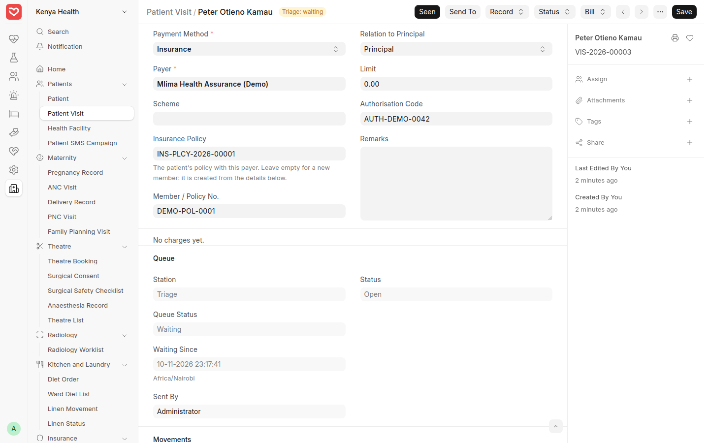
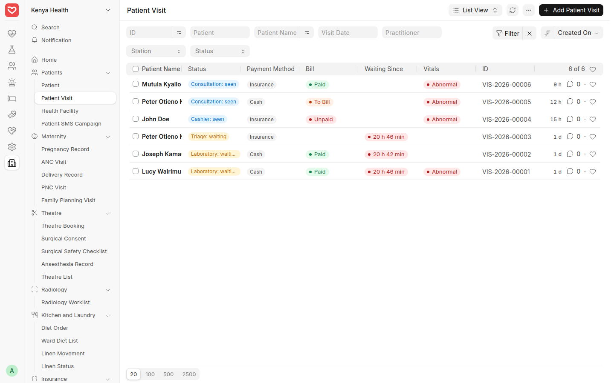
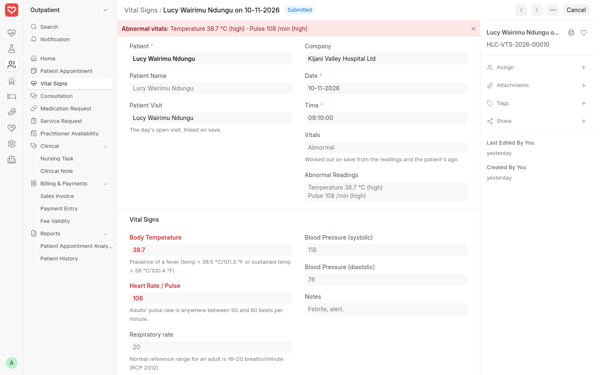
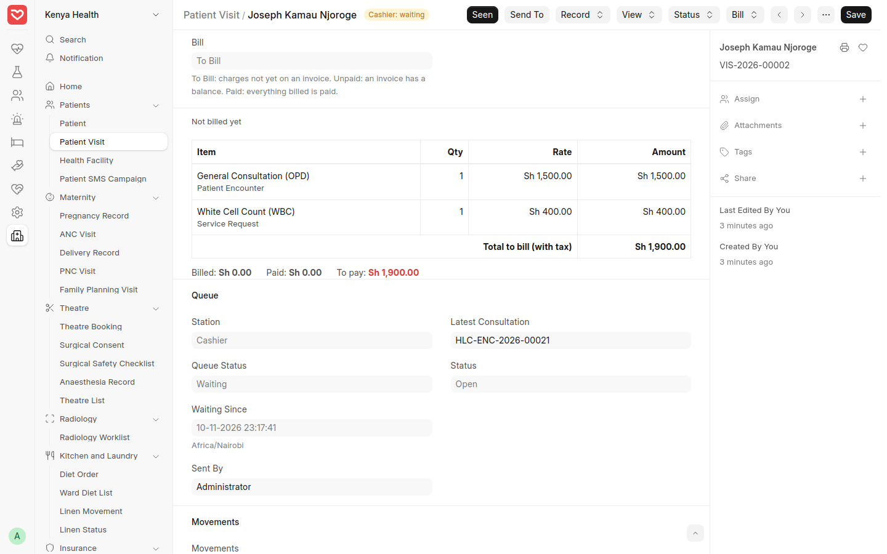
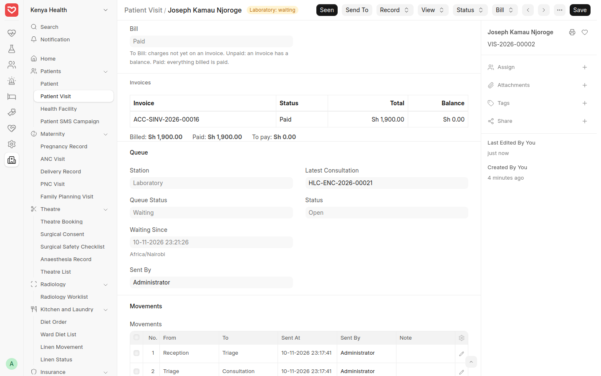
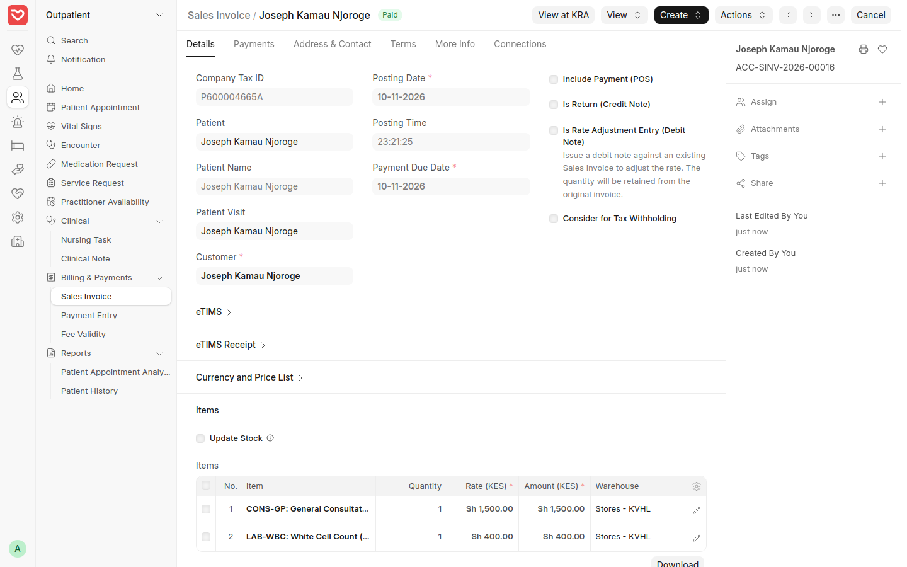
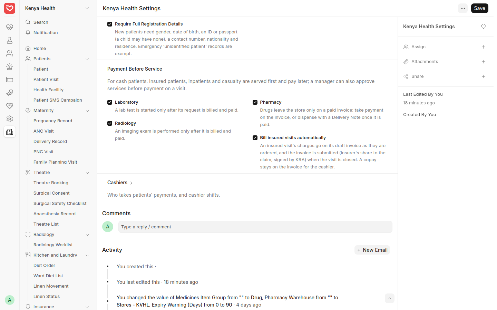

# Reception, Queue and Billing — Step-by-Step Guide

How a patient is registered, checked in, sent from station to station, billed as the visit goes, and served by the lab, radiology and pharmacy once paid. Shown on the demo hospital at hospital.royceltd.com.

## At a glance

| Step | Who | What happens |
| --- | --- | --- |
| 1. Register | Reception | Full details are required; phone and ID numbers are hidden from other staff |
| 2. Check in | Reception | A **Patient Visit** opens, cash or insurance, and the patient joins the first waiting list |
| 3. Waiting lists | Every station | Each station sees who is waiting and for how long, marks them **Seen** and sends them on |
| 4. Triage | Nurse | Vital signs are flagged **Normal** or **Abnormal** |
| 5. Consultation | Doctor | The consultation takes the doctor and service type from the visit |
| 6. Bill and pay | Cashier | The visit's bill shows what is not billed yet; **Create Bill** makes the invoice |
| 7. Lab and radiology | Lab, radiographer | A cash patient's test or exam starts once it is paid |
| 8. Pharmacy | Pharmacist | Drugs leave the store once paid |
| 9. Close | Any station | **Complete Visit** takes the patient off every list |

The visit is the patient's file for the day: every move, the vitals flag, the consultation and the bill are on it.

## Step 1 — Register the patient

**Who:** reception. **Where:** Healthcare › Patient › *+ Add Patient*.

A new patient can't be saved without:

- sex and date of birth
- an ID type and number (national ID, passport, birth certificate…). A child under 18 may be registered with ID type *None*
- a mobile number. For a child, the next of kin's phone is enough
- nationality, and the county for Kenyans
- residence (estate, town or village), picked from the list

The form marks these fields as required. Emergency patients registered as *unidentified* (ER- numbers) and newborns registered from a delivery are exempt. An older patient with missing details still saves, with a reminder to complete them.

**Residence list:** choose the patient's estate, town or village from the list; its county and sub-county fill in. With a county chosen first, the list shows that county's places. A place that isn't listed yet: type it and choose **Create a new Residence**, give its type (estate, town or village), and save. The list lives in Kenya Health › Residence, where an administrator can fix spellings and merge duplicates (rename one onto the other, ticking *Merge*). The report **Patients by Residence** shows, for any period, how many patients each place sent and how many were registered, busiest first, so you can see where to strengthen marketing. Importing patients? Import the Residence list first: a patient with a residence that isn't on the list is refused.

**Who sees phone and ID numbers:** reception and administrators see them in full. Nurses, doctors, lab and pharmacy staff see `XXXXXXXX` in lists, forms and search, and can still save the patient without losing the real numbers. SMS and printed forms always use the real numbers.

## Step 2 — Check the patient in

**Who:** reception. **Where:** on the patient, **Create › Check In (New Visit)**; or on an appointment, **Start Visit**; or Kenya Health › Patient Visit › *+ Add*.

1. Choose the **Visit Type**: Outpatient, Review, Casualty, Lab only, Radiology only or Pharmacy only. It decides the first waiting list: triage for outpatient and review, casualty for casualty, and straight to the lab, radiology or pharmacy for the others.
2. For a consultation, choose the **Service Type** (for example General Consultation) and the **Practitioner**. The department fills in.
3. Tick **Referred In** and name the facility if the patient brought a referral.
4. **Payment Method:** *Cash*, or *Insurance*:
   - Choose the **Payer** and **Scheme**. If the patient already has a policy with that payer it fills in by itself, with the member number.
   - For a new member, type the **Member / Policy No.** and **Cover Valid Until**, the relation to the principal member (and the principal's name and number for a dependant), the **Limit** and the **Authorisation Code**. The policy is created when you save.
   - Expired cover is refused: renew it, or check the patient in as cash.
5. Save. The patient is now waiting at the first station.

A patient can have one open visit a day. Checking them in twice names the visit that is already open.

Demo record: **VIS-2026-00003**, *Peter Otieno Kamau*, insured with Mlima Health Assurance: his policy INS-PLCY-2026-00001 and member number were picked up, authorisation code AUTH-DEMO-0042.

*Check-in for an insured patient: payer, scheme, policy and authorisation code.*

## Step 3 — The waiting lists

**Who:** every station. **Where:** Kenya Health › Patient Visit.

1. Set the **Station** filter to your station (Triage, Consultation, Laboratory, Pharmacy, Cashier…). The list shows open visits only.
2. Each row shows the station and whether the patient is *waiting* or *seen*, how long they have waited (orange after 30 minutes, red after an hour), cash or insurance, the **Bill** status and the triage **Vitals** flag. No phone or ID numbers.
3. Open the patient and press **Seen** when you call them in.
4. When you are done, press **Send To**, choose the next station (and the doctor, when sending to Consultation), add a note if useful, and send.

Every move is kept under **Movements**, with who sent the patient, when, and when they were seen.

*Open visits: station, waiting time, payment method, bill status and vitals flag.*

## Step 4 — Triage and the vitals flag

**Who:** triage nurse. **Where:** on the visit, **Record › Vital Signs**.

1. Record temperature, pulse, respiratory rate, blood pressure, **SpO2**, height and weight. BMI is worked out.
2. Save. The record is flagged **Normal** or **Abnormal**. Abnormal readings turn red, and the top of the form lists them, for example *Temperature 38.7 °C (high)*.
3. Send the patient to Consultation.

The limits depend on age (pulse and breathing rate by age band, blood pressure from 13 years, BMI for adults). They are being confirmed with the hospital's clinicians.

The flag shows on the visit and in the waiting lists, so the doctor sees at once who is unwell.

Demo record: *Lucy Wairimu Ndung'u*, visit VIS-2026-00001, vital signs **HLC-VTS-2026-00010**: temperature 38.7 °C and pulse 108, flagged Abnormal.

*Vital signs flagged Abnormal, with the readings that are out of range.*

## Step 5 — Consultation

**Who:** doctor. **Where:** on the visit, **Record › Consultation**.

The consultation opens with the patient, doctor, department and service type from the visit, and opening it marks the patient seen at Consultation. Order lab tests, imaging and drugs as usual (see the [Outpatient guide](02-outpatient.md), Steps 4 and 7), then **Send To** the Cashier.

## Step 6 — The visit's bill, and the cashier

**Who:** cashier (anyone else can read the bill). **Where:** the visit's **Bill** section.

The Bill section lists everything ordered or given since check-in that is not billed yet: consultation, tests, imaging, procedures and drugs, priced as the invoice will price them, with the insurer's share for insured patients. Below it are the visit's invoices, and the totals **Billed**, **Paid** and **To pay**.

The **Bill** status reads:

| Status | Meaning |
| --- | --- |
| To Bill | Something is not on an invoice yet |
| Unpaid | An invoice has a balance |
| Paid | Everything billed is paid |

Demo record: *Joseph Kamau Njoroge*, **VIS-2026-00002**, a review with a white cell count ordered, waiting at the Cashier: **To Bill**, 1,900 to pay.

*The visit's bill: a consultation and a test not billed yet.*

To bill:

1. On the visit, **Bill › Create Bill**. A draft invoice opens with the unbilled lines, linked to the visit.
2. Check the lines and submit. The invoice is signed by KRA eTIMS as usual.
3. **Create › Payment**: M-Pesa with its code, or cash.
4. Send the patient on to the lab, radiology or pharmacy.

A visit has one draft bill at a time: Create Bill opens the existing draft instead of making a second one. Every invoice made for the patient that day links to the visit.

Demo record: Joseph's bill **ACC-SINV-2026-00016** (consultation 1,500 and white cell count 400), made with Create Bill and paid by M-Pesa. His visit shows **Paid** and he is sent on to the lab.

*Joseph's visit after payment: the invoice, nothing left to pay.*

*The invoice made from the visit: paid, signed by KRA eTIMS, and linked back to the visit.*

## Step 7 — Lab and radiology: paid first

**Who:** lab technologist, radiographer.

For a cash patient:

- **Lab:** a test is started from the doctor's order only once the order is on an invoice that is fully paid. Before that the system refuses with *Payment required … Send the patient to the Cashier*. A test entered without an order can be worked on, but its results are released only once paid.
- **Radiology:** an exam can't be marked **Performed** until it is paid.

A billed but unpaid invoice is not enough: the balance must be zero.

Look at the **Bill** column of your waiting list before calling the patient: *Paid* means you can go ahead.

**Served first, settled later:** insured patients, inpatients, casualty visits, and visits a manager has approved (Step 9).

## Step 8 — Pharmacy: paid first

**Who:** pharmacist, cashier.

Drugs leave the store only on a paid invoice. Either:

- the cashier ticks **Include Payment** on the pharmacy bill, with **Update Stock**, and takes the money before submitting. An unpaid bill with Update Stock is refused; or
- the cashier bills without Update Stock, the patient pays, and the pharmacy issues the drugs with a **Delivery Note** made from the invoice (**Create › Delivery Note**). A Delivery Note against an unpaid invoice is refused.

The same exemptions apply as for the lab.

## Step 9 — Services before payment

**Who:** Healthcare Administrator or Accounts Manager. **Where:** on the visit, **Bill › Allow Services Before Payment**.

For a patient who will pay later (a staff member, a waiver, a family that is raising the money), give the reason and confirm. The lab, radiology and pharmacy then serve the visit before payment. The reason and who approved it show at the top of the visit, and in the Bill column as *(credit approved)*.

## Step 10 — Close the visit

**Who:** the last station. **Where:** on the visit, **Status › Complete Visit**.

The patient leaves every waiting list. **Status › Cancel Visit** (with a reason) is for a patient who left without being seen, or a visit opened by mistake.

## Settings

**Kenya Health Settings** (Kenya Health › Setup):

| Section | Setting | Default |
| --- | --- | --- |
| Patient Registration | Require full registration details | On |
| Payment Before Service | Laboratory | On |
| | Radiology | On |
| | Pharmacy | On |

Each consulting doctor needs a **consultation charge** (Healthcare › Practitioner › Charges). Without it the visit's bill can't price the consultation and says so.

Give reception staff the **Receptionist** role: it registers patients, checks them in, records insurance policies and appointments, and sees phone and ID numbers. See the [Administrator setup guide](08-administrator-setup.md).

*Kenya Health Settings: required registration details and payment before service.*
