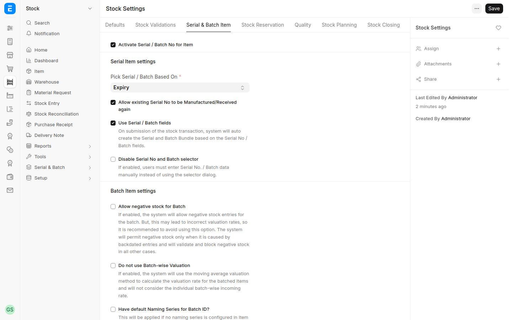
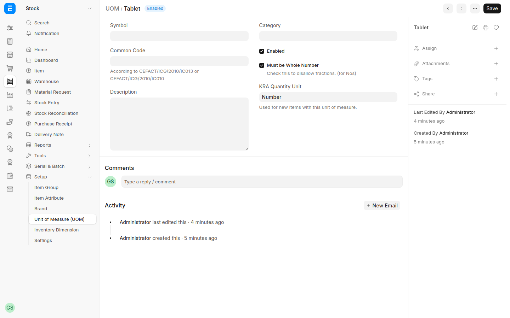
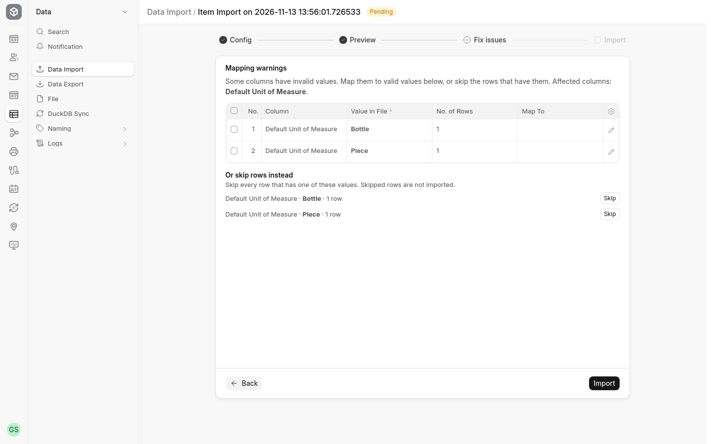
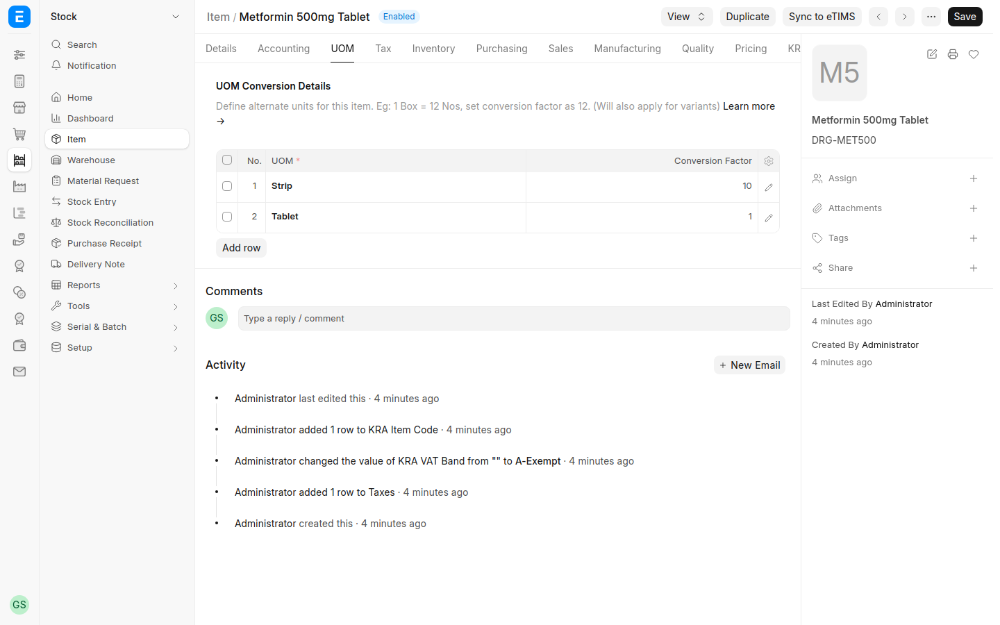
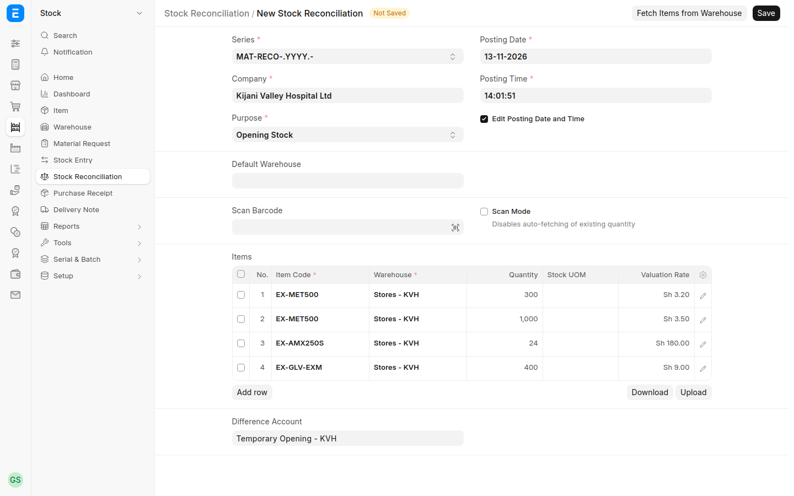

# Pharmacy and Stock Setup and Data Upload — Step-by-Step Guide

How to set up the pharmacy and stores in RoyceERP Health and move the medicines, prices and stock from the hospital's previous system: settings, stores, units, the upload templates, the order of uploads, opening stock on go-live day, and the checks before go-live. For the hospital's ICT manager, with the pharmacist-in-charge and the accountant. Shown on the demo hospital at hospital.royceltd.com.

Day-to-day pharmacy work (receiving, transfers, dispensing, counts, expiry and recalls) is in [Pharmacy and stock](06-pharmacy-and-stock.md).

## At a glance

| # | What | Where | Who | When |
| --- | --- | --- | --- | --- |
| 1 | Turn on batches and expiry order | Stock Settings | ICT manager | Once, before any upload |
| 2 | Stores | Stock › Warehouse | ICT manager, pharmacist | Once |
| 3 | Units and their KRA units | Stock › Setup › UOM | ICT manager | Once |
| 4 | Item groups, VAT and price lists | Stock › Setup | ICT manager, accountant | Once |
| 5 | Dosage forms | Healthcare › Setup | Pharmacist | Once |
| 6 | Fill the upload templates | Excel | ICT manager, pharmacist | Now |
| 7 | Upload files 1 to 5 | Data › Data Import | ICT manager | Now; again for anything new |
| 8 | Opening stock, per store | Stock › Stock Reconciliation | ICT manager, pharmacist | On go-live day |
| 9 | Check before go-live | Reports | Pharmacist, accountant | After each upload |

**Who decides what:**
- The pharmacist-in-charge approves the medicine list, the units and the stock count.
- The accountant approves selling prices, VAT and cost prices.
- The ICT manager prepares the files and uploads them.

**Catalogue now, stock on go-live day.** Suppliers, items, prices, medicines and batches change slowly, so upload them as soon as the setup is done. Opening stock changes with every sale. Count it and upload it on go-live day, after the last sale in the old system, or it will be wrong by the time you start.

## Step 1 — Turn on batches and expiry order

**Where:** Stock › Settings › Stock Settings.

1. On the **Serial & Batch Item** tab:
   - tick **Activate Serial / Batch No for Item**;
   - set **Pick Serial / Batch Based On** to **Expiry**, so stock leaves in the order it expires;
   - tick **Use Serial / Batch fields**.
2. On the **Stock Validations** tab, leave **Allow Negative Stock** unticked. Stock can then never go below what is on the shelf.
3. Save.

This must be done before the first item is uploaded. An item's *Has Batch No* can't be changed once it has stock.

*Batches on, picked by expiry date.*

## Step 2 — Stores

**Where:** Stock › Warehouse (Tree view).

A store (warehouse) is any place stock is kept and counted. A good layout for each facility:

| Store | Holds | Gets stock from |
| --- | --- | --- |
| Stores | Bulk stock | Suppliers (Purchase Receipt) |
| Pharmacy (OPD) | What the pharmacy dispenses and sells | Stores (transfer) |
| Inpatient pharmacy (if separate) | Stock for ward medication | Stores (transfer) |
| Theatre, Laboratory, Casualty, Clinical Areas | Each department's own stock | Stores (transfer) |
| Expired and Quarantine | Expired or recalled packs waiting for disposal or return | Any store (transfer) |

1. Keep one group per facility (for example *Main* and a branch) with its stores inside. Each store's name ends with the company's abbreviation.
2. Ward beds get their own small stores for ward medication: see [Administrator setup](08-administrator-setup.md), Step 5.
3. In **Kenya Health Settings**, set **Pharmacy Warehouse** to the store the Pharmacy Stock Status report should watch. Leave it empty to watch every store.

## Step 3 — Units and their KRA units

**Where:** Stock › Setup › Unit of Measure (UOM).

Every product is counted in its **smallest unit**: the one you count on the shelf and may sell on its own, such as Tablet, Capsule, Bottle, Vial, Ampoule, Tube, Sachet or Piece. Bigger packs (Strip, Box, Tin) are added to each item as conversions in Step 6, for example 1 Strip = 10 Tablets.

1. Create each unit you need that isn't in the list yet. Tick **Must be Whole Number** for anything counted.
2. Set its **KRA Quantity Unit**. KRA only accepts its own 2-letter units: use **Number (NO)** for counted units such as tablets, bottles and pieces, and **box (BX)** for boxes.
3. Do this before uploading items. Each new item takes its KRA unit from its unit of measure. An item without one is refused when it is sent to KRA ("KRA only accepts item codes with a 2-letter quantity unit").

*Tablet, counted as Number (NO) for KRA.*

## Step 4 — Item groups, VAT and price lists

**Where:** Stock › Setup › Item Group, and Price List (search for it).

1. **Item groups.** Medicines go in **Drug** and sundries (gloves, syringes, cannulas) in **Consumable**. On each group, set the **KRA Product Category**. New items in the group take it for KRA eTIMS.
2. **VAT.** Each item carries an *Item Tax Template*. Most medicines are VAT exempt (*KE Exempt*), but some consumables are charged 16% (*KE Standard 16%*). The accountant confirms these. Royce set up the templates at installation.
3. **Price lists.** *Standard Selling* is the cash price. Each insurer tariff that differs from cash has its own price list: see *Pricebooks* in the [Insurance guide](04-insurance.md), Step 1. *Standard Buying* holds supplier prices.

## Step 5 — Dosage forms

**Where:** Healthcare › Setup › Dosage Form.

Doctors prescribe a **Medication**, which is a generic name, strength and form linked to the stock item the pharmacy dispenses. The system comes with Tablet, Capsule, Syrup, Injection and Cream. Add the other forms the hospital uses before uploading medications, for example Suspension, Eye Drops, Ear Drops, Ointment, Suppository, Pessary, Inhaler, Infusion and Powder.

Medication classes, used for interaction checks, come already loaded with the healthcare module.

## Step 6 — Fill the upload templates

Royce provides the templates, made from the hospital's own site, so their lists show its real stores, price lists and tax templates:

| File | Upload with | One line per |
| --- | --- | --- |
| 1 Suppliers.xlsx | Data Import | Supplier |
| 2 Items.xlsx | Data Import | Product (medicines and sundries), plus a line for each extra unit |
| 3 Item Prices.xlsx | Data Import | Item, price list and unit |
| 4 Medications.xlsx | Data Import | Medicine doctors prescribe (generic, strength, form) |
| 5 Batches.xlsx | Data Import | Batch on the shelf, with its expiry date |
| 6 Opening Stock.csv | The Items table of a Stock Reconciliation | Item, batch and store counted |

Each Excel file has four sheets:
- **Upload:** fill this one. Row 1 holds the column names the system matches: don't change them. Yellow columns are required.
- **Example:** the same columns filled in, to copy the pattern from. Example codes start with *EX-*: never upload them.
- **Notes:** what to put in each column.
- **Lists:** the values the site accepts (stores, units, groups, price lists, tax templates).

**Rules that matter:**
- **Item codes.** Keep the old system's codes if they are unique. They make the two systems easy to compare. Never reuse a code.
- **Item names.** Use generic name, strength and form, for example *Metformin 500mg Tablet*. Staff search by this name.
- **Extra units.** Put each extra unit (Strip, Box) on its own line under the item, with the item's other columns empty. The Example sheet shows how.
- **Prices.** Give each price in KES for one of the unit on that line. To sell by the strip at a different price from 10 single tablets, add a second price line with unit *Strip*.
- **Medications.** File 4 is only for medicines doctors prescribe. Each line links to an item code from file 2, with the same unit. Two brands of the same medicine share one Medication: add the second item on an extra line.
- **Batches.** The batch ID is the batch number on the pack. If two different medicines carry the same number, add the item code to make it unique, for example *AB123-MET500*. Expiry dates are written YYYY-MM-DD. A pack showing only month and year expires on the last day of that month.
- **Expired stock.** Don't upload batches that have already expired. Count them separately and hand them to the pharmacist for disposal.
- **Saving.** Save each file while the **Upload** sheet is showing. Data Import reads the sheet that was open when the file was saved.

## Step 7 — Upload files 1 to 5

**Who:** ICT manager. **Where:** search for **Data Import** › *+ Add*.

Upload in this order: each file uses what the ones before it created.

1. **Suppliers** (Document Type *Supplier*)
2. **Items** (*Item*)
3. **Item Prices** (*Item Price*)
4. **Medications** (*Medication*)
5. **Batches** (*Batch*)

For each file:

1. Choose the **Document Type**, set **Import Type** to *Insert New Records*, and save.
2. **Attach** the filled template. The import walks through **Config**, **Preview**, **Fix issues** and **Import**.
3. **Preview** shows the rows as the system reads them. Check that each column landed in the right place.
4. **Fix issues** lists values the system doesn't know, for example a unit or store that doesn't exist yet. Either create the missing value (Steps 2–5) and attach the file again, or map it to an existing value, or skip those rows.
5. Click **Import**. Each row is saved on its own. At the end, the log shows the rows that failed and why. Fix those rows in the file and upload only them again.

Uploading the medications after the items keeps each item's name and price as uploaded. The medication is linked to the existing item.

To add products later, fill a new template with only the new lines and upload it the same way.

*Fix issues: two units in the file (Bottle, Piece) don't exist on the site yet. Create them, map them, or skip those rows.*

*An uploaded item: counted in tablets, also bought and sold by the strip of 10.*

## Step 8 — Opening stock on go-live day

**Who:** ICT manager, with the pharmacist and a witness for the count. **Where:** Stock › Stock Reconciliation › *+ Add*.

1. **Count.** After the last sale in the old system, count every store **by batch**: item, batch number, expiry date and quantity in the smallest unit.
2. **Make one file per store.** Open *6 Opening Stock.csv* in Excel and fill the rows below the header lines (row 8 down). Fill item code, store, quantity, cost price for one smallest unit, batch number (empty for items without batches), and **1** in the last column. Any batch counted that isn't in the system yet goes into file 5 first. Save as **CSV UTF-8**.
3. **Create the reconciliation.**
   - Set **Purpose** to *Opening Stock*.
   - Tick **Edit Posting Date and Time** and set the go-live date.
   - Check that **Difference Account** shows *Temporary Opening*. It fills in when the purpose is Opening Stock.
4. **Upload.** Under the **Items** table, click **Upload**, choose the store's CSV and click **Upload** in the box. The table fills with your lines, replacing any lines already there. It takes up to 5,000 lines.
5. Save. Check the lines and the total value with the pharmacist. Then **Submit**.
6. Repeat for each store.

*The example file uploaded: one line per item and batch, with the counted quantity and cost price.*

Before the opening stock, every item must be registered with KRA eTIMS: see KRA eTIMS › Compliance Status. The opening stock is reported to KRA as stock in. KRA refuses to sign a sale of a medicine it holds no stock for.

*Opening Stock* can be used only once for each item in each store. To correct a figure afterwards, do a normal stock count: see [Pharmacy and stock](06-pharmacy-and-stock.md), Step 5. The accountant clears *Temporary Opening* with the other opening balances.

## Step 9 — Check before go-live

Run these checks on the uploaded data. Each line is one test: tick it when the result matches.

| # | Check | Where | Expected |
| --- | --- | --- | --- |
| 1 | Number of items | Stock › Item, filtered by Item Group | Same as the count in the old system |
| 2 | Every item has a cash price | Stock › Item Price, Standard Selling | One price per item and unit sold |
| 3 | Every medicine with batches has an expiry date on each batch | Stock › Batch, sorted by Expiry Date | No empty expiry dates |
| 4 | Stock per store matches the count sheet | Stock › Reports › Stock Balance, by store | Same totals as the signed count |
| 5 | Stock per batch | Stock › Reports › Available Batch Report | One line per counted batch, with its expiry date |
| 6 | Value of stock | Stock Balance, *Balance Value* | Agreed by the accountant |
| 7 | A doctor can prescribe | A consultation for a test patient, Medications | The medicine is found by generic name |
| 8 | The pharmacy can dispense | The test patient's pharmacy bill with Update Stock | The first-expiring batch is taken, and the price is right |
| 9 | Selling a strip | The same bill, unit *Strip* | Stock goes down by 10 tablets; the strip price is used |
| 10 | Refill from the main store | Material Request, Material Transfer, then Create › Material Transfer | Stock moves; batches are taken in expiry order |
| 11 | KRA | KRA eTIMS › Compliance Status, Stock Movements | Items registered; movements *Sent* |

Cancel the test bill and transfer afterwards.

## When an upload refuses a row

| Message | Cause | Fix |
| --- | --- | --- |
| Please set Shelf Life in Days for Batched Item … | A batch has no expiry date | Fill the expiry date in file 5 |
| Row #…: Please add Serial and Batch Bundle for Item … | An opening stock line has no batch for a medicine with batches | Fill the batch number; one line per batch |
| Item Price appears multiple times … | The same item, price list and unit twice | Keep one line |
| Item … is counted in …, not … | The medication's unit differs from the item's | Use the item's smallest unit in file 4 |
| Item … has been already used in Medication … | The item is already linked to another medication | Link each item to one medication only |
| Difference Account must be a Asset/Liability type account … | The opening stock's account is wrong | Choose *Temporary Opening* |
| … use the purpose Stock Reconciliation instead of Opening Stock | That item already has stock in that store | Use purpose *Stock Reconciliation* for it |
| The batch … has already expired | Expired stock | Don't load it; see Step 6 |
| KRA only accepts item codes with a 2-letter quantity unit … | The item's unit has no KRA unit | Set it on the unit (Step 3) and on the item's KRA eTIMS tab |
| Duplicate entry (batch) | The batch number exists already | Make it unique, for example add the item code |
