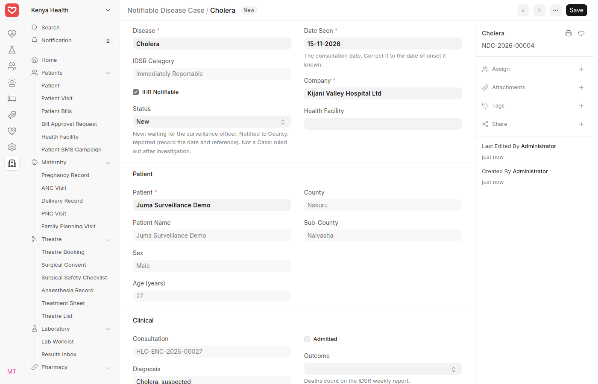
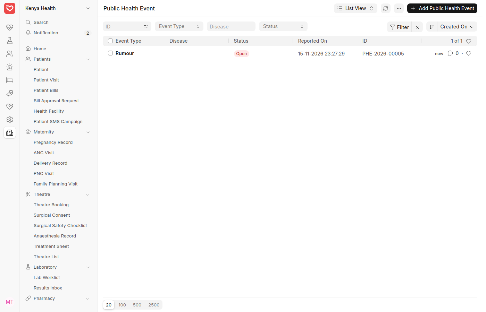
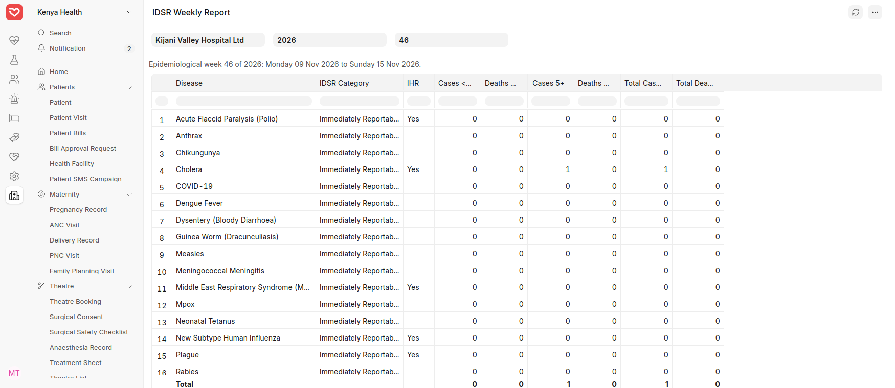
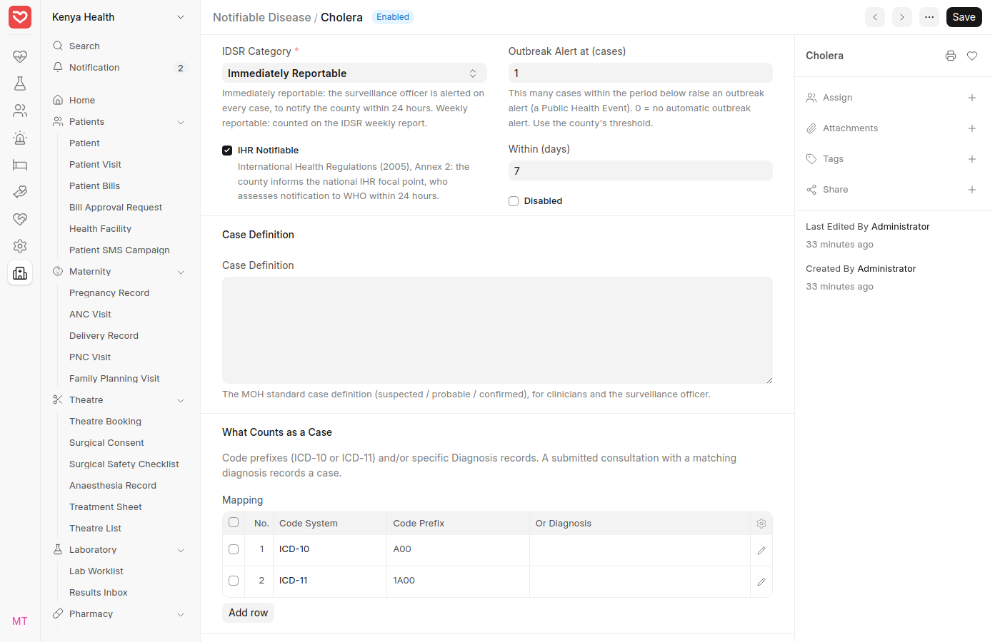
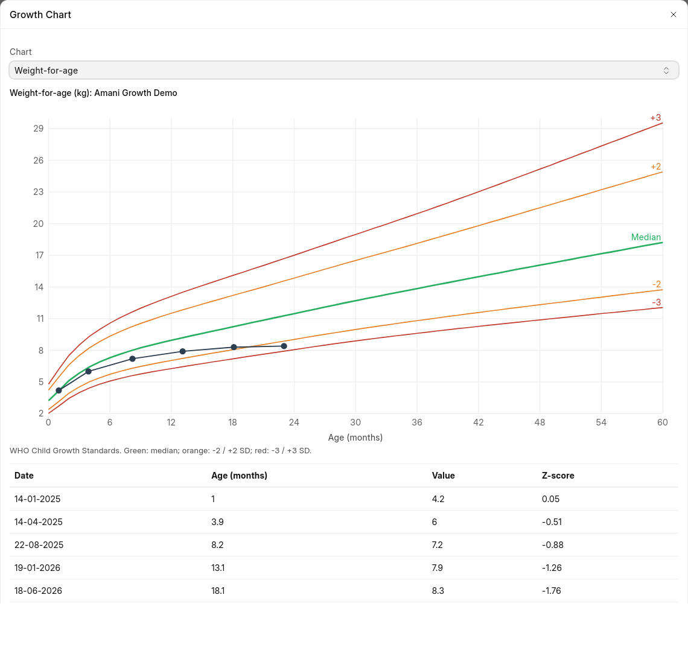
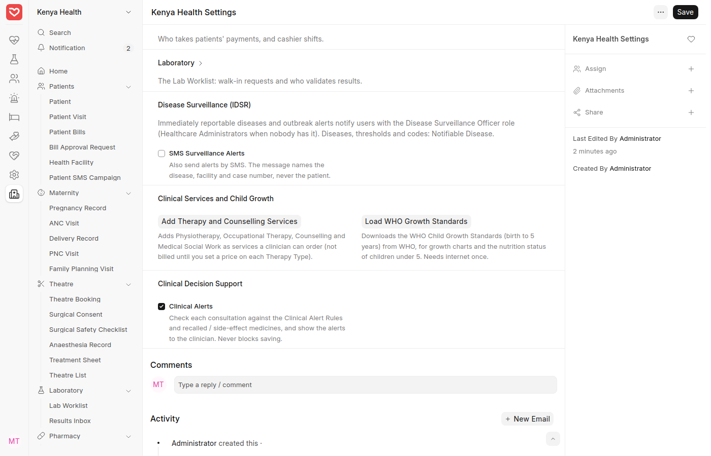
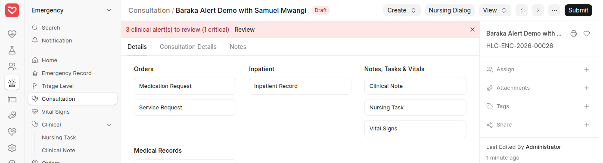
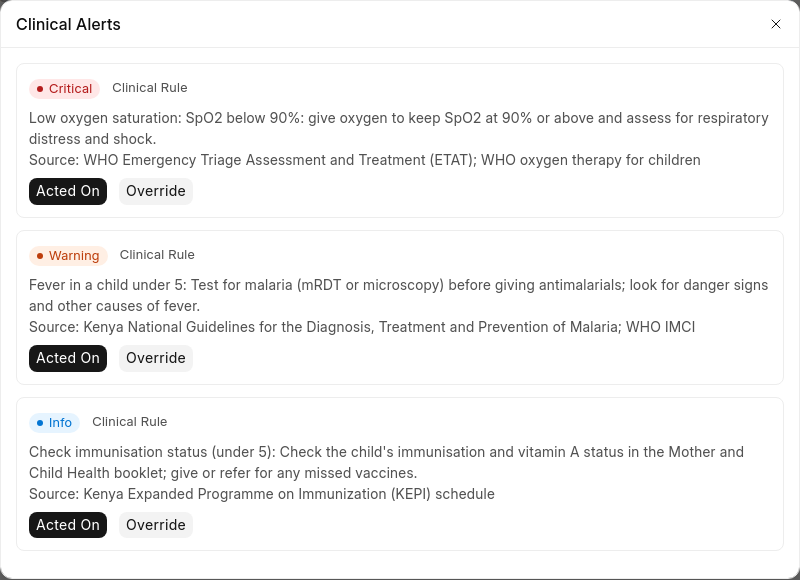
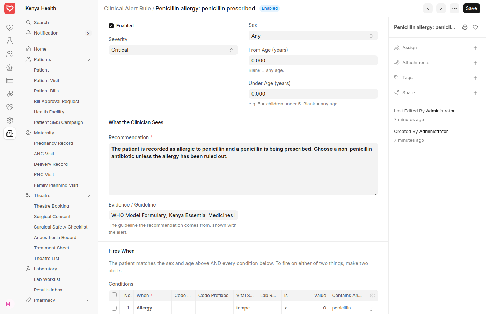
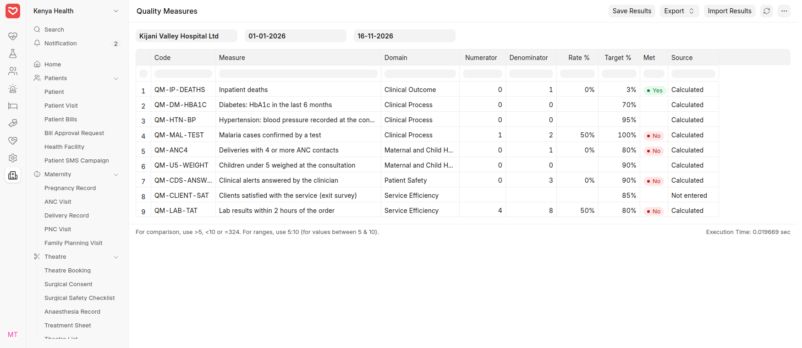

# Disease Surveillance, Child Growth, Clinical Alerts and Quality Measures — Guide

Four features added in versions 0.30 to 0.33:

1. **Disease surveillance (IDSR):** notifiable disease cases, alerts and the weekly report.
2. **Child growth and therapy services:** WHO growth charts, plus physiotherapy, occupational therapy, counselling and social work.
3. **Clinical alerts:** evidence-based reminders at the consultation.
4. **Quality measures:** the hospital's quality indicators, calculated, exported and imported.

They also cover several items the Digital Health Agency (DHA) checks when it certifies a hospital system.

The screenshots come from a demo copy of the system with fictional patients. The features reach your system (bethesda.royceltd.com) after go-live week.

## At a glance

| Feature | Who uses it | Where |
| --- | --- | --- |
| Notifiable disease cases and alerts | Clinicians record the diagnosis as usual; the surveillance officer acts on the alert | Kenya Health › Disease Surveillance |
| IDSR weekly report | Surveillance officer, Health Records Officer | Kenya Health › Disease Surveillance › IDSR Weekly Report |
| Public health events (rumours, clusters, maternal deaths) | Any clinician or nurse reports; the surveillance officer verifies | Kenya Health › Disease Surveillance › Public Health Event |
| Child growth | Triage nurses weigh and measure; clinicians read the result | Vital Signs; Patient › View › Growth Chart |
| Therapy and counselling services | Clinicians order them; therapists, counsellors and social workers record sessions | Consultation › Therapies; Therapy Session |
| Clinical alerts | Clinicians | Shown on the consultation after saving |
| Quality measures | Quality improvement committee, management | Kenya Health › Reports › Quality Measures |
| Quarterly and annual MOH reports | Health Records Officer | MOH 705 / 706 / 711 / 717 › Period |

## Before you start: what Bethesda decides

These lists come pre-filled from national and WHO guidelines. They are a starting point: please review them and tell us what to change.

| Decide | Who should decide |
| --- | --- |
| Who the facility's **disease surveillance focal person** is. They get the alerts. Until someone is named, alerts go to the Healthcare Administrators. | Medical superintendent |
| The notifiable disease list, outbreak thresholds and **SMS alert numbers**, for example the sub-county Disease Surveillance Coordinator if they agree | Surveillance focal person, with the sub-county |
| Which **clinical alert rules** are on, and their wording | Medical superintendent, pharmacy and therapeutics committee |
| Which **quality measures** to track, and their targets | Quality improvement committee |
| **Prices** for physiotherapy, occupational therapy, counselling and social work, if they are billed | Management, finance |

## 1. Disease surveillance (IDSR)

### How a case is recorded

**Who:** nobody does anything extra. The clinician diagnoses as usual.

When a consultation is submitted with a diagnosis on the notifiable disease list (cholera, measles, suspected anthrax and so on), the system creates a **Notifiable Disease Case** with:
- the patient, their age, sex and county;
- the diagnosis and the clinician;
- whether the disease is **immediately reportable** and whether it is notifiable under the International Health Regulations (**IHR**).

A follow-up visit for the same disease within 14 days doesn't create a second case.

A suspected cholera case, recorded automatically when the consultation was submitted.

### The alert

**Who:** the surveillance focal person (role *Disease Surveillance Officer*).

For an **immediately reportable** disease, every case alerts the focal person at once, on the notification bell and by SMS if SMS alerts are switched on. The alert reminds them to notify the county within 24 hours. The SMS never names the patient. It gives only the disease, the facility and the case number.

**What to do:**
1. Open the case from the alert.
2. Notify the county as usual.
3. Set **Status** to *Notified to County*, and fill in *Notified to County On* and the county's line-list reference.
4. Record the **Outcome** (*Alive* or *Died*) and whether the case was **laboratory confirmed**. If the investigation rules it out, set the status to *Not a Case*.

### Outbreak alerts

Each disease can have a threshold, for example 5 typhoid cases in 7 days. When cases reach the threshold, the system opens a **Public Health Event** of type *Outbreak Alert* and alerts the focal person. Later cases join the same event, so it isn't raised again.

### Reporting a rumour or other event

**Who:** any clinician or nurse. **Where:** Disease Surveillance › **Public Health Event** › *+ Add*.

Use this for things that are not a single diagnosis:
- a community rumour;
- a cluster of unexplained illness;
- a maternal or neonatal death;
- an adverse event following immunisation (AEFI).

Describe what happened, where, and how many people are affected. The focal person is alerted to verify it, then records the verification, the date it was reported to the county and the action taken.

A community rumour reported by staff, waiting for the focal person to verify it.

### IDSR weekly report

**Who:** surveillance focal person, Health Records Officer. **Where:** Disease Surveillance › **IDSR Weekly Report**.

Choose the year and the **epidemiological week** (Monday to Sunday). Every notifiable disease is listed, including those with no cases, because a zero report is still a report. Cases and deaths are split into under 5 and 5 and over. Every Monday the focal person also gets a summary of the previous week as a notification.

Week 46: one cholera case, every other disease reported as zero.

### The notifiable disease list

**Who:** surveillance focal person, administrator. **Where:** Disease Surveillance › **Notifiable Disease**.

Each disease has:
- its category (*Immediately Reportable* or *Weekly Reportable*);
- the IHR flag;
- the outbreak threshold;
- a case definition;
- the diagnosis codes that count, as ICD-10 or ICD-11 code beginnings. You can also link one of your own diagnoses directly.

27 diseases come pre-filled from the IDSR guidelines.

### MOH reports by quarter and year

The MOH 705, 706, 711 and 717 reports now have a **Period**: *Month*, *Quarter* or *Year*. A quarter or a year adds up the monthly reports, so it always agrees with the monthly forms you submitted. The MOH 705 shows one column per month.

## 2. Child growth and therapy services

### Growth at triage

**Who:** triage nurse. **Where:** Vital Signs, as usual.

For a child under 5, record the **weight** and **height**. Use height in metres, as the form asks: 0.74 for 74 cm. On saving, the system works out the child's position against the **WHO Child Growth Standards**:
- weight-for-age;
- length/height-for-age;
- weight-for-length/height;
- BMI-for-age.

It also shows a **Nutrition Status**: severe wasting (SAM), moderate wasting (MAM), stunted, underweight, overweight or normal growth. Children under 2 are measured lying down (length) and from 2 years standing (height), as the standards assume.

### The growth chart

**Who:** clinicians, MCH nurses. **Where:** the patient › **View** › **Growth Chart**.

The chart shows the WHO lines for the child's sex from birth to 5 years: the median in green, -2 and +2 in orange, -3 and +3 in red. The child's measurements are the dark dots, with a table of dates, values and z-scores underneath. Switch between *Weight-for-age* and *Length/height-for-age*.

A child whose weight has fallen from the median to below -2: flagged as moderate wasting and underweight at the last visit.

**One-time setup (administrator):** Kenya Health Settings › **Load WHO Growth Standards**. This downloads the WHO tables once and needs internet.

### Physiotherapy, occupational therapy, counselling and social work

**Who:** clinicians order; therapists, counsellors and social workers record.

1. **Order:** on the consultation, add the service on the **Therapies** table, with the number of sessions.
2. **Record each session:** open the patient's Therapy Session and write the **Session Notes**: what was done, the patient's response and the plan.
3. **Longer write-ups**, such as a social work assessment or a counselling record: add a **Clinical Note** on the patient of type *Social Work Assessment*, *Counselling Session*, *Occupational Therapy Note* or *Physiotherapy Note*.

**One-time setup (administrator):** Kenya Health Settings › **Add Therapy and Counselling Services**. The services are not billed until you open each Therapy Type, set its price and tick *Is Billable*.

## 3. Clinical alerts

**Who:** clinicians. **Where:** the consultation.

When you save a consultation, the system checks it against the hospital's **Clinical Alert Rules**, which look at:
- the patient's age and sex;
- their diagnoses now and from earlier visits (the problem list);
- today's vital signs, including a child's growth z-scores;
- recent lab results;
- the allergy list;
- the drugs being prescribed.

It also warns when a drug flagged as **recalled** is prescribed, and reminds you of **side effects** to explain to the patient.

A banner shows how many alerts are waiting. Click **Review**. For each alert:
- **Acted On:** you followed it; or
- **Override:** you didn't, and you give the reason (for example *Pulse oximeter probe on a cold finger; repeat 97%*).

Alerts never stop you saving or submitting the consultation.

A 3-year-old with fever and low oxygen: the critical alert first, each with the guideline it comes from.

The pharmacy's existing allergy and drug-interaction checks still run when drugs are prescribed. These alerts add to them.

### The rules

**Who:** medical superintendent, pharmacy and therapeutics committee, administrator. **Where:** Kenya Health › Setup › **Clinical Alert Rule**.

Each rule has:
- a severity (*Info*, *Warning* or *Critical*);
- the sex and age it applies to;
- conditions: a diagnosis, a vital sign, a lab result, an allergy or a medicine. All of them must be true for the alert to show;
- the **recommendation** and the **guideline** it comes from.

9 rules come pre-filled:
- testing for malaria in a child under 5 with fever;
- low oxygen saturation;
- raised blood pressure;
- severe acute malnutrition;
- severe anaemia;
- diabetes routine care;
- penicillin allergy when a penicillin is prescribed;
- the under-5 immunisation check.

To switch a rule off, untick **Enabled**. To switch all alerts off, untick Kenya Health Settings › **Clinical Alerts**.

To flag a recalled medicine, open the **Medication**, tick **Recalled** under *Safety Alerts* and write the recall notice. Use *Side Effects to Explain* for the reminder shown to prescribers.

### Who responds to alerts

**Where:** Reports › **Clinical Alert Summary**. Shows, per clinician or per alert, how many alerts were shown, how many were critical, and how many were acted on, overridden or not answered.

## 4. Quality measures

**Who:** quality improvement committee, management. **Where:** Kenya Health › Reports › **Quality Measures**.

Choose the period. Each measure shows the **numerator**, the **denominator**, the **rate**, the **target** and whether it was **met**. They are calculated from what is already recorded, so nobody counts by hand.

9 measures come pre-filled:
- hypertension patients with BP recorded;
- children under 5 weighed;
- diabetes patients with an HbA1c in 6 months;
- malaria cases confirmed by a test;
- lab results within 2 hours;
- clinical alerts answered;
- inpatient deaths (lower is better);
- deliveries with 4 or more ANC contacts;
- client satisfaction, which you type in or import from your exit survey.

The targets are placeholders for the committee to set.

- **Save Results:** keeps the period's results, to compare month by month (Quality Measure Result).
- **Export:** downloads the results as a **FHIR MeasureReport** file (the national health data exchange standard) or as **CSV** for Excel.
- **Import Results:** loads results calculated elsewhere, in the same CSV or FHIR format.

To add or change a measure: Setup › **Quality Measure**.

## Not built yet

These features don't yet send anything to national systems automatically:
- the weekly IDSR report and quality results are not submitted to KHIS or DHA; that needs their connection and credentials;
- diagnoses are not linked to the national terminology service;
- the medicines list is not linked to the national product registry.

They come with the national Health Information Exchange connection.
